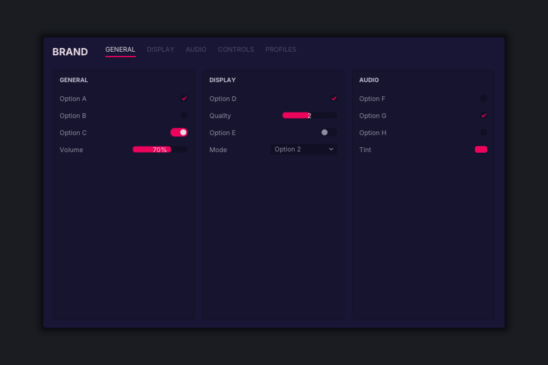

# Menu Design Vault

A reference library of game-menu UI design: the dark, compact, accent-driven style seen in menus like fatality.win and neverlose.cc, plus the HUD and in-world visuals that go with them. It covers how they look, why they look good, and how to rebuild that look in Dear ImGui.

Written for both people (browse in Obsidian or on GitHub) and LLMs (start here, follow links, read only what you need).

## Use this library to build software

1. Start with [Principles](principles/INDEX.md), then read the relevant [widget notes](widgets/INDEX.md).
2. Choose one or two [menu references](references/INDEX.md) or [HUD studies](visuals/INDEX.md) that match the requested look. Use their screenshots, measurements and source citations as evidence.
3. Start from the [minimal glass/sidebar menu](implementation/glass-sidebar-menu.md) for a restrained look, or the [rich style baseline](implementation/imgui-style-baseline.md) and [custom widgets](implementation/custom-widgets.md) for a layered look. Use the [gamesense style](implementation/gamesense-style-menu.md) only when that style is requested.
4. Follow the [build instructions](implementation/code/BUILD.md), [render a preview](implementation/preview-rendering.md), and compare spacing, colors and states against the reference. Finish with the [design audit](principles/avoiding-ai-defaults.md).

For LLM-assisted development, point your agent at this README and the specific reference notes you want it to follow. Examples use neutral labels and placeholder data; these are standalone UI recipes, not game integrations.

## Sections

- [Principles](principles/INDEX.md): the design language itself (color, depth, type, motion, layout) and how to adapt it to games that are not dark shooters (portability). Read first when designing a new menu.
- [Widgets](widgets/INDEX.md): one note per control (toggles, sliders, combos, color pickers, tabs, group boxes), with anatomy, states and an ImGui approach.
- [References](references/INDEX.md): case studies of specific menus and open-source repos. Read when you want a concrete example to match.
- [Implementation](implementation/INDEX.md): tested Dear ImGui code: two baselines (a minimal velocity.cat-style menu and a rich Fatality-style baseline), a gamesense-style menu on request, animation helpers, custom widgets, shadows and glow, full demo menus, and HUD elements.
- [Visuals](visuals/INDEX.md): visual elements outside the menu: HUD status pills, keybind lists, watermarks and toasts, hit markers, countdown badges, info bars, ground-area markers drawn on the floor, glow lines and screen effects. Read when designing anything shown over the scene rather than in the menu.

*A standalone demo menu rendered from the vault's own [code recipes](implementation/custom-widgets.md).*

## Tools

- `tools/sample_colors.py`: samples hex colors from a screenshot at given pixel coordinates. Used to build each reference's palette.

- `tools/preview/render_preview.cpp`: renders a menu to an image headlessly. See [Preview rendering](implementation/preview-rendering.md).

## How the pieces connect

Principles describe *what* and *why*. Widgets apply principles to one control. References are evidence: each one links to the principles and widgets it demonstrates, and those notes list it under "Seen in". Implementation is the *how* in code.

## Sharing scope

This repository includes design notes, reference media and provenance, standalone Dear ImGui recipes, and tools for sampling colors and rendering UI previews. Vault-maintenance instructions, acquisition queues, Obsidian settings, downloaded third-party source trees and compiled binaries stay local. The default-deny `.gitignore` admits only the documented reference sections, supported media formats and explicitly listed UI source files.

Screenshots, video excerpts, design files, fonts and product names retain their respective owners' rights. Source citations and the bundled font license are preserved; inclusion here does not grant permission to redistribute third-party material or copy proprietary code. Check the applicable permissions before reuse.

GitHub backs up committed and pushed files only. Ignored local material is not included, and later edits are not uploaded automatically.
