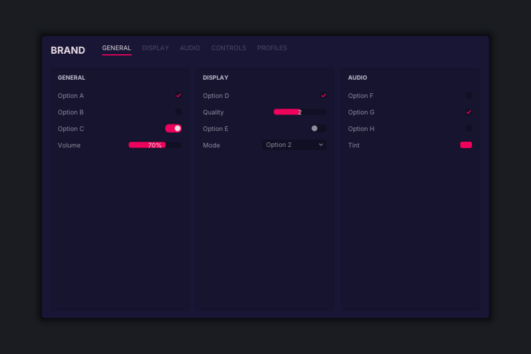

# Implementation

Dear ImGui code that turns the [principles](../principles/INDEX.md) into a working standalone menu. Every snippet is a tested header in [code/](code/BUILD.md).

- [Glass sidebar menu](glass-sidebar-menu.md): the **minimal** baseline. A complete velocity.cat-style menu with an icon rail, pill sub-tabs, search, untitled cards, "⋯" row popups, label-over sliders and combos, color swatch and theme presets. Start here when a request says minimal, clean or simple, or wants a translucent look.
- [Style baseline](imgui-style-baseline.md): palette struct, `ApplyStyle()`, font loading. The **rich** baseline (Fatality palette, rounded, animated).
- [gamesense-style menu](gamesense-style-menu.md): a complete flat menu in the gamesense ("skeet") style (bevel and hue stripe, icon rail, bordered groups, square checkboxes, thin sliders, flat combos, key tags). Not a baseline: use it when a request names gamesense or skeet.
- [Animation helpers](animation-helpers.md): `AnimTo` / `Anim`, frame-rate independent easing in ImGui's state storage.
- [Custom widgets](custom-widgets.md): `CheckRow`, `PillToggle`, `AccentSlider`, `HeaderTabs`, group boxes, and the full demo menu.
- [Popup menus](popup-menus.md): neverlose-style right-click hotkey menu with hover submenus and key capture, and tooltips docked beside the menu. Works after any widget in either baseline.
- [HUD elements](hud-elements.md): status pills, keybind list, segmented capsules (watermark, toasts), hit marker, countdown badge, and ground-area markers (floor mesh and screen hull). Code for the [Visuals](../visuals/INDEX.md) section.
- [Fatality-style in-world visuals](fatality-visuals-code.md): boxes with dark halos, thin draining bars, outlined pixel labels, off-screen arrows, model materials on a mannequin, tracers with impact cubes, a grenade arc with a landing ring, and Fatality toasts. Rendered demo scene included.
- [Draw-list recipes](drawlist-recipes.md): soft shadow, glow, gradients, and how background blur works.
- [Preview rendering](preview-rendering.md): render a menu to a PNG headlessly, so an agent can check its own design.
- [Building the code](code/BUILD.md): compile and test the headers.

Up: [README](../README.md)
