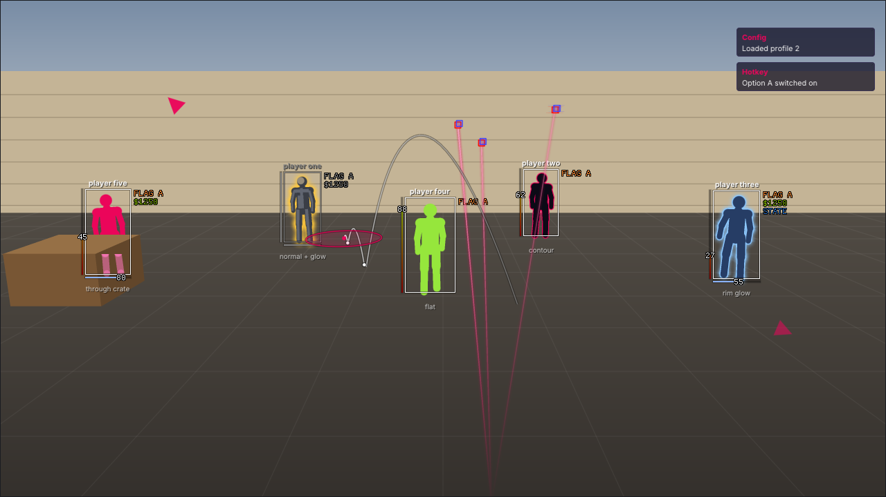

# Fatality-style in-world visuals

Drawing code for the elements in [Fatality — in-game visuals](../visuals/fatality-visuals.md), written for this vault from the values recorded there (no code from the source). Header: `code/fatality_visuals.h`, tested by `headless_test.cpp`.



*Rendered headlessly at 1280 × 720 (see [Preview rendering](preview-rendering.md)). The street, wall, crate and figures are a synthetic scene with its own camera; the toasts have no blur in the preview renderer.*

## What's in it

| Function | Draws | Fatality detail it follows |
|---|---|---|
| `HaloBox` | 1 px box | 40 % black line outside and inside |
| `ThinBar`, `DrainTo` | health / armour bars | 4 px track, 2 px fill, number at the fill's end below 93 %, instant rise, 23 × gap drain |
| `TargetEsp` | box + name + bars + flags | shadowed bold name above, outlined pixel labels 12 px apart on the right, grey when faded |
| `OffscreenArrow` | edge triangle | screen-shaped ellipse, 0.73 s blink |
| `MakeFigure`, `BodyPass` | placeholder mannequin | 16 joints, opaque capsules |
| `DrawMaterial` | normal, flat, rim glow, contour, glow outline | material names from the settings; **looks are this vault's design**, since the source has no drawing code for them |
| `DrawThroughWall` / demo crate | hidden colour behind an occluder | the separate "behind walls" colour |
| `Beam`, `ImpactCube` | bullet tracer, impact cubes | default width 8, two impact colours (red, blue) |
| `GrenadePath`, `SimulateThrow` | arc with bounces, landing ring | one "hit" colour; the physics is a demo, not a game's |
| `FatalityToast` | 200 × 42 toast | menu body colour at 74 %, outline at 75 %, accent title, 20 px slide |

Fonts: ImGui's default ProggyClean stands in for the pixel font, and Inter for the name and toast fonts. In a real build, load a pixel font at its native size and keep positions on whole pixels (`Snap`).

## Code

```cpp
// fatality_visuals.h — in-world visuals in the Fatality style (visuals/fatality-visuals.md), written for this vault.
// Boxes with dark halos, thin bars, outlined pixel labels, off-screen arrows, model materials ("chams") on a
// placeholder mannequin, a glow outline, bullet tracers with impact cubes, a grenade path with its landing ring,
// and translucent toasts in the menu palette.
// Standalone: every function takes plain data (screen rects, fractions, 3D points) and a demo Projector.
// Nothing here reads a game or uses a game's camera; the demo builds its own scene.
#pragma once
#ifndef IMGUI_DEFINE_MATH_OPERATORS
#define IMGUI_DEFINE_MATH_OPERATORS
#endif
#include "imgui.h"
#include "imgui_internal.h"
#include "hud_elements.h"   // hud::Projector, hud::Rgba, hud::U, hud::GradientLine
#include <cmath>

namespace fv {

using hud::Rgba;
using hud::U;
using hud::Projector;

// The menu palette (references/fatality-cs2-source.md), reused so overlay and menu match.
struct Palette {
    ImVec4 accent = Rgba(235, 5, 90), text = Rgba(245, 245, 245), text_dim = Rgba(109, 100, 150);
    ImVec4 bg_bottom = Rgba(17, 15, 35), bg_block = Rgba(25, 21, 52), outline = Rgba(60, 53, 93);
};

struct Fonts { ImFont* pixel = nullptr; ImFont* name = nullptr; ImFont* ui = nullptr; ImFont* ui_bold = nullptr; };

inline ImVec2 Snap(ImVec2 p) { return ImVec2(std::floor(p.x), std::floor(p.y)); }

// ---------------------------------------------------------------------------------------------
// 1. Text. Pixel labels get a 1 px dark outline (8 offset copies); names get a 1 px drop shadow.

inline void PixelText(ImDrawList* dl, const Fonts& f, ImVec2 pos, ImU32 col, const char* s, float alpha = 1.0f) {
    pos = Snap(pos);
    const float size = f.pixel ? f.pixel->LegacySize : 13.0f;
    const ImU32 o = IM_COL32(0, 0, 0, (int)(200 * alpha));
    for (int dy = -1; dy <= 1; ++dy)
        for (int dx = -1; dx <= 1; ++dx)
            if (dx || dy) dl->AddText(f.pixel, size, pos + ImVec2((float)dx, (float)dy), o, s);
    dl->AddText(f.pixel, size, pos, col, s);
}
inline ImVec2 PixelSize(const Fonts& f, const char* s) {
    ImFont* fn = f.pixel ? f.pixel : ImGui::GetFont();
    return fn->CalcTextSizeA(f.pixel ? f.pixel->LegacySize : 13.0f, FLT_MAX, 0.0f, s);
}
inline void ShadowText(ImDrawList* dl, ImFont* font, float size, ImVec2 pos, ImU32 col, const char* s, float alpha = 1.0f) {
    pos = Snap(pos);
    dl->AddText(font, size, pos + ImVec2(1, 1), IM_COL32(0, 0, 0, (int)(180 * alpha)), s);
    dl->AddText(font, size, pos, col, s);
}

// ---------------------------------------------------------------------------------------------
// 2. Box, bars and labels around a screen rectangle.

struct Target {
    ImRect box;                 // screen rectangle (top-left, bottom-right)
    const char* name;
    float health = 1.0f;        // 0..1, already eased by the caller (see DrainTo)
    float armor = -1.0f;        // 0..1, < 0 hides the bar
    const char* flags[3] = {};  // short words stacked on the right
    ImVec4 flag_cols[3] = {};
    bool faded = false;         // drawn grey (e.g. stale data)
    float alpha = 1.0f;
};

struct EspStyle {
    ImVec4 box = Rgba(255, 255, 255), name = Rgba(255, 255, 255), armor = Rgba(140, 180, 255);
    ImVec4 health_empty = Rgba(130, 0, 0), health_full = Rgba(130, 180, 0);
    bool health_gradient = true;
    float bar_track = 4.0f, bar_fill = 2.0f, bar_gap = 1.0f, label_line = 12.0f;
};

// 1 px box with a 1 px 40 % black line just outside and just inside it.
inline void HaloBox(ImDrawList* dl, ImRect r, ImU32 col, float alpha = 1.0f) {
    r.Min = Snap(r.Min); r.Max = Snap(r.Max);
    const ImU32 halo = IM_COL32(0, 0, 0, (int)(102 * alpha));
    dl->AddRect(r.Min - ImVec2(1, 1), r.Max + ImVec2(1, 1), halo);
    dl->AddRect(r.Min + ImVec2(1, 1), r.Max - ImVec2(1, 1), halo);
    dl->AddRect(r.Min, r.Max, col);
}

// Thin bar: 4 px dark track, 2 px fill inset 1 px. Vertical bars fill upward. `c0` is the empty end.
inline void ThinBar(ImDrawList* dl, const Fonts& f, ImVec2 start, float length, bool vertical, float frac,
                    ImU32 c0, ImU32 c1, int value, const EspStyle& st, float alpha = 1.0f) {
    start = Snap(start);
    frac = ImSaturate(frac);
    const float fill = std::floor((length - 2.0f) * frac);
    const ImU32 track = IM_COL32(0, 0, 0, (int)(102 * alpha));
    if (vertical) {
        dl->AddRectFilled(start - ImVec2(0, length), start + ImVec2(st.bar_track, 0), track);
        const ImVec2 b = start + ImVec2(1, -1), t = b + ImVec2(st.bar_fill, -fill);
        dl->AddRectFilledMultiColor(ImVec2(b.x, t.y), ImVec2(t.x, b.y), c1, c1, c0, c0);
        if (value >= 0) {
            char buf[8]; ImFormatString(buf, 8, "%d", value);
            const ImVec2 ts = PixelSize(f, buf);
            PixelText(dl, f, ImVec2(start.x + 2 - ts.x * 0.5f, t.y - ts.y * 0.5f), IM_COL32(255, 255, 255, (int)(255 * alpha)), buf, alpha);
        }
    } else {
        dl->AddRectFilled(start, start + ImVec2(length, st.bar_track), track);
        const ImVec2 a = start + ImVec2(1, 1);
        dl->AddRectFilledMultiColor(a, a + ImVec2(fill, st.bar_fill), c0, c1, c1, c0);
        if (value >= 0) {
            char buf[8]; ImFormatString(buf, 8, "%d", value);
            const ImVec2 ts = PixelSize(f, buf);
            PixelText(dl, f, ImVec2(a.x + fill - ts.x * 0.5f, start.y + 2 - ts.y * 0.5f), IM_COL32(255, 255, 255, (int)(255 * alpha)), buf, alpha);
        }
    }
}

// Value easing for bars: rises at once, falls at 23 units/s times the gap (so big drops drain fast, then settle).
inline float DrainTo(ImGuiID id, float target, float units = 100.0f) {
    ImGuiStorage& s = hud::Store();
    float v = s.GetFloat(id, target);
    if (target >= v) v = target;
    else {
        const float gap = (v - target) * units;
        v = ImMax(target, v - ImGui::GetIO().DeltaTime * 23.0f * ImMax(1.0f, gap) / units);
    }
    s.SetFloat(id, v);
    return v;
}

inline void TargetEsp(ImDrawList* dl, const Fonts& f, const Target& t, const EspStyle& st = EspStyle()) {
    const float a = t.alpha;
    const ImVec4 grey = Rgba(128, 128, 128);
    HaloBox(dl, t.box, U(t.faded ? grey : st.box, a), a);

    // name above, centred
    if (t.name && f.name) {
        const float sz = 13.0f;
        const ImVec2 ns = f.name->CalcTextSizeA(sz, FLT_MAX, 0.0f, t.name);
        ShadowText(dl, f.name, sz, ImVec2(t.box.GetCenter().x - ns.x * 0.5f, t.box.Min.y - ns.y - 3.0f),
                   U(t.faded ? grey : st.name, a), t.name, a);
    }

    // health, left; the blended colour drives either the whole fill (solid) or its top end (gradient)
    const float h = t.box.GetHeight();
    const ImVec4 mix = ImLerp(st.health_empty, st.health_full, t.health);
    const ImU32 top = U(t.faded ? grey : mix, a), bottom = st.health_gradient ? U(t.faded ? grey : st.health_empty, a) : top;
    const int hv = t.health <= 0.93f ? (int)std::lround(t.health * 100.0f) : -1;
    ThinBar(dl, f, ImVec2(t.box.Min.x - 6.0f, t.box.Max.y + 1.0f), h + 2.0f, true, t.health, bottom, top, hv, st, a);

    // armor, bottom
    if (t.armor >= 0.0f) {
        const ImU32 c = U(t.faded ? grey : st.armor, a);
        const int av = t.armor <= 0.93f ? (int)std::lround(t.armor * 100.0f) : -1;
        ThinBar(dl, f, ImVec2(t.box.Min.x - 1.0f, t.box.Max.y + 2.0f), t.box.GetWidth() + 2.0f, false, t.armor, c, c, av, st, a);
    }

    // flags, right, one per line
    float y = t.box.Min.y - 1.0f;
    for (int i = 0; i < 3; ++i) {
        if (!t.flags[i]) continue;
        PixelText(dl, f, ImVec2(t.box.Max.x + 4.0f, y), U(t.faded ? grey : t.flag_cols[i], a), t.flags[i], a);
        y += st.label_line;
    }
}

// ---------------------------------------------------------------------------------------------
// 3. Off-screen arrow: a triangle on a screen-shaped ellipse, pointing along `angle` (radians, 0 = right,
// clockwise on screen). `dist` is 0..1 of the way from centre to edge. Alpha blinks over 0.73 s each way.

inline void OffscreenArrow(ImDrawList* dl, ImVec2 screen, float angle, float size, float dist, ImVec4 col, double now) {
    const ImVec2 c = screen * 0.5f;
    const float rx = (c.x - size) * dist, ry = rx * (screen.y / screen.x);
    const ImVec2 p = c + ImVec2(std::cos(angle) * rx, std::sin(angle) * ry);
    const float phase = (float)std::fmod(now, 1.46) / 0.73f;   // 0..2
    const float blink = phase < 1.0f ? 1.0f - phase : phase - 1.0f;
    const ImVec2 fwd(std::cos(angle), std::sin(angle)), side(-fwd.y, fwd.x);
    dl->AddTriangleFilled(p + fwd * size, p + side * (size * 0.5f), p - side * (size * 0.5f), U(col, 0.25f + 0.75f * blink));
}

// ---------------------------------------------------------------------------------------------
// 4. Placeholder mannequin and model materials. A figure is 16 joints in world space; materials are drawn
// as stacked capsule passes (opaque, so overlaps never darken).

enum Joint { Head, Neck, Chest, Pelvis, LSho, LElb, LHand, RSho, RElb, RHand, LHip, LKnee, LFoot, RHip, RKnee, RFoot, JointCount };

struct Figure { ImVec2 p[JointCount]; float scale; ImRect bounds; };

// Stand a figure at (x, y) on the ground, turned by `yaw` radians, and project it.
inline Figure MakeFigure(const Projector& proj, float x, float y, float yaw, float pose = 0.0f) {
    struct J { float side, fwd, z; };
    const J local[JointCount] = {
        { 0, 0, 67 }, { 0, 0, 60 }, { 0, 0.5f, 52 }, { 0, 0, 38 },
        { -8, 0, 57 }, { -10.5f, 2.0f + pose * 6, 45 }, { -10, 5.0f + pose * 10, 34 },
        { 8, 0, 57 }, { 10.5f, 2.0f - pose * 4, 45 }, { 10, 4.0f - pose * 6, 34 },
        { -4.5f, 0, 37 }, { -5, 1.5f + pose * 5, 20 }, { -5.5f, pose * 6, 2 },
        { 4.5f, 0, 37 }, { 5, 1.0f - pose * 5, 20 }, { 5.5f, -pose * 6, 2 } };
    const float cs = std::cos(yaw), sn = std::sin(yaw);
    Figure fig;
    fig.bounds = ImRect(FLT_MAX, FLT_MAX, -FLT_MAX, -FLT_MAX);
    for (int i = 0; i < JointCount; ++i) {
        const float wx = x + local[i].side * cs - local[i].fwd * sn, wy = y + local[i].side * sn + local[i].fwd * cs;
        fig.p[i] = proj(wx, wy, local[i].z);
        fig.bounds.Add(fig.p[i]);
    }
    fig.scale = (proj(x, y, 0).y - proj(x, y, 67).y) / 67.0f;   // screen px per world unit at this depth
    return fig;
}

// Bones as (a, b, radius in world units). The torso is one wide capsule; the head is a circle.
struct Bone { int a, b; float r; };
inline const Bone* Bones(int* n) {
    static const Bone b[] = {
        { Chest, Pelvis, 7.0f }, { LSho, RSho, 4.0f }, { Neck, Chest, 3.5f },
        { LSho, LElb, 2.7f }, { LElb, LHand, 2.3f }, { RSho, RElb, 2.7f }, { RElb, RHand, 2.3f },
        { LHip, LKnee, 3.6f }, { LKnee, LFoot, 3.0f }, { RHip, RKnee, 3.6f }, { RKnee, RFoot, 3.0f } };
    *n = IM_ARRAYSIZE(b);
    return b;
}

// One opaque pass of the whole body, every capsule grown by `grow` px.
inline void BodyPass(ImDrawList* dl, const Figure& f, ImU32 col, float grow = 0.0f) {
    int n; const Bone* b = Bones(&n);
    for (int i = 0; i < n; ++i) {
        const float r = b[i].r * f.scale + grow;
        dl->AddLine(f.p[b[i].a], f.p[b[i].b], col, r * 2.0f);
        dl->AddCircleFilled(f.p[b[i].a], r, col, 16);
        dl->AddCircleFilled(f.p[b[i].b], r, col, 16);
    }
    dl->AddCircleFilled(f.p[Head], 5.5f * f.scale + grow, col, 20);
}

// "Normal": a plain shaded stand-in for the textured model (lit side lighter).
inline void BodyNormal(ImDrawList* dl, const Figure& f) {
    BodyPass(dl, f, IM_COL32(58, 62, 70, 255));
    int n; const Bone* b = Bones(&n);
    for (int i = 0; i < n; ++i) {   // a lighter stripe offset to the light side
        const float r = b[i].r * f.scale;
        dl->AddLine(f.p[b[i].a] - ImVec2(r * 0.35f, 0), f.p[b[i].b] - ImVec2(r * 0.35f, 0), IM_COL32(96, 101, 112, 255), r * 0.9f);
    }
    dl->AddCircleFilled(f.p[Head] - ImVec2(1.5f * f.scale, 1.0f * f.scale), 4.0f * f.scale, IM_COL32(150, 140, 122, 255), 20);
}

enum Material { MatNormal, MatFlat, MatRimGlow, MatContour, MatGlowOutline };

// Soft halo: `layers` growing passes at falling alpha, drawn before (under) the body.
inline void Halo(ImDrawList* dl, const Figure& f, ImVec4 col, float spread = 7.0f, int layers = 7, float strength = 0.22f) {
    for (int i = layers; i >= 1; --i) {
        const float k = (float)i / (float)layers;
        BodyPass(dl, f, U(col, strength * (1.0f - k) * (1.0f - k) + 0.02f), spread * k);
    }
}

inline void DrawMaterial(ImDrawList* dl, const Figure& f, Material m, ImVec4 primary, ImVec4 secondary) {
    switch (m) {
    case MatNormal: BodyNormal(dl, f); break;
    case MatFlat: BodyPass(dl, f, U(primary)); break;
    case MatRimGlow: {   // outer halo + bright rim + dark body tinted with the colour
        Halo(dl, f, secondary, 8.0f, 8, 0.28f);
        BodyPass(dl, f, U(secondary), 1.5f);
        BodyPass(dl, f, U(ImLerp(Rgba(10, 8, 18), primary, 0.35f)));
        break;
    }
    case MatContour:     // thin bright outline around a near-black body
        BodyPass(dl, f, U(primary), 1.2f);
        BodyPass(dl, f, U(Rgba(12, 10, 22)));
        break;
    case MatGlowOutline: // the model as is, with a soft coloured glow around it
        Halo(dl, f, primary, 9.0f, 9, 0.30f);
        BodyNormal(dl, f);
        break;
    }
}

// The same figure partly behind an occluder: the hidden colour everywhere, then the visible material
// clipped to the screen area above the occluder's top edge.
inline void DrawThroughWall(ImDrawList* dl, const Figure& f, float occluder_top_y, ImVec4 hidden, Material visible, ImVec4 primary, ImVec4 secondary) {
    BodyPass(dl, f, U(hidden));
    dl->PushClipRect(ImVec2(-1e5f, -1e5f), ImVec2(1e5f, occluder_top_y), true);
    DrawMaterial(dl, f, visible, primary, secondary);
    dl->PopClipRect();
}

// ---------------------------------------------------------------------------------------------
// 5. Bullet tracer ("beam"): glow layers up to `width` px around a bright core; the start end fades.
// Impact markers: small wireframe cubes in two colours.

inline void Beam(ImDrawList* dl, ImVec2 from, ImVec2 to, ImVec4 col, float width = 8.0f, float age = 0.0f) {
    const float life = ImSaturate(1.0f - age);
    for (int i = 4; i >= 1; --i) {
        const float k = (float)i / 4.0f;
        hud::GradientLine(dl, from, to, U(col, 0.0f), U(col, life * 0.20f * (1.0f - k * 0.6f)), width * k);
    }
    hud::GradientLine(dl, from, to, U(col, 0.0f), U(ImLerp(col, Rgba(255, 255, 255), 0.65f), life), 1.6f);
}

inline void ImpactCube(ImDrawList* dl, const Projector& proj, float x, float y, float z, float half, ImVec4 col) {
    ImVec2 c[8];
    for (int i = 0; i < 8; ++i)
        c[i] = proj(x + ((i & 1) ? half : -half), y + ((i & 2) ? half : -half), z + ((i & 4) ? half : -half));
    static const int faces[6][4] = { { 0, 1, 3, 2 }, { 4, 5, 7, 6 }, { 0, 1, 5, 4 }, { 2, 3, 7, 6 }, { 0, 2, 6, 4 }, { 1, 3, 7, 5 } };
    for (auto& fc : faces) dl->AddQuadFilled(c[fc[0]], c[fc[1]], c[fc[2]], c[fc[3]], U(col, 0.10f));
    static const int edges[12][2] = { { 0, 1 }, { 1, 3 }, { 3, 2 }, { 2, 0 }, { 4, 5 }, { 5, 7 }, { 7, 6 }, { 6, 4 }, { 0, 4 }, { 1, 5 }, { 2, 6 }, { 3, 7 } };
    for (auto& e : edges) dl->AddLine(c[e[0]], c[e[1]], U(col, 0.9f), 1.0f);
}

// ---------------------------------------------------------------------------------------------
// 6. Grenade path: a 3D polyline (already simulated by the caller) drawn as a line with a dark under-stroke,
// dots at bounces, and a landing ring on the ground with a soft fill in the hit colour.

struct PathPoint { float x, y, z; bool bounce; };

inline void GrenadePath(ImDrawList* dl, const Projector& proj, const PathPoint* pts, int n, float land_radius,
                        ImVec4 line_col, ImVec4 hit_col) {
    for (int pass = 0; pass < 2; ++pass)
        for (int i = 0; i + 1 < n; ++i) {
            const ImVec2 a = proj(pts[i].x, pts[i].y, pts[i].z), b = proj(pts[i + 1].x, pts[i + 1].y, pts[i + 1].z);
            const float fade = 0.35f + 0.65f * (float)i / (float)(n - 1);   // brighter toward the landing
            if (pass == 0) dl->AddLine(a, b, IM_COL32(0, 0, 0, 120), 3.5f);
            else dl->AddLine(a, b, U(line_col, fade), 1.6f);
        }
    for (int i = 0; i < n; ++i)
        if (pts[i].bounce) {
            const ImVec2 p = proj(pts[i].x, pts[i].y, pts[i].z);
            dl->AddCircleFilled(p, 3.5f, IM_COL32(0, 0, 0, 160), 12);
            dl->AddCircleFilled(p, 2.4f, U(line_col), 12);
        }
    // landing ring: projected circle on the ground plane
    const PathPoint& e = pts[n - 1];
    const int seg = 48;
    ImVec2 ring[seg];
    for (int i = 0; i < seg; ++i) {
        const float t = (float)i / seg * 6.2831853f;
        ring[i] = proj(e.x + std::cos(t) * land_radius, e.y + std::sin(t) * land_radius, 0.0f);
    }
    hud::Fan(dl, proj(e.x, e.y, 0.0f), ring, seg, U(hit_col, 0.05f), U(hit_col, 0.22f));
    dl->AddPolyline(ring, seg, IM_COL32(0, 0, 0, 120), ImDrawFlags_Closed, 3.0f);
    dl->AddPolyline(ring, seg, U(hit_col, 0.9f), ImDrawFlags_Closed, 1.5f);
    const ImVec2 c = proj(e.x, e.y, 0.0f);
    dl->AddCircleFilled(c, 3.0f, U(hit_col), 12);
}

// Simple ballistic path with ground bounces, for the demo (not a game's physics).
inline int SimulateThrow(PathPoint* out, int max, float x, float y, float z, float vx, float vy, float vz, float wall_y = 1e9f) {
    int n = 0;
    const float dt = 0.03f, g = 800.0f;
    int bounces = 0;
    while (n < max) {
        out[n++] = { x, y, z, false };
        const float nx = x + vx * dt, ny = y + vy * dt, nz = z + vz * dt;
        vz -= g * dt;
        if (ny > wall_y && y <= wall_y) { vy = -vy * 0.45f; vx *= 0.6f; out[n - 1].bounce = true; ++bounces; continue; }
        if (nz <= 0.0f) {
            x = nx; y = ny; z = 0.0f;
            if (n < max) out[n++] = { x, y, z, true };
            vz = -vz * 0.38f; vx *= 0.55f; vy *= 0.55f; ++bounces;
            if (vz < 60.0f || bounces > 3) break;
            continue;
        }
        x = nx; y = ny; z = nz;
    }
    out[n - 1].bounce = false;
    return n;
}

// ---------------------------------------------------------------------------------------------
// 7. Toasts: 200 x 42, menu body colour at 74 % and outline at 75 %, accent title. Slide down 20 px in.

inline void FatalityToast(ImDrawList* dl, const Fonts& f, ImVec2 top_right, int slot, const char* title, const char* body,
                          float t_in, const Palette& pal = Palette()) {
    const float e = 1.0f - (1.0f - t_in) * (1.0f - t_in);
    const ImVec2 pos = top_right + ImVec2(-200.0f, slot * 50.0f - 20.0f * (1.0f - e));
    const ImRect r(pos, pos + ImVec2(200, 42));
    dl->AddRectFilled(r.Min, r.Max, U(pal.bg_bottom, 0.74f * e), 4.0f);
    dl->AddRect(r.Min, r.Max, U(pal.outline, 0.75f * e), 4.0f);
    dl->AddText(f.ui_bold, 13.0f, r.Min + ImVec2(8, 7), U(pal.accent, e), title);
    dl->AddText(f.ui, 13.0f, r.Min + ImVec2(8, 23), U(pal.text, e), body);
}

// ---------------------------------------------------------------------------------------------
// Demo scene: a synthetic street with a back wall, a crate and five figures. Everything is placeholder data.

inline void DrawDemoScene(Fonts f = Fonts()) {   // any font left null falls back to the current font
    ImFont* fallback = ImGui::GetFont();
    if (!f.pixel) f.pixel = fallback;
    if (!f.name) f.name = fallback;
    if (!f.ui) f.ui = fallback;
    if (!f.ui_bold) f.ui_bold = fallback;
    const ImGuiIO& io = ImGui::GetIO();
    const ImVec2 ds = io.DisplaySize;
    const double now = ImGui::GetTime();
    const Palette pal;
    ImGui::SetNextWindowPos(ImVec2(0, 0));
    ImGui::SetNextWindowSize(ds);
    ImGui::Begin("##fv_demo", nullptr, ImGuiWindowFlags_NoDecoration | ImGuiWindowFlags_NoBackground |
                                       ImGuiWindowFlags_NoInputs | ImGuiWindowFlags_NoSavedSettings);
    ImDrawList* dl = ImGui::GetWindowDrawList();
    const Projector proj = { 0.0f, -330.0f, 150.0f, 0.0f, 260.0f, 30.0f, 900.0f, ImVec2(ds.x * 0.5f, ds.y * 0.46f) };

    // backdrop: sky, a pale back wall, floor with a grid (so marks are judged on light and dark)
    const float horizon = proj(0, 2000, 0).y;
    dl->AddRectFilledMultiColor(ImVec2(0, 0), ImVec2(ds.x, horizon), IM_COL32(120, 140, 165, 255), IM_COL32(120, 140, 165, 255),
                                IM_COL32(176, 186, 196, 255), IM_COL32(176, 186, 196, 255));
    dl->AddRectFilledMultiColor(ImVec2(0, horizon), ds, IM_COL32(88, 82, 74, 255), IM_COL32(88, 82, 74, 255),
                                IM_COL32(52, 48, 44, 255), IM_COL32(52, 48, 44, 255));
    const float wall_y = 520.0f;
    dl->AddQuadFilled(proj(-700, wall_y, 0), proj(700, wall_y, 0), proj(700, wall_y, 190), proj(-700, wall_y, 190), IM_COL32(196, 180, 150, 255));
    for (int i = 0; i < 6; ++i) dl->AddLine(proj(-700, wall_y, 30.0f * i + 10), proj(700, wall_y, 30.0f * i + 10), IM_COL32(150, 136, 110, 255), 1.0f);
    for (int i = -10; i <= 10; ++i) dl->AddLine(proj(i * 70.0f, -200), proj(i * 70.0f, wall_y), IM_COL32(255, 255, 255, 16));
    for (int j = -2; j <= 8; ++j) dl->AddLine(proj(-700, j * 70.0f), proj(700, j * 70.0f), IM_COL32(255, 255, 255, 16));

    // figures (back to front so nearer ones draw on top)
    struct Spot { float x, y, yaw, pose; Material m; ImVec4 c1, c2; const char* label; };
    const Spot spots[] = {
        { -150, 330, 0.3f, 0.6f, MatNormal, {}, {}, "normal + glow" },
        { 110, 360, -0.4f, -0.4f, MatContour, pal.accent, {}, "contour" },
        { 250, 190, -0.2f, 0.8f, MatRimGlow, Rgba(90, 160, 255), Rgba(140, 200, 255), "rim glow" },
        { -10, 150, 0.1f, -0.7f, MatFlat, Rgba(150, 230, 60), {}, "flat" },
    };
    Figure figs[4];
    for (int i = 0; i < 4; ++i) figs[i] = MakeFigure(proj, spots[i].x, spots[i].y, spots[i].yaw, spots[i].pose);
    DrawMaterial(dl, figs[0], MatGlowOutline, Rgba(255, 200, 60), {});
    for (int i = 1; i < 4; ++i) DrawMaterial(dl, figs[i], spots[i].m, spots[i].c1, spots[i].c2);

    // crate in front of a fifth figure: hidden colour below the crate's top edge
    const Figure hidden = MakeFigure(proj, -290, 200, 0.5f, 0.3f);
    const float cx = -290, cy = 150, cw = 34, chh = 40;
    const ImVec2 cr[8] = { proj(cx - cw, cy - cw, 0), proj(cx + cw, cy - cw, 0), proj(cx + cw, cy - cw, chh), proj(cx - cw, cy - cw, chh),
                           proj(cx - cw, cy + cw, chh), proj(cx + cw, cy + cw, chh), proj(cx + cw, cy + cw, 0), proj(cx - cw, cy + cw, 0) };
    const float crate_top = cr[3].y;
    // draw the figure first (behind), then the crate, then the hidden-colour pass on top of the crate
    DrawMaterial(dl, hidden, MatFlat, pal.accent, {});
    dl->AddQuadFilled(cr[3], cr[2], cr[5], cr[4], IM_COL32(150, 112, 70, 255));   // top
    dl->AddQuadFilled(cr[0], cr[1], cr[2], cr[3], IM_COL32(120, 86, 52, 255));    // front
    dl->AddQuadFilled(cr[1], cr[6], cr[5], cr[2], IM_COL32(98, 70, 42, 255));     // side
    dl->PushClipRect(ImVec2(0, crate_top), ds, true);
    BodyPass(dl, hidden, U(Rgba(255, 120, 190), 0.55f));
    dl->PopClipRect();

    // ESP on every figure
    auto box_of = [](const Figure& fg) {
        const float h = fg.bounds.GetHeight() + 10.0f * fg.scale, w = h * 0.27f, cxm = (fg.p[Pelvis].x + fg.p[Neck].x) * 0.5f;
        return ImRect(ImVec2(cxm - w, fg.bounds.Max.y - h), ImVec2(cxm + w, fg.bounds.Max.y + 2.0f));
    };
    const char* names[5] = { "player one", "player two", "player three", "player four", "player five" };
    const float hp[5] = { 1.0f, 0.62f, 0.27f, 0.88f, 0.45f };
    const float ar[5] = { 1.0f, 0.0f, 0.55f, -1.0f, 0.8f };
    const Figure* all[5] = { &figs[0], &figs[1], &figs[2], &figs[3], &hidden };
    for (int i = 0; i < 5; ++i) {
        Target t;
        t.box = box_of(*all[i]);
        t.name = names[i];
        t.health = DrainTo(hud::Key("fv_hp", i), hp[i]);
        t.armor = ar[i] > 0.0f ? ar[i] : -1.0f;
        t.flags[0] = "FLAG A"; t.flag_cols[0] = Rgba(255, 141, 54);
        if (i % 2 == 0) { t.flags[1] = "$1250"; t.flag_cols[1] = Rgba(130, 180, 0); }
        if (i == 2) { t.flags[2] = "STATE"; t.flag_cols[2] = Rgba(46, 115, 201); }
        t.faded = (i == 0);
        TargetEsp(dl, f, t);
    }

    // material captions under the figures
    const char* caps[5] = { spots[0].label, spots[1].label, spots[2].label, spots[3].label, "through crate" };
    for (int i = 0; i < 5; ++i) {
        const ImRect b = box_of(*all[i]);
        const ImVec2 ts = f.ui->CalcTextSizeA(12.0f, FLT_MAX, 0.0f, caps[i]);
        ShadowText(dl, f.ui, 12.0f, ImVec2(b.GetCenter().x - ts.x * 0.5f, b.Max.y + 14.0f), IM_COL32(255, 255, 255, 200), caps[i]);
    }

    // bullet tracers from near the viewer to the back wall, with impact cubes in two colours
    const ImVec2 muzzle = ImVec2(ds.x * 0.5f + 70.0f, ds.y + 10.0f);
    const float hits[3][3] = { { 20, wall_y, 120 }, { 52, wall_y, 96 }, { 150, wall_y, 140 } };
    for (int i = 0; i < 3; ++i) {
        Beam(dl, muzzle, proj(hits[i][0], hits[i][1], hits[i][2]), pal.accent, 8.0f, i * 0.25f);
        ImpactCube(dl, proj, hits[i][0], hits[i][1] - 3, hits[i][2], 4.0f, Rgba(255, 0, 0));
        ImpactCube(dl, proj, hits[i][0] + 2, hits[i][1] - 3, hits[i][2] + 2, 4.0f, Rgba(60, 60, 255));
    }

    // grenade path off the back wall, landing on the floor
    PathPoint pts[160];
    const int n = SimulateThrow(pts, 160, 30, -90, 70, -105, 330, 300);
    GrenadePath(dl, proj, pts, n, 42.0f, Rgba(255, 255, 255), pal.accent);

    // off-screen arrows
    OffscreenArrow(dl, ds, 3.90f, 24.0f, 0.85f, pal.accent, now);
    OffscreenArrow(dl, ds, 0.40f, 24.0f, 0.85f, pal.accent, now + 0.4);

    // toasts, top right
    FatalityToast(dl, f, ImVec2(ds.x - 16, 40), 0, "Config", "Loaded profile 2", ImSaturate((float)now / 0.25f), pal);
    FatalityToast(dl, f, ImVec2(ds.x - 16, 40), 1, "Hotkey", "Option A switched on", ImSaturate((float)(now - 0.3) / 0.25f), pal);

    ImGui::End();
}

} // namespace fv
```

Related: [Fatality — in-game visuals](../visuals/fatality-visuals.md), [HUD elements](hud-elements.md), [Fatality CS2 — menu drawing code](../references/fatality-cs2-source.md), [Model preview](../widgets/model-preview.md), [Glow lines](../visuals/glow-lines.md)
