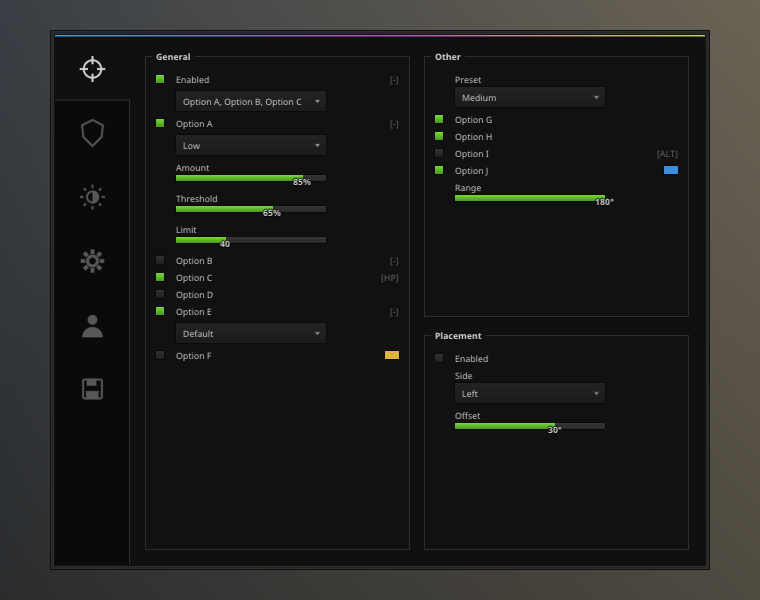

# gamesense-style menu

A complete flat menu in the [gamesense](../references/gamesense-menu.md) ("skeet") style. It is a distinctive named style, **not a baseline**: use it when a request asks for gamesense or skeet. For a generic minimal menu start from [Glass sidebar menu](glass-sidebar-menu.md); for a rich one, from the [Style baseline](imgui-style-baseline.md). Everything here is 0 rounding, 1 px lines and one accent.



*Rendered with Noto Sans 12 px (regular and bold) via [Preview rendering](preview-rendering.md). The real product uses a smaller Verdana-like face.*

Usage:

```cpp
ImGui::CreateContext();
gs::SetAccent(gs::Hex(0xc0362c));   // optional: the one user color; its gradient partner is derived
gs::ApplyStyle();
ImFont* bold = ImGui::GetIO().Fonts->AddFontFromFileTTF("Bold.ttf", 12.0f);   // titles and slider values
// each frame:
ImGui::SetNextWindowPos(ImVec2(100, 100), ImGuiCond_FirstUseEver);
gs::DrawGamesenseMenu(bold);
```

To build your own page instead of the demo: `BeginMenu` → `TabRail` → one `BeginGroup`/`EndGroup` per box (you pass each box's position and size, so layouts are explicit) → `EndMenu`.

| Piece | What it does | Widget note |
|---|---|---|
| `Palette`, `P()`, `SetAccent`, `ApplyStyle` | every color in one struct; `ImGuiStyle` with no rounding | [Color and contrast](../principles/color-and-contrast.md) |
| `BeginMenu` / `EndMenu` | window, 5 px bevel, 2 px hue stripe, rail and page backgrounds | |
| `TabRail` | icon cells; the selected one merges into the page instead of lighting up | [Tabs and navigation](../widgets/tabs-and-navigation.md) |
| `BeginGroup` / `EndGroup` | bordered child with the title on its top border | [Group boxes](../widgets/group-boxes.md) |
| `Checkbox`, `KeyTag`, `Label` | 8 px gradient square in its own column; dim `[key]` at the row's right edge | [Toggles and checkboxes](../widgets/toggles-and-checkboxes.md) |
| `Slider`, `SliderInt` | 6 px track, gradient fill, value riding the end of the fill | [Sliders](../widgets/sliders.md) |
| `Combo` | flat 150 × 20 field, tiny triangle, flush list | [Combos and dropdowns](../widgets/combos-and-dropdowns.md) |
| `Swatch` | 14 × 8 swatch at the row's right edge, picker popup | [Color pickers](../widgets/color-pickers.md) |

Notes:

- **Two-column rows.** Group children use `ImGuiChildFlags_AlwaysUseWindowPadding` with a 30 px left padding, so every label and control starts at the same indent. Checkboxes draw their square 20 px to the left of the item, in the padding. ImGui clips half the padding by default, so `PushRowClip` widens the clip rect for the square, key tags, swatches and slider values.
- **Group title on the border.** The border is drawn on the parent's draw list, 1 px outside the child. The title is drawn on the child's list with a clip rect pushed outside the child (`PushClipRect(..., false)`), over a small patch of the group fill that breaks the line.
- **Selected tab.** The cell is filled with the page color, gets 1 px lines above and below, and the rail divider is drawn in two pieces that skip it.
- **No hover colors on fields beyond a one-step lift**, and labels brighten slightly on hover. That's more feedback than the original has; remove it for the exact look.
- The stripe colors follow the original's hue order but are chosen, not sampled (the captures are too compressed). The checkbox-off and accent gradients are exact values from the repo.
- Animation uses `menu::Anim` from [Animation helpers](animation-helpers.md) (checkbox fill, slider fill, hover).

Lessons from porting this style into a larger production menu (2026-11; not in the demo code):

- **Fixed-height rows, controls right-aligned on the row.** Keeping one row height (22 px there) with every control vertically centred and right-aligned was simpler than the original's mixed label-above layouts, and it kept two cards side by side aligned row for row. Combos and text fields that were taller than a row (ImGui's default 25 px frames) overflowed it; draw them as 18–20 px fields instead.
- **Key tags:** hover-only when unbound, `[...]` while capturing, right-click mode list (Always on / Toggle / Hold / Off); details in [Keybinds](../widgets/keybinds.md), variant B.
- **Window resize grip.** A 12 px hit area in the bottom-right corner drawn as three short diagonal lines (dim, brighter on hover or drag), `ResizeNWSE` cursor. Dragging sets a stored width and height clamped to a minimum (600 × 420 there) and to the display; double-click resets to the default size. Exclude the grip's corner from the page scrollbar so the two don't overlap.
- **Square popups everywhere.** Once the frame is square, any leftover rounded popup (pickers, dropdowns, profile menus) stands out at once; give every popup the same 1 px dark edge and fade it in without scaling.

File: `code/gamesense_menu.h`

```cpp
// gamesense_menu.h — a flat menu in the gamesense ("skeet") style, used on request (references/gamesense-menu.md).
// Near-black, 1 px lines, one accent: a beveled frame with a hue stripe, an icon rail whose selected tab merges into
// the page, bordered group boxes, square checkboxes, thin sliders whose value rides the fill, flat combos, key tags
// and swatches. Standalone: draws its own ImGui window and nothing else. Labels are placeholders.
#pragma once
#ifndef IMGUI_DEFINE_MATH_OPERATORS
#define IMGUI_DEFINE_MATH_OPERATORS
#endif
#include "imgui.h"
#include "imgui_internal.h"
#include "menu_anim.h"
#include "menu_style.h"   // CoverStockBlues
#include <cmath>

namespace gs {

using menu::Anim;
using menu::AnimTo;
using menu::SubId;

inline ImVec4 Hex(unsigned rgb, float a = 1.0f) {
    return ImVec4(((rgb >> 16) & 0xFF) / 255.0f, ((rgb >> 8) & 0xFF) / 255.0f, (rgb & 0xFF) / 255.0f, a);
}
inline ImU32 U(const ImVec4& c) { return ImGui::GetColorU32(c); }
inline ImVec4 Scale(ImVec4 c, float m) { return ImVec4(c.x * m, c.y * m, c.z * m, c.w); }   // darken rgb

// Every color the menu uses. Sampled from the screenshots (approximate) unless marked.
struct Palette {
    ImVec4 base      = Hex(0x0a0a0a);   // rail, outline under fields
    ImVec4 page      = Hex(0x101010);   // content background
    ImVec4 group     = Hex(0x111111);   // group fill, one step above the page
    ImVec4 line      = Hex(0x2d2d2d);   // group border, rail divider
    ImVec4 bevel[5]  = { Hex(0x101010), Hex(0x2e2e2e), Hex(0x252525), Hex(0x2e2e2e), Hex(0x111111) };   // outside -> in
    ImVec4 field     = Hex(0x232323), field_lo = Hex(0x1b1b1b);   // combo box gradient
    ImVec4 field_hov = Hex(0x2b2b2b);
    ImVec4 track     = Hex(0x363636), track_lo = Hex(0x2b2b2b);   // slider track gradient
    ImVec4 off       = Hex(0x31332f), off_lo   = Hex(0x20211f);   // checkbox off gradient (repo, exact)
    ImVec4 text      = Hex(0xcac8c9);   // labels
    ImVec4 title     = Hex(0xd6d4d5);   // group titles, hovered labels, slider values
    ImVec4 dim       = Hex(0x646464);   // key tags
    ImVec4 arrow     = Hex(0x979797);   // combo triangle
    ImVec4 icon_off  = Hex(0x575757), icon_on = Hex(0xd2d2d2);
    ImVec4 accent    = Hex(0x74db33), accent_lo = Hex(0x4e9521);   // gradient top / bottom (repo, exact)
    ImVec4 stripe[3] = { Hex(0x3ba6d9), Hex(0xb84fc8), Hex(0xc6d94e) };   // hue order matches; values picked, not sampled
};
inline Palette& P() { static Palette p; return p; }

// One user color: the darker gradient partner is derived (the repo's pair is about 0.67x).
inline void SetAccent(ImVec4 c) { P().accent = c; P().accent_lo = Scale(c, 0.67f); }

// Layout tokens, px.
namespace k {
constexpr float bevel = 5, stripe = 2, rail_w = 75, tab_h = 64, rail_top = 0, icon = 13;
constexpr float gutter = 16, group_pad_y = 16, title_x = 10;
constexpr float check = 8, check_x = 10, indent = 30;   // checkbox column at check_x; labels and controls at indent
constexpr float item_w = 150, track_h = 6, field_h = 20, row_gap = 5, tag_r = 10;
constexpr float swatch_w = 14, swatch_h = 8;
}

// Call once after creating the context (and after SetAccent if you change it at startup).
inline void ApplyStyle() {
    const Palette& p = P();
    ImGuiStyle& s = ImGui::GetStyle();
    s.WindowRounding = 0.0f; s.ChildRounding = 0.0f; s.PopupRounding = 0.0f;
    s.FrameRounding = 0.0f;  s.GrabRounding = 0.0f;  s.ScrollbarRounding = 0.0f;
    s.WindowBorderSize = 0.0f; s.ChildBorderSize = 0.0f; s.PopupBorderSize = 1.0f; s.FrameBorderSize = 0.0f;
    s.WindowPadding = ImVec2(0, 0); s.FramePadding = ImVec2(6, 3);
    s.ItemSpacing = ImVec2(8, k::row_gap); s.ItemInnerSpacing = ImVec2(6, 4);
    s.ScrollbarSize = 4.0f; s.GrabMinSize = 12.0f;

    ImVec4* c = s.Colors;
    c[ImGuiCol_Text]                 = p.text;
    c[ImGuiCol_TextDisabled]         = p.dim;
    c[ImGuiCol_WindowBg]             = p.page;
    c[ImGuiCol_ChildBg]              = p.group;
    c[ImGuiCol_PopupBg]              = p.field;
    c[ImGuiCol_Border]               = p.base;
    c[ImGuiCol_BorderShadow]         = ImVec4(0, 0, 0, 0);
    c[ImGuiCol_FrameBg]              = p.field;
    c[ImGuiCol_FrameBgHovered]       = p.field_hov;
    c[ImGuiCol_FrameBgActive]        = p.field_hov;
    c[ImGuiCol_Button]               = p.field;
    c[ImGuiCol_ButtonHovered]        = p.field_hov;
    c[ImGuiCol_ButtonActive]         = p.track;
    c[ImGuiCol_Header]               = p.field_hov;
    c[ImGuiCol_HeaderHovered]        = p.field_hov;
    c[ImGuiCol_HeaderActive]         = p.track;
    c[ImGuiCol_Separator]            = p.line;
    c[ImGuiCol_CheckMark]            = p.accent;
    c[ImGuiCol_SliderGrab]           = p.accent;
    c[ImGuiCol_SliderGrabActive]     = p.accent_lo;
    c[ImGuiCol_ScrollbarBg]          = p.group;
    c[ImGuiCol_ScrollbarGrab]        = Hex(0x3c3c3c);
    c[ImGuiCol_ScrollbarGrabHovered] = Hex(0x4a4a4a);
    c[ImGuiCol_ScrollbarGrabActive]  = p.accent;
    c[ImGuiCol_TextSelectedBg]       = ImVec4(p.accent.x, p.accent.y, p.accent.z, 0.3f);
    c[ImGuiCol_ModalWindowDimBg]     = ImVec4(0, 0, 0, 0.5f);
    menu::CoverStockBlues(s, p.page, p.field, p.accent);
}

// Rows draw the checkbox, key tags and swatches in the group's side padding, which ImGui clips by default.
// This widens the clip rect horizontally to the whole inner rect; pair with PopClipRect().
inline void PushRowClip(ImGuiWindow* w) {
    w->DrawList->PushClipRect(ImVec2(w->InnerRect.Min.x, w->InnerClipRect.Min.y),
                              ImVec2(w->InnerRect.Max.x, w->InnerClipRect.Max.y), false);
}

// Flat gradient rect with a 1 px base-colored outline (fields, tracks, checkbox squares).
inline void Field(ImDrawList* dl, ImVec2 a, ImVec2 b, ImVec4 top, ImVec4 bottom) {
    dl->AddRectFilled(a - ImVec2(1, 1), b + ImVec2(1, 1), U(P().base));
    dl->AddRectFilledMultiColor(a, b, U(top), U(top), U(bottom), U(bottom));
}

// ---------------------------------------------------------------------------------------------
// Chrome: window with bevel and stripe, icon rail.

struct Chrome { ImRect rail, page; };

// Opens the menu window (set its position first if you want) and draws the bevel, the stripe and both backgrounds.
// Returns the rail and page rects. Pair with EndMenu().
inline Chrome BeginMenu(const char* name, ImVec2 size) {
    const Palette& p = P();
    ImGui::SetNextWindowSize(size, ImGuiCond_Always);
    ImGui::Begin(name, nullptr, ImGuiWindowFlags_NoDecoration | ImGuiWindowFlags_NoBackground |
                                ImGuiWindowFlags_NoSavedSettings | ImGuiWindowFlags_NoScrollWithMouse);
    ImGuiWindow* w = ImGui::GetCurrentWindow();
    ImDrawList* dl = w->DrawList;
    const ImRect r = w->Rect();
    for (int i = 0; i < 5; ++i)   // five 1 px rings, outside -> inside
        dl->AddRect(r.Min + ImVec2((float)i, (float)i), r.Max - ImVec2((float)i, (float)i), U(p.bevel[i]));
    const ImRect in(r.Min + ImVec2(k::bevel, k::bevel), r.Max - ImVec2(k::bevel, k::bevel));

    Chrome ch;
    ch.rail = ImRect(ImVec2(in.Min.x, in.Min.y + k::stripe), ImVec2(in.Min.x + k::rail_w, in.Max.y));
    ch.page = ImRect(ImVec2(ch.rail.Max.x, ch.rail.Min.y), in.Max);
    dl->AddRectFilled(ch.rail.Min, ch.rail.Max, U(p.base));
    dl->AddRectFilled(ch.page.Min, ch.page.Max, U(p.page));

    // stripe: a bright 1 px line over a half-brightness one, hue cyan -> magenta -> yellow-green
    const float mx = (in.Min.x + in.Max.x) * 0.5f;
    for (int row = 0; row < 2; ++row) {
        const float m = row == 0 ? 1.0f : 0.5f, y = in.Min.y + row;
        const ImU32 c0 = U(Scale(p.stripe[0], m)), c1 = U(Scale(p.stripe[1], m)), c2 = U(Scale(p.stripe[2], m));
        dl->AddRectFilledMultiColor(ImVec2(in.Min.x, y), ImVec2(mx, y + 1), c0, c1, c1, c0);
        dl->AddRectFilledMultiColor(ImVec2(mx, y), ImVec2(in.Max.x, y + 1), c1, c2, c2, c1);
    }
    return ch;
}
inline void EndMenu() { ImGui::End(); }

// Placeholder rail glyphs, stroked (swap in an icon font). s = half size.
inline void RailIcon(ImDrawList* dl, int i, ImVec2 c, float s, ImU32 col) {
    const float th = ImMax(1.5f, s * 0.15f);
    switch (i % 6) {
    case 0:   // target
        dl->AddCircle(c, s * 0.75f, col, 28, th);
        for (int q = 0; q < 4; ++q) {
            const float a = q * IM_PI * 0.5f;
            const ImVec2 d(std::cos(a), std::sin(a));
            dl->AddLine(c + d * (s * 0.35f), c + d * s, col, th);
        }
        break;
    case 1: {   // shield
        const ImVec2 pts[6] = { c + ImVec2(0, -s), c + ImVec2(s * 0.8f, -s * 0.6f), c + ImVec2(s * 0.7f, s * 0.3f),
                                c + ImVec2(0, s), c + ImVec2(-s * 0.7f, s * 0.3f), c + ImVec2(-s * 0.8f, -s * 0.6f) };
        dl->AddPolyline(pts, 6, col, ImDrawFlags_Closed, th);
        break; }
    case 2:   // half-filled sun (display)
        dl->AddCircle(c, s * 0.5f, col, 24, th);
        dl->PathArcTo(c, s * 0.5f, -IM_PI * 0.5f, IM_PI * 0.5f, 12); dl->PathFillConvex(col);
        for (int q = 0; q < 8; ++q) {
            const float a = q * IM_PI * 0.25f;
            const ImVec2 d(std::cos(a), std::sin(a));
            dl->AddLine(c + d * (s * 0.7f), c + d * (s * 0.95f), col, th);
        }
        break;
    case 3:   // gear
        dl->AddCircle(c, s * 0.5f, col, 24, th * 1.6f);
        for (int q = 0; q < 8; ++q) {
            const float a = q * IM_PI * 0.25f;
            const ImVec2 d(std::cos(a), std::sin(a));
            dl->AddLine(c + d * (s * 0.55f), c + d * (s * 0.9f), col, th * 2.0f);
        }
        break;
    case 4:   // person
        dl->AddCircleFilled(c + ImVec2(0, -s * 0.4f), s * 0.38f, col, 16);
        dl->PathArcTo(c + ImVec2(0, s * 0.95f), s * 0.8f, IM_PI, IM_PI * 2.0f, 16); dl->PathFillConvex(col);
        break;
    case 5:   // disk
        dl->AddRect(c - ImVec2(s * 0.8f, s * 0.8f), c + ImVec2(s * 0.8f, s * 0.8f), col, s * 0.12f, 0, th);
        dl->AddRectFilled(c + ImVec2(-s * 0.45f, -s * 0.8f), c + ImVec2(s * 0.3f, -s * 0.25f), col);
        dl->AddRectFilled(c + ImVec2(-s * 0.5f, s * 0.15f), c + ImVec2(s * 0.5f, s * 0.8f), col);
        break;
    }
}

// Icon rail: one cell per tab. The selected cell takes the page color, gets 1 px lines above and below,
// and the rail's divider breaks beside it, so the tab opens into the page. No accent color.
inline bool TabRail(const Chrome& ch, int* tab, int count) {
    const Palette& p = P();
    ImGuiWindow* w = ImGui::GetCurrentWindow();
    ImDrawList* dl = w->DrawList;
    bool changed = false;
    const float top = ch.rail.Min.y + k::rail_top, x0 = ch.rail.Min.x, x1 = ch.rail.Max.x;
    for (int i = 0; i < count; ++i) {
        const ImRect cell(ImVec2(x0, top + i * k::tab_h), ImVec2(x1, top + (i + 1) * k::tab_h));
        ImGui::PushID(i);
        const ImGuiID id = w->GetID("##tab");
        ImGui::PopID();
        ImGui::ItemAdd(cell, id);
        bool hovered, held;
        if (ImGui::ButtonBehavior(cell, id, &hovered, &held) && *tab != i) { *tab = i; changed = true; }
        const bool sel = (*tab == i);
        if (sel) {
            dl->AddRectFilled(cell.Min, cell.Max, U(p.page));
            if (cell.Min.y > ch.rail.Min.y + 0.5f)   // the first tab meets the stripe directly
                dl->AddLine(ImVec2(x0, cell.Min.y), ImVec2(x1, cell.Min.y), U(p.line));
            dl->AddLine(ImVec2(x0, cell.Max.y - 1), ImVec2(x1, cell.Max.y - 1), U(p.line));
        }
        const float on = Anim(SubId(id, "sel"), sel, 12.0f), hov = Anim(SubId(id, "hov"), hovered, 14.0f);
        RailIcon(dl, i, cell.GetCenter(), k::icon, U(ImLerp(p.icon_off, p.icon_on, ImMax(on, hov * 0.45f))));
    }
    // divider at the rail's right edge, broken beside the selected cell
    const float sx = x1 - 1.0f;
    const float s0 = top + ImClamp(*tab, 0, count - 1) * k::tab_h, s1 = s0 + k::tab_h;
    dl->AddRectFilled(ImVec2(sx, ch.rail.Min.y), ImVec2(x1, s0), U(p.line));
    dl->AddRectFilled(ImVec2(sx, s1 - 1.0f), ImVec2(x1, ch.rail.Max.y), U(p.line));
    return changed;
}

// ---------------------------------------------------------------------------------------------
// Group box: 1 px line around a fill one step above the page; bold title on the top border, line broken under it.
// Content starts at the label indent; checkboxes draw in the column left of it. Always pair with EndGroup().

inline bool BeginGroup(const char* title, ImVec2 pos, ImVec2 size, ImFont* bold = nullptr) {
    const Palette& p = P();
    ImGui::GetCurrentWindow()->DrawList->AddRect(pos - ImVec2(1, 1), pos + size + ImVec2(1, 1), U(p.line));
    ImGui::SetCursorScreenPos(pos);
    ImGui::PushStyleVar(ImGuiStyleVar_WindowPadding, ImVec2(k::indent, k::group_pad_y));
    const bool visible = ImGui::BeginChild(title, size, ImGuiChildFlags_AlwaysUseWindowPadding);
    ImGui::PopStyleVar();

    ImDrawList* dl = ImGui::GetWindowDrawList();
    if (bold) ImGui::PushFont(bold, 0.0f);
    const char* end = ImGui::FindRenderedTextEnd(title);
    const ImVec2 ts = ImGui::CalcTextSize(title, end);
    const ImVec2 tp(pos.x + k::title_x, ImFloor(pos.y - 1.0f - ts.y * 0.5f));
    dl->PushClipRect(ImVec2(pos.x - 1.0f, tp.y), pos + size, false);   // the title sits half outside the child
    dl->AddRectFilled(ImVec2(tp.x - 4.0f, pos.y - 2.0f), ImVec2(tp.x + ts.x + 4.0f, pos.y + 1.0f), U(p.group));
    dl->AddText(tp, U(p.title), title, end);
    dl->PopClipRect();
    if (bold) ImGui::PopFont();
    return visible;
}
inline void EndGroup() { ImGui::EndChild(); }

// ---------------------------------------------------------------------------------------------
// Rows. Labels stay in `text` and brighten toward `title` on hover; only the accent shows state.

// Dim "[key]" right-aligned on the previous item's row. Pass "-" for unbound.
inline void KeyTag(const char* key) {
    ImGuiWindow* w = ImGui::GetCurrentWindow();
    if (w->SkipItems || !key) return;
    char buf[32];
    ImFormatString(buf, IM_ARRAYSIZE(buf), "[%s]", key);
    const ImRect row = ImGui::GetCurrentContext()->LastItemData.Rect;
    const ImVec2 ts = ImGui::CalcTextSize(buf);
    PushRowClip(w);
    w->DrawList->AddText(ImVec2(w->InnerRect.Max.x - k::tag_r - ts.x, row.Min.y + (row.GetHeight() - ts.y) * 0.5f),
                         U(P().dim), buf);
    w->DrawList->PopClipRect();
}

// 8 px square in the checkbox column, accent gradient when on, dark gradient when off; no check mark.
inline bool Checkbox(const char* label, bool* v, const char* key = nullptr) {
    ImGuiWindow* w = ImGui::GetCurrentWindow();
    if (w->SkipItems) return false;
    const Palette& p = P();
    const ImGuiID id = w->GetID(label);
    const char* end = ImGui::FindRenderedTextEnd(label);
    const ImVec2 ts = ImGui::CalcTextSize(label, end);
    const ImVec2 pos = w->DC.CursorPos;
    const float row_h = ImMax(ts.y, k::check);
    const ImRect bb(ImVec2(pos.x - (k::indent - k::check_x), pos.y), ImVec2(pos.x + ts.x, pos.y + row_h));
    ImGui::ItemSize(ImVec2(ts.x, row_h));
    if (!ImGui::ItemAdd(bb, id)) return false;

    bool hovered, held;
    const bool pressed = ImGui::ButtonBehavior(bb, id, &hovered, &held);
    if (pressed) { *v = !*v; ImGui::MarkItemEdited(id); }
    const float on = Anim(SubId(id, "on"), *v, 16.0f), hov = Anim(SubId(id, "hov"), hovered, 12.0f);

    ImDrawList* dl = w->DrawList;
    const ImVec2 b0(bb.Min.x, pos.y + ImFloor((row_h - k::check) * 0.5f)), b1 = b0 + ImVec2(k::check, k::check);
    PushRowClip(w);
    Field(dl, b0, b1, ImLerp(p.off, p.accent, on), ImLerp(p.off_lo, p.accent_lo, on));
    dl->PopClipRect();
    dl->AddText(ImVec2(pos.x, pos.y + (row_h - ts.y) * 0.5f), U(ImLerp(p.text, p.title, hov * 0.7f)), label, end);
    if (key) KeyTag(key);
    return pressed;
}

// Plain label at the indent (for rows whose control sits below, or a swatch-only row).
inline void Label(const char* text) {
    ImGuiWindow* w = ImGui::GetCurrentWindow();
    if (w->SkipItems) return;
    const ImVec2 ts = ImGui::CalcTextSize(text);
    const ImRect bb(w->DC.CursorPos, w->DC.CursorPos + ts);
    ImGui::ItemSize(bb);
    if (!ImGui::ItemAdd(bb, 0)) return;
    w->DrawList->AddText(bb.Min, U(P().text), text);
}

// Label above (hide it with "##"), a 6 px track `item_w` wide with an accent gradient fill and no thumb.
// The value is centered on the end of the fill and overlaps the track's lower edge, in `bold` with a dark outline.
inline bool Slider(const char* label, float* v, float v_min, float v_max, const char* fmt = "%.0f",
                   ImFont* bold = nullptr) {
    ImGuiWindow* w = ImGui::GetCurrentWindow();
    if (w->SkipItems) return false;
    const Palette& p = P();
    const ImGuiID id = w->GetID(label);
    const char* end = ImGui::FindRenderedTextEnd(label);
    const bool has_label = end != label;
    const float text_h = ImGui::GetTextLineHeight();
    const ImVec2 pos = w->DC.CursorPos;
    const float ty = pos.y + (has_label ? text_h + 2.0f : 1.0f);
    const ImRect track(ImVec2(pos.x, ty), ImVec2(pos.x + k::item_w, ty + k::track_h));
    const ImRect bb(pos, ImVec2(track.Max.x, track.Max.y + ImFloor(text_h * 0.5f)));
    ImGui::ItemSize(bb);
    if (!ImGui::ItemAdd(bb, id)) return false;

    const ImRect hit(track.Min - ImVec2(0, 3), track.Max + ImVec2(0, 3));
    bool hovered, held;
    ImGui::ButtonBehavior(hit, id, &hovered, &held, ImGuiButtonFlags_PressedOnClick);
    bool changed = false;
    if (held) {
        const float f = ImSaturate((ImGui::GetIO().MousePos.x - track.Min.x) / track.GetWidth());
        const float nv = v_min + f * (v_max - v_min);
        if (nv != *v) { *v = nv; changed = true; ImGui::MarkItemEdited(id); }
    }
    const float frac = (v_max > v_min) ? ImSaturate((*v - v_min) / (v_max - v_min)) : 0.0f;
    const float shown = AnimTo(SubId(id, "fill"), frac, 22.0f);
    const float hov = Anim(SubId(id, "hov"), hovered || held, 12.0f);

    ImDrawList* dl = w->DrawList;
    if (has_label) dl->AddText(pos, U(ImLerp(p.text, p.title, hov * 0.7f)), label, end);
    Field(dl, track.Min, track.Max, p.track, p.track_lo);
    const float fx = track.Min.x + ImFloor(track.GetWidth() * shown);
    if (fx > track.Min.x)
        dl->AddRectFilledMultiColor(track.Min, ImVec2(fx, track.Max.y), U(p.accent), U(p.accent), U(p.accent_lo), U(p.accent_lo));

    char buf[32];
    ImFormatString(buf, IM_ARRAYSIZE(buf), fmt, *v);
    if (bold) ImGui::PushFont(bold, 0.0f);
    const ImVec2 vs = ImGui::CalcTextSize(buf);
    const ImVec2 vp(ImFloor(fx - vs.x * 0.5f), ImFloor(track.Max.y - vs.y * 0.45f));
    PushRowClip(w);
    const ImU32 outline = U(Hex(0x000000, 0.85f));
    for (int q = 0; q < 4; ++q) dl->AddText(vp + ImVec2(q == 0 ? -1.0f : q == 1 ? 1.0f : 0.0f, q == 2 ? -1.0f : q == 3 ? 1.0f : 0.0f), outline, buf);
    dl->AddText(vp, U(p.title), buf);
    dl->PopClipRect();
    if (bold) ImGui::PopFont();
    return changed;
}

inline bool SliderInt(const char* label, int* v, int v_min, int v_max, const char* fmt = "%.0f", ImFont* bold = nullptr) {
    float f = (float)*v;
    const bool changed = Slider(label, &f, (float)v_min, (float)v_max, fmt, bold);
    if (changed) *v = (int)std::lround(f);
    return changed;
}

// Label above (hide it with "##"), a flat `item_w` x 20 box, value left (clipped), tiny filled triangle right.
// The list opens flush under the box; the selected entry is drawn in the accent.
inline bool Combo(const char* label, int* current, const char* const* items, int count) {
    ImGuiWindow* w = ImGui::GetCurrentWindow();
    if (w->SkipItems || count <= 0) return false;
    const Palette& p = P();
    const ImGuiID id = w->GetID(label);
    const char* end = ImGui::FindRenderedTextEnd(label);
    const bool has_label = end != label;
    const float text_h = ImGui::GetTextLineHeight();
    const ImVec2 pos = w->DC.CursorPos;
    const float by = pos.y + (has_label ? text_h + 2.0f : 1.0f);
    const ImRect box(ImVec2(pos.x, by), ImVec2(pos.x + k::item_w, by + k::field_h));
    const ImRect bb(pos, box.Max + ImVec2(0, 1));
    ImGui::ItemSize(bb);
    if (!ImGui::ItemAdd(bb, id)) return false;

    const ImGuiID popup_id = SubId(id, "list");
    bool hovered, held;
    if (ImGui::ButtonBehavior(box, id, &hovered, &held)) ImGui::OpenPopupEx(popup_id);
    const bool open = ImGui::IsPopupOpen(popup_id, ImGuiPopupFlags_None);
    const float hov = Anim(SubId(id, "hov"), hovered || open, 14.0f);

    ImDrawList* dl = w->DrawList;
    if (has_label) dl->AddText(pos, U(ImLerp(p.text, p.title, hov * 0.7f)), label, end);
    Field(dl, box.Min, box.Max, ImLerp(p.field, p.field_hov, hov), p.field_lo);
    const char* cur = (*current >= 0 && *current < count) ? items[*current] : "";
    const ImVec2 cs = ImGui::CalcTextSize(cur);
    dl->PushClipRect(box.Min, box.Max - ImVec2(16.0f, 0.0f), true);
    dl->AddText(ImVec2(box.Min.x + 7.0f, box.Min.y + ImFloor((k::field_h - cs.y) * 0.5f)), U(p.text), cur);
    dl->PopClipRect();
    const float ax = box.Max.x - 11.0f, ay = box.Min.y + ImFloor(k::field_h * 0.5f) - 1.0f;
    dl->AddTriangleFilled(ImVec2(ax, ay), ImVec2(ax + 5.0f, ay), ImVec2(ax + 2.5f, ay + 3.0f), U(p.arrow));

    bool changed = false;
    if (open) {
        ImGui::SetNextWindowPos(ImVec2(box.Min.x, box.Max.y + 1.0f));
        ImGui::SetNextWindowSize(ImVec2(k::item_w, 0.0f));
        ImGui::PushStyleVar(ImGuiStyleVar_WindowPadding, ImVec2(0.0f, 0.0f));
        ImGui::PushStyleVar(ImGuiStyleVar_ItemSpacing, ImVec2(0.0f, 0.0f));
        if (ImGui::BeginPopupEx(popup_id, ImGuiWindowFlags_NoTitleBar | ImGuiWindowFlags_NoMove |
                                          ImGuiWindowFlags_NoSavedSettings | ImGuiWindowFlags_AlwaysAutoResize)) {
            ImGuiWindow* pw = ImGui::GetCurrentWindow();
            for (int i = 0; i < count; ++i) {
                ImGui::PushID(i);
                const ImVec2 ip = pw->DC.CursorPos;
                const ImRect ib(ip, ip + ImVec2(k::item_w, k::field_h));
                const ImGuiID iid = pw->GetID("item");
                ImGui::ItemSize(ib);
                if (ImGui::ItemAdd(ib, iid)) {
                    bool ih, iheld;
                    if (ImGui::ButtonBehavior(ib, iid, &ih, &iheld)) { *current = i; changed = true; ImGui::CloseCurrentPopup(); }
                    if (ih) pw->DrawList->AddRectFilled(ib.Min, ib.Max, U(p.field_hov));
                    const ImVec2 is = ImGui::CalcTextSize(items[i]);
                    pw->DrawList->AddText(ImVec2(ib.Min.x + 7.0f, ib.Min.y + ImFloor((k::field_h - is.y) * 0.5f)),
                                          U(i == *current ? p.accent : p.text), items[i]);
                }
                ImGui::PopID();
            }
            ImGui::EndPopup();
        }
        ImGui::PopStyleVar(2);
    }
    return changed;
}

// Small flat swatch right-aligned on the previous item's row; clicking opens a picker.
inline bool Swatch(const char* str_id, ImVec4* col) {
    ImGuiWindow* w = ImGui::GetCurrentWindow();
    if (w->SkipItems) return false;
    const ImRect row = ImGui::GetCurrentContext()->LastItemData.Rect;
    const ImGuiID id = w->GetID(str_id);
    const ImVec2 s0(w->InnerRect.Max.x - k::tag_r - k::swatch_w, ImFloor(row.GetCenter().y - k::swatch_h * 0.5f));
    const ImRect sb(s0, s0 + ImVec2(k::swatch_w, k::swatch_h));
    ImGui::ItemAdd(sb, id);
    bool hovered, held;
    const ImGuiID popup_id = SubId(id, "picker");
    if (ImGui::ButtonBehavior(sb, id, &hovered, &held)) ImGui::OpenPopupEx(popup_id);
    PushRowClip(w);
    Field(w->DrawList, sb.Min, sb.Max, ImVec4(col->x, col->y, col->z, 1.0f), ImVec4(col->x, col->y, col->z, 1.0f));
    w->DrawList->PopClipRect();

    bool changed = false;
    if (ImGui::IsPopupOpen(popup_id, ImGuiPopupFlags_None)) {
        ImGui::SetNextWindowPos(ImVec2(sb.Min.x, sb.Max.y + 4.0f));
        ImGui::PushStyleVar(ImGuiStyleVar_WindowPadding, ImVec2(6.0f, 6.0f));
        if (ImGui::BeginPopupEx(popup_id, ImGuiWindowFlags_NoTitleBar | ImGuiWindowFlags_NoMove |
                                          ImGuiWindowFlags_NoSavedSettings | ImGuiWindowFlags_AlwaysAutoResize)) {
            ImGui::SetNextItemWidth(150.0f);
            changed = ImGui::ColorPicker4("##picker", &col->x, ImGuiColorEditFlags_NoSidePreview |
                                          ImGuiColorEditFlags_NoSmallPreview | ImGuiColorEditFlags_NoInputs |
                                          ImGuiColorEditFlags_AlphaBar);
            ImGui::EndPopup();
        }
        ImGui::PopStyleVar();
    }
    return changed;
}

// ---------------------------------------------------------------------------------------------
// Demo: a 660 x 540 menu with six rail tabs and three groups of placeholder rows. Call once per frame.
// `bold` (optional) is used for group titles and slider values.

inline void DrawGamesenseMenu(ImFont* bold = nullptr) {
    static int tab = 0;
    static bool on[12] = { true, true, false, true, false, true, false, true, true, false, true, false };
    static int multi = 0, mode = 1, style_i = 0, preset = 2, side = 0;
    static float amount = 85.0f, chance = 65.0f, limit = 40.0f, range = 180.0f, offset = 30.0f;
    static ImVec4 col_a = Hex(0xe0b33a), col_b = Hex(0x3a8fe0);
    static const char* multi_items[] = { "Option A, Option B, Option C", "Option A", "None" };
    static const char* mode_items[]  = { "Off", "Low", "Medium", "Maximum" };
    static const char* style_items[] = { "Default", "Static", "Animated" };
    static const char* side_items[]  = { "Left", "Right", "Both" };
    static const char* titles[6][3] = {
        { "General", "Other", "Placement" }, { "Protection", "Limits", "Extra" }, { "Display", "World", "Effects" },
        { "Interface", "Behavior", "Extra" }, { "Profile", "Appearance", "Extra" }, { "Presets", "Storage", "Scripts" } };
    const char* deg = "%.0f\xC2\xB0";   // degree sign (in ImGui's default Latin-1 range)

    const Chrome ch = BeginMenu("##gamesense", ImVec2(660.0f, 540.0f));
    TabRail(ch, &tab, 6);
    const float g = k::gutter;
    const float col_w = ImFloor((ch.page.GetWidth() - g * 3.0f) * 0.5f);
    const float top = ch.page.Min.y + g + 4.0f, bottom = ch.page.Max.y - g;
    const float lx = ch.page.Min.x + g, rx = lx + col_w + g;
    const float rh1 = ImFloor((bottom - top - g - 4.0f) * 0.55f), rh2 = bottom - top - rh1 - g - 4.0f;

    if (BeginGroup(titles[tab][0], ImVec2(lx, top), ImVec2(col_w, bottom - top), bold)) {
        Checkbox("Enabled", &on[0], "-");
        Combo("##multi", &multi, multi_items, 3);
        Checkbox("Option A", &on[1], "-");
        Combo("##mode_a", &mode, mode_items, 4);
        Slider("Amount", &amount, 0.0f, 100.0f, "%.0f%%", bold);
        Slider("Threshold", &chance, 0.0f, 100.0f, "%.0f%%", bold);
        Slider("Limit", &limit, 0.0f, 120.0f, "%.0f", bold);
        Checkbox("Option B", &on[2], "-");
        Checkbox("Option C", &on[3], "HP");
        Checkbox("Option D", &on[4]);
        Checkbox("Option E", &on[5], "-");
        Combo("##style", &style_i, style_items, 3);
        Checkbox("Option F", &on[6]);
        Swatch("##col_a", &col_a);
    }
    EndGroup();

    if (BeginGroup(titles[tab][1], ImVec2(rx, top), ImVec2(col_w, rh1), bold)) {
        Combo("Preset", &preset, mode_items, 4);
        Checkbox("Option G", &on[7]);
        Checkbox("Option H", &on[8]);
        Checkbox("Option I", &on[9], "ALT");
        Checkbox("Option J", &on[10]);
        Swatch("##col_b", &col_b);
        Slider("Range", &range, 0.0f, 180.0f, deg, bold);
    }
    EndGroup();

    if (BeginGroup(titles[tab][2], ImVec2(rx, top + rh1 + g + 4.0f), ImVec2(col_w, rh2), bold)) {
        Checkbox("Enabled##c", &on[11]);
        Combo("Side", &side, side_items, 3);
        Slider("Offset", &offset, -90.0f, 90.0f, deg, bold);
    }
    EndGroup();
    EndMenu();
}

} // namespace gs
```

Related: [gamesense — main menu](../references/gamesense-menu.md), [Style baseline](imgui-style-baseline.md), [Custom widgets](custom-widgets.md), [Glass sidebar menu](glass-sidebar-menu.md), [Animation helpers](animation-helpers.md), [Building the code](code/BUILD.md)
