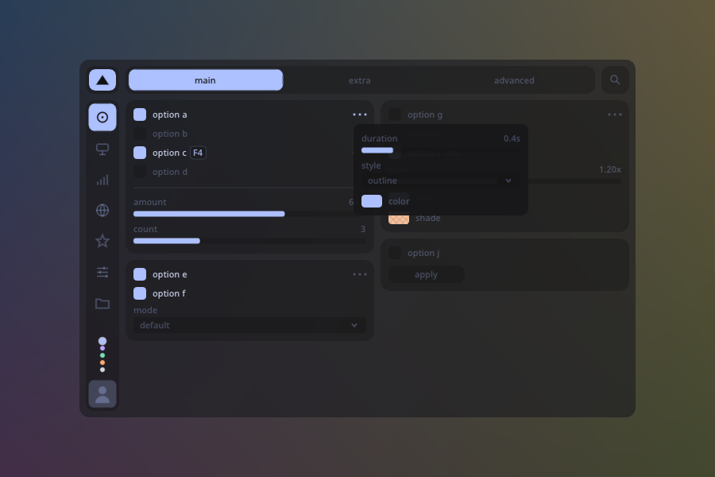

# Glass sidebar menu

The **minimal baseline**: start here when a request says minimal, clean or simple (for a richer look, start from the [Style baseline](imgui-style-baseline.md)). A complete standalone menu in the [velocity.cat](../references/velocity-cat-menu.md) style: a translucent window, a 42 px icon rail, a sub-tab bar with a sliding accent pill, a search mode, and untitled cards in two columns. Unlike [Custom widgets](custom-widgets.md), which use one full-width row each with the control right-aligned, these widgets put the **control first** (checkbox or swatch, then label) or the **label above** (slider, combo).



Use it in a real window the same way as the demo menu: call `glass::ApplyStyle()` once, then `glass::DrawGlassMenu()` each frame. Call `ApplyStyle()` again after changing `glass::PresetIndex()`; the theme dots on the rail already do this. It needs [menu_anim.h](animation-helpers.md) and [menu_style.h](imgui-style-baseline.md) (for `CoverStockBlues`).

| Function | Widget note |
|---|---|
| `Checkbox(label, &v, key)` | [Toggles and checkboxes](../widgets/toggles-and-checkboxes.md), variant C |
| `BeginRowPopup` / `EndRowPopup` | [Row settings popup](../widgets/row-settings-popup.md) |
| `Slider`, `SliderInt` | [Sliders](../widgets/sliders.md), label-over variant |
| `Combo` | [Combos and dropdowns](../widgets/combos-and-dropdowns.md) |
| `ColorSwatch` | [Color pickers](../widgets/color-pickers.md) |
| `BeginCard` / `EndCard` | [Group boxes](../widgets/group-boxes.md), untitled |
| rail + pill sub-tabs in `DrawGlassMenu` | [Tabs and navigation](../widgets/tabs-and-navigation.md) |
| `DrawSearchResults` + search bar in `DrawGlassMenu` | [Settings search](../widgets/settings-search.md) |

Notes:

- **Popups are near-opaque** (`PopupBg` halfway between `dark` and `elevated`, at 96% alpha). The source uses 67% over a backdrop blur, but stock ImGui has no blur, so at 67% the rows behind a popup show through. Add blur ([Draw-list recipes](drawlist-recipes.md)) and you can drop the alpha back.
- The window is 69% opaque. Over a sharp scene with no blur, raise `ImGuiCol_WindowBg` alpha to about 0.9.
- Sub-tab pill position is stored **per tab, relative to the window**: switching sub-tabs slides it, switching tabs snaps it, and dragging the window doesn't animate it.
- `LabeledGap()` pulls labeled items 3 px closer to the row above, which matches the source's tighter spacing before items that have a label line.
- Icons are simple stroked shapes drawn with the draw list. Swap in an icon font ([Typography and icons](../principles/typography-and-icons.md)).
- Not included: window scale-in from the center, the combo items' staggered slide-in, and an editable slider value.

File: `code/glass_sidebar_menu.h`

```cpp
// glass_sidebar_menu.h — velocity.cat-style layout (references/velocity-cat-menu.md).
// Translucent window, 42 px icon rail, sliding-pill sub-tab bar with a search button that expands,
// untitled auto-height cards in two columns, and rows whose extra settings sit behind a "..." popup.
// Standalone: draws its own ImGui window and nothing else. Labels are placeholders.
#pragma once
#ifndef IMGUI_DEFINE_MATH_OPERATORS
#define IMGUI_DEFINE_MATH_OPERATORS
#endif
#include "imgui.h"
#include "imgui_internal.h"
#include "menu_anim.h"
#include "menu_style.h"   // CoverStockBlues
#include <cmath>
#include <cstdint>

namespace glass {

using menu::Anim;
using menu::AnimTo;
using menu::SubId;

inline ImVec4 Rgba(int r, int g, int b, int a = 255) { return ImVec4(r / 255.0f, g / 255.0f, b / 255.0f, a / 255.0f); }
inline ImVec4 SetA(ImVec4 c, int a) { c.w = a / 255.0f; return c; }   // replace alpha
inline ImVec4 MulA(ImVec4 c, float m) { c.w *= m; return c; }         // scale alpha
inline ImU32 U(const ImVec4& c) { return ImGui::GetColorU32(c); }
inline float Smooth(float t) { return t * t * (3.0f - 2.0f * t); }

// Six tokens; every widget color derives from them. The five presets are the source's theme swatches.
struct Theme { ImVec4 accent, dark, text, text_dim, card, elevated; };

inline const Theme& Preset(int i) {
    static const Theme k[5] = {
        { Rgba(173, 192, 255), Rgba(17, 17, 17), Rgba(221, 229, 255, 235), Rgba(173, 192, 255, 82), Rgba(17, 17, 17, 82), Rgba(31, 31, 35, 118) }, // periwinkle
        { Rgba(190, 164, 255), Rgba(18, 17, 23), Rgba(235, 229, 255, 235), Rgba(190, 164, 255, 88), Rgba(18, 17, 23, 88), Rgba(34, 31, 43, 125) }, // lavender
        { Rgba(122, 224, 181), Rgba(14, 20, 19), Rgba(222, 246, 238, 235), Rgba(122, 224, 181, 88), Rgba(14, 20, 19, 88), Rgba(25, 39, 35, 125) }, // mint
        { Rgba(255, 171, 112), Rgba(22, 17, 15), Rgba(255, 232, 214, 235), Rgba(255, 171, 112, 88), Rgba(22, 17, 15, 88), Rgba(43, 32, 26, 125) }, // peach
        { Rgba(210, 214, 224), Rgba(18, 18, 20), Rgba(232, 235, 242, 235), Rgba(210, 214, 224, 82), Rgba(18, 18, 20, 92), Rgba(35, 35, 39, 126) }, // silver
    };
    return k[ImClamp(i, 0, 4)];
}
inline int& PresetIndex() { static int i = 0; return i; }
inline const Theme& T() { return Preset(PresetIndex()); }

// Layout tokens, px.
namespace k {
constexpr float gap = 8, rail_w = 42, icon_btn = 35, bar_h = 35, bar_pad = 4;
constexpr float window_r = 12, card_r = 10, child_r = 12, btn_r = 8, popup_r = 8;
constexpr float pad = 10, spacing = 8;
constexpr float check = 16, check_r = 4, track_h = 7, combo_h = 20, combo_r = 4, combo_item_h = 22;
constexpr float swatch_w = 26, swatch_h = 16, swatch_r = 4, dots_w = 16, popup_w = 220;
}

// Call once after creating the context, and again after changing PresetIndex().
inline void ApplyStyle() {
    const Theme& t = T();
    ImGuiStyle& s = ImGui::GetStyle();
    s.WindowRounding = k::window_r; s.ChildRounding = k::child_r; s.PopupRounding = k::popup_r;
    s.FrameRounding = k::combo_r;   s.GrabRounding = 3.0f;        s.ScrollbarRounding = 3.0f;
    s.WindowBorderSize = 0.0f; s.ChildBorderSize = 0.0f; s.PopupBorderSize = 0.0f; s.FrameBorderSize = 0.0f;
    s.WindowPadding = ImVec2(k::pad, k::pad); s.FramePadding = ImVec2(8, 4);
    s.ItemSpacing = ImVec2(k::spacing, k::spacing); s.ItemInnerSpacing = ImVec2(6, 4);
    s.ScrollbarSize = 6.0f;

    ImVec4* c = s.Colors;
    c[ImGuiCol_Text]                 = t.text;
    c[ImGuiCol_TextDisabled]         = t.text_dim;
    c[ImGuiCol_WindowBg]             = SetA(t.elevated, 175);   // over a blurred backdrop in the source
    c[ImGuiCol_ChildBg]              = t.card;
    // The source draws popups at elevated/170 over a backdrop blur, which hides what's under them.
    // ImGui has no blur, so popups here are near-opaque: halfway between dark and elevated.
    c[ImGuiCol_PopupBg]              = SetA(ImLerp(t.dark, t.elevated, 0.5f), 245);
    c[ImGuiCol_Border]               = ImVec4(0, 0, 0, 0);
    c[ImGuiCol_BorderShadow]         = ImVec4(0, 0, 0, 0);
    c[ImGuiCol_FrameBg]              = t.card;
    c[ImGuiCol_FrameBgHovered]       = SetA(t.card, 120);
    c[ImGuiCol_FrameBgActive]        = SetA(t.card, 120);
    c[ImGuiCol_Button]               = t.card;
    c[ImGuiCol_ButtonHovered]        = SetA(t.card, 120);
    c[ImGuiCol_ButtonActive]         = t.accent;
    c[ImGuiCol_Header]               = SetA(t.accent, 42);
    c[ImGuiCol_HeaderHovered]        = SetA(t.card, 125);
    c[ImGuiCol_HeaderActive]         = SetA(t.accent, 60);
    c[ImGuiCol_Separator]            = SetA(t.accent, 30);
    c[ImGuiCol_CheckMark]            = t.accent;
    c[ImGuiCol_SliderGrab]           = t.accent;
    c[ImGuiCol_SliderGrabActive]     = t.accent;
    c[ImGuiCol_ScrollbarBg]          = ImVec4(0, 0, 0, 0);
    c[ImGuiCol_ScrollbarGrab]        = t.text_dim;
    c[ImGuiCol_ScrollbarGrabHovered] = t.accent;
    c[ImGuiCol_ScrollbarGrabActive]  = t.accent;
    c[ImGuiCol_TextSelectedBg]       = SetA(t.accent, 76);
    c[ImGuiCol_ModalWindowDimBg]     = ImVec4(0, 0, 0, 0.5f);
    menu::CoverStockBlues(s, t.elevated, t.card, t.accent);
}

// ---------------------------------------------------------------------------------------------
// Widgets. All draw into the current window; label tiers go text_dim -> text on hover or when on.

// Items with a label line above (slider, combo) sit 3 px closer to the row before them.
inline void LabeledGap() {
    ImGuiWindow* w = ImGui::GetCurrentWindow();
    if (w->DC.CursorPos.y > w->DC.CursorStartPos.y + 0.5f) w->DC.CursorPos.y -= 3.0f;
}

// Filled square that turns solid accent when on (no checkmark), label to the right.
// `key` (optional) draws a small key badge after the label.
inline bool Checkbox(const char* label, bool* v, const char* key = nullptr) {
    ImGuiWindow* w = ImGui::GetCurrentWindow();
    if (w->SkipItems) return false;
    const Theme& t = T();
    const ImGuiID id = w->GetID(label);
    const char* end = ImGui::FindRenderedTextEnd(label);
    const ImVec2 ts = ImGui::CalcTextSize(label, end);
    const ImVec2 pos = w->DC.CursorPos;
    const float row_h = ImMax(k::check, ts.y);
    const ImRect bb(pos, pos + ImVec2(k::check + (ts.x > 0.0f ? k::spacing + ts.x : 0.0f), row_h));
    ImGui::ItemSize(bb);
    if (!ImGui::ItemAdd(bb, id)) return false;

    bool hovered, held;
    const bool pressed = ImGui::ButtonBehavior(bb, id, &hovered, &held);
    if (pressed) { *v = !*v; ImGui::MarkItemEdited(id); }

    const float on = Smooth(Anim(SubId(id, "on"), *v, 8.0f));
    const float hov = Anim(SubId(id, "hov"), hovered, 10.0f);
    ImDrawList* dl = w->DrawList;
    const ImVec2 bmin(pos.x, pos.y + (row_h - k::check) * 0.5f);
    dl->AddRectFilled(bmin, bmin + ImVec2(k::check, k::check), U(t.card), k::check_r);
    if (on > 0.01f) dl->AddRectFilled(bmin, bmin + ImVec2(k::check, k::check), U(MulA(t.accent, on)), k::check_r);

    const ImVec2 tp(pos.x + k::check + k::spacing, pos.y + (row_h - ts.y) * 0.5f);
    dl->AddText(tp, U(ImLerp(t.text_dim, t.text, ImMax(on, hov))), label, end);

    if (key && *key) {
        const ImVec2 ks = ImGui::CalcTextSize(key);
        const ImVec2 b0(tp.x + ts.x + 4.0f, tp.y + (ts.y - ks.y - 2.0f) * 0.5f);
        const ImVec2 b1 = b0 + ImVec2(ks.x + 8.0f, ks.y + 2.0f);
        ImVec4 border = ImLerp(ImVec4(0, 0, 0, 0), t.accent, on * 0.5f);
        border.w = ImMax(border.w, 30.0f / 255.0f);
        dl->AddRectFilled(b0, b1, U(t.card), 4.0f);
        dl->AddRect(b0, b1, U(border), 4.0f);
        dl->AddText(b0 + ImVec2(4.0f, 1.0f), U(ImLerp(t.text_dim, t.accent, on)), key);
    }
    return pressed;
}

// Three dots at the right edge of the previous item's row. Clicking opens a 220 px popup
// anchored under the dots; put the row's secondary settings inside. Pair with EndRowPopup().
inline bool BeginRowPopup(const char* str_id, float width = k::popup_w) {
    ImGuiWindow* w = ImGui::GetCurrentWindow();
    if (w->SkipItems) return false;
    const Theme& t = T();
    const ImRect row = ImGui::GetCurrentContext()->LastItemData.Rect;
    ImGui::PushID(str_id);
    const ImGuiID id = w->GetID("##dots");
    const ImRect dots(ImVec2(w->WorkRect.Max.x - k::dots_w, row.Min.y), ImVec2(w->WorkRect.Max.x, row.Max.y));
    ImGui::ItemAdd(dots, id);
    bool hovered, held;
    if (ImGui::ButtonBehavior(dots, id, &hovered, &held)) ImGui::OpenPopup("##row_popup");
    const bool open = ImGui::IsPopupOpen("##row_popup");

    const float hl = Anim(SubId(id, "hl"), hovered || open, 12.0f);
    const ImU32 col = U(ImLerp(t.text_dim, t.accent, hl));
    const float r = 1.5f, sp = 4.0f, total = r * 6.0f + sp * 2.0f;
    const float x0 = dots.Min.x + (k::dots_w - total) * 0.5f + r, cy = dots.GetCenter().y;
    for (int i = 0; i < 3; ++i) w->DrawList->AddCircleFilled(ImVec2(x0 + i * (r * 2.0f + sp), cy), r, col, 8);

    // Fade in over ~0.2 s (the source also grows the height from 0 with ease-out-cubic).
    const float o = Anim(SubId(id, "open"), open, 14.0f);
    const float e = 1.0f - (1.0f - o) * (1.0f - o) * (1.0f - o);
    ImGui::SetNextWindowPos(ImVec2(dots.Min.x, dots.Max.y + 4.0f));
    ImGui::SetNextWindowSize(ImVec2(width, 0.0f));
    ImGui::PushStyleVar(ImGuiStyleVar_Alpha, ImGui::GetStyle().Alpha * ImMax(e, 0.05f));
    const bool visible = ImGui::BeginPopup("##row_popup", ImGuiWindowFlags_NoMove);
    if (!visible) { ImGui::PopStyleVar(); ImGui::PopID(); }
    return visible;
}
inline void EndRowPopup() { ImGui::EndPopup(); ImGui::PopStyleVar(); ImGui::PopID(); }

// Label left and value right on one line, 7 px pill track below. No visible thumb.
inline bool Slider(const char* label, float* v, float v_min, float v_max, const char* fmt = "%.0f") {
    ImGuiWindow* w = ImGui::GetCurrentWindow();
    if (w->SkipItems) return false;
    LabeledGap();
    const Theme& t = T();
    const ImGuiID id = w->GetID(label);
    const char* end = ImGui::FindRenderedTextEnd(label);
    const float text_h = ImGui::GetTextLineHeight(), area_h = 12.0f, sp = k::spacing * 0.25f;
    const ImVec2 pos = w->DC.CursorPos;
    const float width = ImGui::GetContentRegionAvail().x;
    const ImRect bb(pos, pos + ImVec2(width, text_h + sp + area_h));
    ImGui::ItemSize(bb);
    if (!ImGui::ItemAdd(bb, id)) return false;

    const ImRect hit(ImVec2(pos.x, pos.y + text_h + sp), bb.Max);
    bool hovered, held;
    ImGui::ButtonBehavior(hit, id, &hovered, &held, ImGuiButtonFlags_PressedOnClick);
    bool changed = false;
    if (held && width > 0.0f) {
        const float f = ImSaturate((ImGui::GetIO().MousePos.x - hit.Min.x) / width);
        const float nv = v_min + f * (v_max - v_min);
        if (nv != *v) { *v = nv; changed = true; ImGui::MarkItemEdited(id); }
    }

    const float frac = (v_max > v_min) ? ImSaturate((*v - v_min) / (v_max - v_min)) : 0.0f;
    const float shown = AnimTo(SubId(id, "fill"), frac, 20.0f);
    const float hl = Anim(SubId(id, "hov"), hovered || held, 12.0f);
    ImDrawList* dl = w->DrawList;

    char buf[32];
    ImFormatString(buf, IM_ARRAYSIZE(buf), fmt, *v);
    const ImVec2 vs = ImGui::CalcTextSize(buf);
    dl->AddText(pos, U(ImLerp(t.text_dim, t.text, hl)), label, end);
    dl->AddText(ImVec2(bb.Max.x - vs.x, pos.y), U(ImLerp(t.text_dim, t.accent, held ? 0.85f : hl * 0.65f)), buf);

    const float ty = hit.Min.y + (area_h - k::track_h) * 0.5f;
    const float r = k::track_h * 0.5f;
    dl->AddRectFilled(ImVec2(pos.x, ty), ImVec2(bb.Max.x, ty + k::track_h), U(t.card), r);
    const float fill = ImMax(4.0f, width * shown);
    dl->AddRectFilled(ImVec2(pos.x, ty), ImVec2(pos.x + fill, ty + k::track_h), U(t.accent), r);
    return changed;
}

inline bool SliderInt(const char* label, int* v, int v_min, int v_max, const char* fmt = "%.0f") {
    float f = (float)*v;
    const bool changed = Slider(label, &f, (float)v_min, (float)v_max, fmt);
    if (changed) *v = (int)std::lround(f);
    return changed;
}

// Label above a 20 px box; current value left, thin chevron right (flips up when open).
inline bool Combo(const char* label, int* current, const char* const* items, int count) {
    ImGuiWindow* w = ImGui::GetCurrentWindow();
    if (w->SkipItems || count <= 0) return false;
    LabeledGap();
    const Theme& t = T();
    const ImGuiID id = w->GetID(label);
    const char* end = ImGui::FindRenderedTextEnd(label);
    const float text_h = ImGui::GetTextLineHeight(), sp = k::spacing * 0.25f;
    const ImVec2 pos = w->DC.CursorPos;
    const float width = ImGui::GetContentRegionAvail().x;
    const ImRect bb(pos, pos + ImVec2(width, text_h + sp + k::combo_h));
    ImGui::ItemSize(bb);
    if (!ImGui::ItemAdd(bb, id)) return false;

    const ImRect box(ImVec2(pos.x, pos.y + text_h + sp), bb.Max);
    const ImGuiID popup_id = SubId(id, "list");
    bool hovered, held;
    if (ImGui::ButtonBehavior(box, id, &hovered, &held)) ImGui::OpenPopupEx(popup_id);
    const bool open = ImGui::IsPopupOpen(popup_id, ImGuiPopupFlags_None);
    const float hl = Anim(SubId(id, "hov"), hovered || open, 15.0f);

    ImDrawList* dl = w->DrawList;
    dl->AddText(pos, U(ImLerp(t.text_dim, t.text, hl)), label, end);
    dl->AddRectFilled(box.Min, box.Max, U(ImLerp(t.card, SetA(t.card, 120), hl)), k::combo_r);
    const char* cur = (*current >= 0 && *current < count) ? items[*current] : "";
    const ImVec2 cs = ImGui::CalcTextSize(cur);
    dl->AddText(ImVec2(box.Min.x + 8.0f, box.Min.y + (k::combo_h - cs.y) * 0.5f), U(ImLerp(t.text_dim, t.text, hl)), cur);

    const float aw = 6.0f, ah = 3.5f, ax = box.Max.x - aw - 12.0f, ay = box.Min.y + (k::combo_h - ah) * 0.5f;
    const ImVec2 down[3] = { ImVec2(ax, ay), ImVec2(ax + aw * 0.5f, ay + ah), ImVec2(ax + aw, ay) };
    const ImVec2 up[3]   = { ImVec2(ax, ay + ah), ImVec2(ax + aw * 0.5f, ay), ImVec2(ax + aw, ay + ah) };
    dl->AddPolyline(open ? up : down, 3, U(t.text_dim), ImDrawFlags_None, 1.5f);

    bool changed = false;
    if (open) {
        ImGui::SetNextWindowPos(ImVec2(box.Min.x, box.Max.y + 4.0f));
        ImGui::SetNextWindowSize(ImVec2(width, 0.0f));
        ImGui::PushStyleVar(ImGuiStyleVar_WindowPadding, ImVec2(5.0f, 5.0f));
        ImGui::PushStyleVar(ImGuiStyleVar_PopupRounding, k::combo_r);
        ImGui::PushStyleVar(ImGuiStyleVar_ItemSpacing, ImVec2(0.0f, 0.0f));
        if (ImGui::BeginPopupEx(popup_id, ImGuiWindowFlags_NoTitleBar | ImGuiWindowFlags_NoMove |
                                          ImGuiWindowFlags_NoSavedSettings | ImGuiWindowFlags_AlwaysAutoResize)) {
            ImGuiWindow* pw = ImGui::GetCurrentWindow();
            for (int i = 0; i < count; ++i) {
                ImGui::PushID(i);
                const ImVec2 ip = pw->DC.CursorPos;
                const ImRect ib(ip, ip + ImVec2(ImGui::GetContentRegionAvail().x, k::combo_item_h));
                const ImGuiID iid = pw->GetID("item");
                ImGui::ItemSize(ib);
                if (ImGui::ItemAdd(ib, iid)) {
                    bool ih, iheld;
                    if (ImGui::ButtonBehavior(ib, iid, &ih, &iheld)) {
                        *current = i; changed = true; ImGui::CloseCurrentPopup();
                    }
                    const float sel = Anim(SubId(iid, "sel"), i == *current, 12.0f);
                    const float ihv = Anim(SubId(iid, "hov"), ih, 15.0f);
                    // only the first and last rows round their outer corners
                    ImDrawFlags corners = ImDrawFlags_RoundCornersNone;
                    if (i == 0) corners |= ImDrawFlags_RoundCornersTop;
                    if (i == count - 1) corners |= ImDrawFlags_RoundCornersBottom;
                    if (sel > 0.01f) pw->DrawList->AddRectFilled(ib.Min, ib.Max, U(MulA(SetA(t.accent, 42), sel)), k::combo_r, corners);
                    if (ihv > 0.01f) pw->DrawList->AddRectFilled(ib.Min, ib.Max, U(MulA(SetA(t.card, 125), ihv)), k::combo_r, corners);
                    const ImVec2 is = ImGui::CalcTextSize(items[i]);
                    pw->DrawList->AddText(ImVec2(ib.Min.x + 8.0f, ib.Min.y + (k::combo_item_h - is.y) * 0.5f),
                                          U(ImLerp(t.text, ImLerp(t.text, t.accent, 0.4f), sel)), items[i]);
                }
                ImGui::PopID();
            }
            ImGui::EndPopup();
        }
        ImGui::PopStyleVar(3);
    }
    return changed;
}

// 26x16 swatch (checkerboard under translucent colors), label right. Click opens a picker popup.
inline bool ColorSwatch(const char* label, ImVec4* col) {
    ImGuiWindow* w = ImGui::GetCurrentWindow();
    if (w->SkipItems) return false;
    const Theme& t = T();
    const ImGuiID id = w->GetID(label);
    const char* end = ImGui::FindRenderedTextEnd(label);
    const ImVec2 ts = ImGui::CalcTextSize(label, end);
    const ImVec2 pos = w->DC.CursorPos;
    const float row_h = ImMax(k::swatch_h, ts.y);
    const ImRect bb(pos, pos + ImVec2(k::swatch_w + (ts.x > 0.0f ? k::spacing + ts.x : 0.0f), row_h));
    ImGui::ItemSize(bb);
    if (!ImGui::ItemAdd(bb, id)) return false;
    bool hovered, held;
    const ImGuiID popup_id = SubId(id, "picker");
    if (ImGui::ButtonBehavior(bb, id, &hovered, &held)) ImGui::OpenPopupEx(popup_id);

    ImDrawList* dl = w->DrawList;
    const ImVec2 s0(pos.x, pos.y + (row_h - k::swatch_h) * 0.5f), s1 = s0 + ImVec2(k::swatch_w, k::swatch_h);
    if (col->w < 1.0f) {
        dl->AddRectFilled(s0, s1, IM_COL32(180, 180, 180, 255), k::swatch_r);
        for (float y = s0.y; y < s1.y; y += 4.0f)
            for (float x = s0.x; x < s1.x; x += 4.0f)
                if ((((int)((x - s0.x) / 4.0f)) + ((int)((y - s0.y) / 4.0f))) % 2 == 0)
                    dl->AddRectFilled(ImVec2(x, y), ImVec2(ImMin(x + 4.0f, s1.x), ImMin(y + 4.0f, s1.y)), IM_COL32(220, 220, 220, 255));
    }
    dl->AddRectFilled(s0, s1, ImGui::ColorConvertFloat4ToU32(*col), k::swatch_r);
    const float hl = Anim(SubId(id, "hov"), hovered, 12.0f);
    dl->AddText(ImVec2(s1.x + k::spacing, pos.y + (row_h - ts.y) * 0.5f), U(ImLerp(t.text_dim, t.text, hl)), label, end);

    bool changed = false;
    ImGui::SetNextWindowPos(ImVec2(s0.x, s1.y + 4.0f), ImGuiCond_Appearing);
    if (ImGui::BeginPopupEx(popup_id, ImGuiWindowFlags_NoTitleBar | ImGuiWindowFlags_NoSavedSettings | ImGuiWindowFlags_AlwaysAutoResize)) {
        ImGui::SetNextItemWidth(180.0f);
        changed = ImGui::ColorPicker4("##picker", &col->x, ImGuiColorEditFlags_NoSidePreview |
                                      ImGuiColorEditFlags_NoSmallPreview | ImGuiColorEditFlags_AlphaBar | ImGuiColorEditFlags_NoInputs);
        ImGui::EndPopup();
    }
    return changed;
}

// Card-colored button; brightens on hover, fills accent while held.
inline bool Button(const char* label, ImVec2 size) {
    ImGuiWindow* w = ImGui::GetCurrentWindow();
    if (w->SkipItems) return false;
    const Theme& t = T();
    const ImGuiID id = w->GetID(label);
    const char* end = ImGui::FindRenderedTextEnd(label);
    const ImVec2 pos = w->DC.CursorPos;
    if (size.x <= 0.0f) size.x = ImGui::GetContentRegionAvail().x;
    const ImRect bb(pos, pos + size);
    ImGui::ItemSize(bb);
    if (!ImGui::ItemAdd(bb, id)) return false;
    bool hovered, held;
    const bool pressed = ImGui::ButtonBehavior(bb, id, &hovered, &held);
    const float hv = Anim(SubId(id, "hov"), hovered, 12.0f);
    const float ac = Anim(SubId(id, "act"), held, 15.0f);
    ImVec4 bg = ImLerp(ImLerp(t.card, SetA(t.card, 120), hv), t.accent, ac);
    w->DrawList->AddRectFilled(bb.Min, bb.Max, U(bg), k::btn_r);
    const ImVec2 ts = ImGui::CalcTextSize(label, end);
    w->DrawList->AddText(bb.GetCenter() - ts * 0.5f, U(ImLerp(t.text_dim, t.text, hv)), label, end);
    return pressed;
}

// 1 px accent line at 12% alpha with 4 px above and below.
inline void Separator() {
    ImGuiWindow* w = ImGui::GetCurrentWindow();
    if (w->SkipItems) return;
    const ImVec2 pos = w->DC.CursorPos;
    const float width = ImGui::GetContentRegionAvail().x;
    const ImRect bb(pos, pos + ImVec2(width, 1.0f + k::spacing));
    ImGui::ItemSize(bb);
    if (!ImGui::ItemAdd(bb, 0)) return;
    const float y = pos.y + k::spacing * 0.5f;
    w->DrawList->AddLine(ImVec2(pos.x, y), ImVec2(pos.x + width, y), U(SetA(T().accent, 30)), 1.0f);
}

// Untitled card: auto-height child with 10 px padding. Always pair with EndCard().
inline bool BeginCard(const char* id, float width) {
    return ImGui::BeginChild(id, ImVec2(width, 0.0f), ImGuiChildFlags_AutoResizeY | ImGuiChildFlags_AlwaysUseWindowPadding,
                             ImGuiWindowFlags_NoScrollbar | ImGuiWindowFlags_NoScrollWithMouse);
}
inline void EndCard() { ImGui::EndChild(); }

// ---------------------------------------------------------------------------------------------
// Chrome: rail icons, brand mark, sub-tab bar, search.

// Stroked 18 px glyphs drawn with the draw list (the source uses SVGs; swap in an icon font if you have one).
inline void DrawIcon(ImDrawList* dl, int idx, ImVec2 c, ImU32 col) {
    const float th = 1.6f;
    switch (idx) {
    case 0: // ring with center dot
        dl->AddCircle(c, 7.0f, col, 24, th); dl->AddCircleFilled(c, 1.6f, col); break;
    case 1: { // monitor
        dl->AddRect(c + ImVec2(-8, -6), c + ImVec2(8, 4), col, 2.0f, 0, th);
        dl->AddLine(c + ImVec2(-4, 8), c + ImVec2(4, 8), col, th); dl->AddLine(c + ImVec2(0, 4), c + ImVec2(0, 8), col, th); break; }
    case 2: // level bars
        for (int i = 0; i < 4; ++i) { const float h = 4.0f + 3.0f * ((i * 5) % 4); dl->AddLine(c + ImVec2(-6.0f + i * 4.0f, 7.0f), c + ImVec2(-6.0f + i * 4.0f, 7.0f - h), col, th); }
        break;
    case 3: // globe
        dl->AddCircle(c, 8.0f, col, 28, th); dl->AddLine(c + ImVec2(-8, 0), c + ImVec2(8, 0), col, th);
        dl->AddEllipse(c, ImVec2(3.2f, 8.0f), col, 0.0f, 24, th); break;
    case 4: { // star
        ImVec2 pts[10];
        for (int i = 0; i < 10; ++i) { const float a = -IM_PI * 0.5f + i * IM_PI / 5.0f, r = (i % 2) ? 3.6f : 8.0f; pts[i] = c + ImVec2(std::cos(a) * r, std::sin(a) * r); }
        dl->AddPolyline(pts, 10, col, ImDrawFlags_Closed, th); break; }
    case 5: // sliders
        for (int i = 0; i < 3; ++i) {
            const float y = -5.0f + i * 5.0f, kx = (i == 1) ? -3.0f : (i == 0 ? 2.0f : 5.0f);
            dl->AddLine(c + ImVec2(-7, y), c + ImVec2(7, y), col, th); dl->AddLine(c + ImVec2(kx, y - 2), c + ImVec2(kx, y + 2), col, th);
        }
        break;
    default: { // folder
        const ImVec2 p[6] = { c + ImVec2(-8, -5), c + ImVec2(-3, -5), c + ImVec2(-1, -3), c + ImVec2(8, -3), c + ImVec2(8, 6), c + ImVec2(-8, 6) };
        dl->AddPolyline(p, 6, col, ImDrawFlags_Closed, th); break; }
    }
}

inline void DrawBrandMark(ImDrawList* dl, ImVec2 c, ImU32 col) {   // neutral placeholder mark
    dl->AddTriangleFilled(c + ImVec2(0, -6), c + ImVec2(8, 6), c + ImVec2(-8, 6), col);
}

inline void DrawSearchIcon(ImDrawList* dl, ImVec2 c, ImU32 col) {
    dl->AddCircle(c + ImVec2(-1.5f, -1.5f), 4.7f, col, 20, 1.3f);
    dl->AddLine(c + ImVec2(2.0f, 2.0f), c + ImVec2(5.5f, 5.5f), col, 1.3f);
}

// Placeholder content shared by every tab: two columns of untitled cards.
inline void DrawBody(float col_w, ImVec2 left, ImVec2 right) {
    static bool opt[10] = { true, false, true, false, true, true, false, false, true, false };
    static float amount = 65.0f, scale = 1.2f, fade = 0.4f;
    static int count = 3, mode = 0, style_idx = 1;
    static ImVec4 tint = ImVec4(0.68f, 0.75f, 1.0f, 1.0f), shade = ImVec4(1.0f, 0.67f, 0.44f, 0.6f);
    static const char* modes[] = { "default", "compact", "relaxed" };
    static const char* styles[] = { "solid", "outline", "soft" };

    ImGui::SetCursorScreenPos(left);
    ImGui::BeginGroup();
    if (BeginCard("##card_a", col_w)) {
        Checkbox("option a", &opt[0]);
        if (BeginRowPopup("##a")) {
            Slider("duration", &fade, 0.0f, 2.0f, "%.1fs");
            Combo("style", &style_idx, styles, 3);
            ColorSwatch("color", &tint);
            EndRowPopup();
        }
        Checkbox("option b", &opt[1]);
        Checkbox("option c", &opt[2], "F4");
        if (BeginRowPopup("##c")) { ColorSwatch("color", &shade); EndRowPopup(); }
        Checkbox("option d", &opt[3]);
        Separator();
        Slider("amount", &amount, 0.0f, 100.0f, "%.0f%%");
        SliderInt("count", &count, 1, 8);
    }
    EndCard();
    if (BeginCard("##card_b", col_w)) {
        Checkbox("option e", &opt[4]);
        if (BeginRowPopup("##e")) { Slider("scale", &scale, 0.5f, 2.0f, "%.2fx"); EndRowPopup(); }
        Checkbox("option f", &opt[5]);
        Combo("mode", &mode, modes, 3);
    }
    EndCard();
    ImGui::EndGroup();

    ImGui::SetCursorScreenPos(right);
    ImGui::BeginGroup();
    if (BeginCard("##card_c", col_w)) {
        Checkbox("option g", &opt[6]);
        if (BeginRowPopup("##g")) { ColorSwatch("color", &tint); EndRowPopup(); }
        Checkbox("option h", &opt[7]);
        Checkbox("option i", &opt[8], "M5");
        Slider("scale", &scale, 0.5f, 2.0f, "%.2fx");
        ColorSwatch("tint", &tint);
        ColorSwatch("shade", &shade);
    }
    EndCard();
    if (BeginCard("##card_d", col_w)) {
        Checkbox("option j", &opt[9]);
        Button("apply", ImVec2(96.0f, 22.0f));
    }
    EndCard();
    ImGui::EndGroup();
}

struct SearchEntry { const char* name; const char* category; const char* key; };

// Search mode replaces the body with 44 px result rows: name over category, key badge right.
inline void DrawSearchResults(const char* query, ImVec2 pos, ImVec2 size) {
    static const SearchEntry entries[] = {
        { "option a", "general / main", nullptr }, { "option c", "general / main", "F4" },
        { "amount", "general / main", nullptr },   { "mode", "display / layout", nullptr },
        { "option i", "audio / output", "M5" },    { "scale", "audio / output", nullptr },
    };
    const Theme& t = T();
    ImGui::SetCursorScreenPos(pos);
    if (ImGui::BeginChild("##search_results", size, ImGuiChildFlags_AlwaysUseWindowPadding)) {
        ImGuiWindow* w = ImGui::GetCurrentWindow();
        int shown = 0;
        for (int i = 0; i < IM_ARRAYSIZE(entries); ++i) {
            const SearchEntry& e = entries[i];
            if (query[0] && !ImStristr(e.name, nullptr, query, nullptr) && !ImStristr(e.category, nullptr, query, nullptr)) continue;
            ImGui::PushID(i);
            const ImVec2 p = w->DC.CursorPos;
            const ImRect rb(p, p + ImVec2(ImGui::GetContentRegionAvail().x, 44.0f));
            const ImGuiID id = w->GetID("row");
            ImGui::ItemSize(rb);
            if (ImGui::ItemAdd(rb, id)) {
                bool hv, held;
                ImGui::ButtonBehavior(rb, id, &hv, &held);
                const float a = Anim(SubId(id, "hov"), hv, 12.0f);
                w->DrawList->AddRectFilled(rb.Min, rb.Max, U(ImLerp(t.card, SetA(t.accent, 90), a * 0.35f)), 8.0f);
                const float lh = ImGui::GetTextLineHeight(), y0 = rb.Min.y + (44.0f - (lh * 2.0f + 3.0f)) * 0.5f;
                w->DrawList->AddText(ImVec2(rb.Min.x + 8.0f, y0), U(ImLerp(t.text, t.dark, a * 0.2f)), e.name);
                w->DrawList->AddText(ImVec2(rb.Min.x + 8.0f, y0 + lh + 3.0f), U(MulA(t.text_dim, 170.0f / 255.0f)), e.category);
                if (e.key) {
                    const ImVec2 ks = ImGui::CalcTextSize(e.key);
                    const ImVec2 b0(rb.Max.x - ks.x - 16.0f - 6.0f, rb.GetCenter().y - 10.0f);
                    w->DrawList->AddRectFilled(b0, b0 + ImVec2(ks.x + 16.0f, 20.0f), U(t.card), 5.0f);
                    w->DrawList->AddText(b0 + ImVec2(8.0f, (20.0f - ks.y) * 0.5f), U(t.text_dim), e.key);
                }
            }
            ImGui::PopID();
            ++shown;
        }
        if (shown == 0) ImGui::TextColored(t.text_dim, "no matches");
    }
    ImGui::EndChild();
}

// The whole menu. Call once per frame. `open_search` starts it in search mode (for previews).
inline void DrawGlassMenu(bool open_search = false) {
    static int tab = 0;
    static int sub[7] = {};
    static bool search = false;
    static char query[96] = "";
    static bool focus_query = false;
    if (open_search) search = true;

    static const char* const sub_names[7][4] = {
        { "main", "extra", "advanced" }, { "layout", "effects" }, { "output", "input", "mixer" },
        { "scene", "lighting", "sky" }, { "items", "sets", "slots", "presets" }, { "main", "keys", "camera", "hud" }, { "general" } };
    static const int sub_count[7] = { 3, 2, 3, 3, 4, 4, 1 };

    const Theme& t = T();
    ImGui::SetNextWindowSize(ImVec2(700, 450), ImGuiCond_Always);
    ImGui::PushStyleVar(ImGuiStyleVar_WindowPadding, ImVec2(0, 0));
    ImGui::Begin("##glass_menu", nullptr, ImGuiWindowFlags_NoTitleBar | ImGuiWindowFlags_NoResize | ImGuiWindowFlags_NoScrollbar |
                                          ImGuiWindowFlags_NoScrollWithMouse | ImGuiWindowFlags_NoCollapse | ImGuiWindowFlags_NoSavedSettings);
    ImGui::PopStyleVar();
    const ImVec2 wp = ImGui::GetWindowPos(), ws = ImGui::GetWindowSize();
    ImDrawList* dl = ImGui::GetWindowDrawList();

    // --- Rail: brand pill card, then icon tabs card with theme dots and avatar at the bottom.
    const ImVec2 rail(wp.x + k::gap, wp.y + k::gap);
    const float rail_h = ws.y - k::gap * 2.0f;
    dl->AddRectFilled(rail, rail + ImVec2(k::rail_w, k::bar_h), U(t.card), k::card_r);
    dl->AddRectFilled(rail + ImVec2(4, 4), rail + ImVec2(k::rail_w - 4, k::bar_h - 4), U(t.accent), k::btn_r);
    DrawBrandMark(dl, rail + ImVec2(k::rail_w * 0.5f, k::bar_h * 0.5f), U(t.dark));

    const float tabs_y = rail.y + k::bar_h + k::gap, tabs_h = rail_h - k::bar_h - k::gap;
    dl->AddRectFilled(ImVec2(rail.x, tabs_y), ImVec2(rail.x + k::rail_w, tabs_y + tabs_h), U(t.card), k::card_r);
    const float bx = rail.x + (k::rail_w - k::icon_btn) * 0.5f;
    for (int i = 0; i < 7; ++i) {
        const ImVec2 b0(bx, tabs_y + 4.0f + i * (k::icon_btn + 4.0f));
        ImGui::PushID(i);
        ImGui::SetCursorScreenPos(b0);
        if (ImGui::InvisibleButton("##tab", ImVec2(k::icon_btn, k::icon_btn)) && !search) tab = i;
        const bool hov = ImGui::IsItemHovered();
        const float hv = Anim(ImGui::GetID("hov"), hov, 12.0f);
        const float ac = Anim(ImGui::GetID("act"), tab == i, 10.0f);
        ImGui::PopID();
        if (ac > 0.01f) dl->AddRectFilled(b0, b0 + ImVec2(k::icon_btn, k::icon_btn), U(MulA(t.accent, ac)), k::btn_r);
        ImVec4 ic = ImLerp(t.text_dim, t.accent, hv);
        if (tab == i) ic = ImLerp(ic, t.dark, ac);
        DrawIcon(dl, i, b0 + ImVec2(k::icon_btn, k::icon_btn) * 0.5f, U(ic));
    }

    const ImVec2 av(bx, tabs_y + tabs_h - k::icon_btn - 4.0f);
    dl->AddRectFilled(av, av + ImVec2(k::icon_btn, k::icon_btn), U(SetA(t.accent, 60)), 7.0f);   // avatar placeholder
    dl->AddCircleFilled(av + ImVec2(17.5f, 13.0f), 5.0f, U(t.text_dim));
    dl->PathArcTo(av + ImVec2(17.5f, 29.0f), 9.0f, IM_PI, IM_PI * 2.0f, 16);
    dl->PathFillConvex(U(t.text_dim));

    if (!search) {
        const float dot = 6.0f, dgap = 3.0f, block = 5 * dot + 4 * dgap;
        const float sy = av.y - block - 10.0f, cx = rail.x + k::rail_w * 0.5f;
        for (int i = 0; i < 5; ++i) {
            const float cy = sy + i * (dot + dgap) + dot * 0.5f;
            ImGui::PushID(100 + i);
            ImGui::SetCursorScreenPos(ImVec2(cx - dot * 0.5f - 2.0f, cy - dot * 0.5f - 2.0f));
            if (ImGui::InvisibleButton("##swatch", ImVec2(dot + 4.0f, dot + 4.0f))) { PresetIndex() = i; ApplyStyle(); }
            const bool active = PresetIndex() == i;
            const float a = Anim(ImGui::GetID("hov"), ImGui::IsItemHovered() || active, 14.0f);
            ImGui::PopID();
            const float r = dot * 0.5f + a * 0.75f;
            if (active) dl->AddCircleFilled(ImVec2(cx, cy), r + 1.5f, U(SetA(t.text, 200)), 16);
            dl->AddCircleFilled(ImVec2(cx, cy), r, U(Preset(i).accent), 16);
        }
    }

    // --- Top bar: sub-tab card with a sliding accent pill, plus a square search card.
    const float cx0 = rail.x + k::rail_w + k::gap;
    const float content_w = ws.x - k::gap * 2.0f - k::rail_w - k::gap;
    const float bar_y = rail.y;
    const float sub_h = k::bar_h - k::bar_pad * 2.0f;
    const float util_w = k::bar_pad + sub_h + k::bar_pad;
    const float subs_w = content_w - util_w - k::gap;
    const int n = sub_count[tab];
    const float btn_w = (subs_w - k::bar_pad * 2.0f) / (float)n;
    const float by = bar_y + k::bar_pad;
    dl->AddRectFilled(ImVec2(cx0, bar_y), ImVec2(cx0 + subs_w, bar_y + k::bar_h), U(t.card), k::card_r);
    dl->AddRectFilled(ImVec2(cx0 + subs_w + k::gap, bar_y), ImVec2(cx0 + content_w, bar_y + k::bar_h), U(t.card), k::card_r);

    // pill position is stored per tab and relative to the window: switching tabs snaps, switching sub-tabs slides
    ImGui::PushID("##subtabs");
    const float pill_rel = AnimTo(ImGui::GetID((void*)(intptr_t)(tab + 1)), k::bar_pad + btn_w * sub[tab], 18.0f);
    dl->AddRectFilled(ImVec2(cx0 + pill_rel, by), ImVec2(cx0 + pill_rel + btn_w, by + sub_h), U(t.accent), k::btn_r);
    for (int i = 0; i < n; ++i) {
        const ImVec2 b0(cx0 + k::bar_pad + btn_w * i, by);
        ImGui::PushID(i);
        ImGui::SetCursorScreenPos(b0);
        if (ImGui::InvisibleButton("##sub", ImVec2(btn_w, sub_h)) && !search) sub[tab] = i;
        const bool act = sub[tab] == i;
        const float hv = Anim(ImGui::GetID("hov"), ImGui::IsItemHovered() && !act, 14.0f);
        const float ac = Anim(ImGui::GetID((void*)(intptr_t)(1000 + tab)), act, 12.0f);
        ImGui::PopID();
        if (hv > 0.01f) dl->AddRectFilled(b0, b0 + ImVec2(btn_w, sub_h), U(SetA(t.elevated, (int)(90.0f * hv))), k::btn_r);
        const ImVec2 ts = ImGui::CalcTextSize(sub_names[tab][i]);
        const ImVec2 tp(std::floor(b0.x + (btn_w - ts.x) * 0.5f), std::floor(b0.y + (sub_h - ts.y) * 0.5f));
        dl->AddText(tp, U(ImLerp(ImLerp(t.text_dim, t.dark, ac), t.text, hv * 0.35f)), sub_names[tab][i]);
    }
    ImGui::PopID();

    const ImVec2 sb0(cx0 + subs_w + k::gap + k::bar_pad, by);
    ImGui::SetCursorScreenPos(sb0);
    if (ImGui::InvisibleButton("##search_btn", ImVec2(sub_h, sub_h)) && !search) { search = true; query[0] = 0; focus_query = true; }
    const float shv = Anim(ImGui::GetID("##search_hov"), ImGui::IsItemHovered(), 14.0f);
    if (shv > 0.01f) dl->AddRectFilled(sb0, sb0 + ImVec2(sub_h, sub_h), U(SetA(t.card, (int)(120.0f * shv))), k::btn_r);
    DrawSearchIcon(dl, sb0 + ImVec2(sub_h, sub_h) * 0.5f, U(ImLerp(t.text_dim, t.text, shv)));

    // Search: the square card grows leftward over the sub-tabs into a full-width input.
    const float sa = Smooth(Anim(ImGui::GetID("##search_anim"), search, 18.0f));
    if (sa > 0.01f) {
        const float pw = ImLerp(util_w, content_w, sa), px = cx0 + content_w - pw;
        dl->AddRectFilled(ImVec2(px, bar_y), ImVec2(px + pw, bar_y + k::bar_h), U(SetA(t.dark, (int)(225.0f * sa))), k::card_r);
        dl->AddRectFilled(ImVec2(px, bar_y), ImVec2(px + pw, bar_y + k::bar_h), U(SetA(t.elevated, (int)(190.0f + 55.0f * sa))), k::card_r);
        const ImVec2 x0(px + pw - k::bar_pad - sub_h, by);
        if (pw > util_w + 24.0f) {
            ImGui::SetCursorScreenPos(ImVec2(px + k::bar_pad + 8.0f, by + (sub_h - ImGui::GetFrameHeight()) * 0.5f));
            ImGui::PushStyleColor(ImGuiCol_FrameBg, ImVec4(0, 0, 0, 0));
            ImGui::PushStyleColor(ImGuiCol_TextDisabled, t.text_dim);
            ImGui::SetNextItemWidth(ImMax(24.0f, pw - k::bar_pad * 3.0f - 8.0f - sub_h));
            if (focus_query) { ImGui::SetKeyboardFocusHere(); focus_query = false; }
            ImGui::InputTextWithHint("##query", "search settings...", query, IM_ARRAYSIZE(query));
            ImGui::PopStyleColor(2);
        }
        ImGui::SetCursorScreenPos(x0);
        if (ImGui::InvisibleButton("##search_close", ImVec2(sub_h, sub_h)) || ImGui::IsKeyPressed(ImGuiKey_Escape)) search = false;
        const float ch = Anim(ImGui::GetID("##close_hov"), ImGui::IsItemHovered(), 14.0f);
        dl->AddRectFilled(x0, x0 + ImVec2(sub_h, sub_h), U(ImLerp(SetA(t.card, 0), SetA(t.accent, 80), ch)), k::btn_r);
        const ImVec2 c = x0 + ImVec2(sub_h, sub_h) * 0.5f;
        const ImU32 xc = U(ImLerp(SetA(t.text_dim, (int)(180.0f * sa)), t.text, ImMax(ch, sa)));
        dl->AddLine(c + ImVec2(-4, -4), c + ImVec2(4, 4), xc, 1.3f);
        dl->AddLine(c + ImVec2(-4, 4), c + ImVec2(4, -4), xc, 1.3f);
    }

    // --- Body: two equal columns of cards, or search results.
    const float body_y = bar_y + k::bar_h + k::gap;
    const float col_w = (content_w - k::gap) * 0.5f;
    if (search)
        DrawSearchResults(query, ImVec2(cx0, body_y), ImVec2(content_w, wp.y + ws.y - k::gap - body_y));
    else
        DrawBody(col_w, ImVec2(cx0, body_y), ImVec2(cx0 + col_w + k::gap, body_y));

    ImGui::End();
}

} // namespace glass
```

Related: [velocity.cat — main menu](../references/velocity-cat-menu.md), [Animation helpers](animation-helpers.md), [Custom widgets](custom-widgets.md), [Preview rendering](preview-rendering.md), [Building the code](code/BUILD.md)
