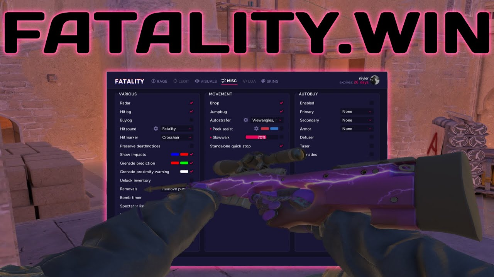

# Fatality — misc tab

## Summary

The menu of a closed-source commercial product (fatality.win), shown in a video thumbnail. Dense, wide, three-column settings layout on a navy-violet base with a single hot-pink accent. The framework behind it is not public; it is believed to be ImGui-like or a custom immediate-mode renderer, but that's unconfirmed. (The CS2 source turned out to be a custom retained-mode GUI; see [Fatality CS2 — menu drawing code](fatality-cs2-source.md).)

This is the first Fatality capture in the vault and the source of the rich [Style baseline](../implementation/imgui-style-baseline.md)'s default values. The owner's favourite is the [first tab in grey and indigo](fatality-rage-tab.md), and exact values are in the source note. This capture arranges its shades differently from both: the window is the lighter shade and the group boxes are barely distinct from it, where the source and the rage-tab captures use a darker body with lighter boxes. It may be a different build (a guess).

Feature names visible in the screenshot belong to the original product; this note describes layout and styling only.

## Layout

- **Header bar**: bold uppercase wordmark at left; six icon + uppercase-label tabs; active tab in light text with a short accent underline; profile block at right (username, meta line in accent, round avatar).
- **Content**: three equal columns, each a group box with an uppercase header (light gray) above its rows.
- **Rows**: label left in mid gray; controls right-aligned. Order of extras: gear icon → color swatch(es) → main control.
- Some labels have a small accent dot before them (likely marks a row with a keybind or condition; purpose unconfirmed).
- Wide aspect (~730×500 px in a 1280×720 frame).

## Palette

Sampled with `tools/sample_colors.py` from a compressed 1280×720 thumbnail: approximate.

| Role | Hex | Notes |
|---|---|---|
| Outer border | `#101227` | 1 px frame around the window |
| Window base | `#191635` | header and body |
| Group-box surface | `#171229`–`#161736` | barely distinct from base |
| Inset / control bg | `#110f24` | checkboxes, combos, slider track |
| Text primary | `#e8dbe4` | wordmark |
| Section header | `#c1c0d0` | uppercase group headers |
| Label | `#8f8ea0` | row labels |
| Inactive tab | `#4c486d` | dim nav items |
| Accent | `#ec035c` | slider fill, checks, underline |
| Accent (anti-aliased / dim) | `#ac2560`, `#84225b` | edges of thin accent marks |

A pink outer glow surrounds the window in the thumbnail; it may be a thumbnail effect rather than part of the menu.

## Widgets

- [Checkboxes](../widgets/toggles-and-checkboxes.md): small inset square; checked = accent checkmark only.
- [Sliders](../widgets/sliders.md): thin accent-filled bar with centered "70%" value text.
- [Combos](../widgets/combos-and-dropdowns.md): inset field with chevron; multi-select shows a truncated comma list.
- [Color swatches](../widgets/color-pickers.md): small rounded rectangles, up to two per row.
- [Tabs](../widgets/tabs-and-navigation.md): header icon tabs with underline.
- [Group boxes](../widgets/group-boxes.md): three columns.

## What makes it work

- One accent, used only for state (checked, active, filled). Everything else is navy and gray.
- Every row the same height, every control right-aligned to the same edge: the columns read as a clean grid.
- Uppercase small headers create hierarchy without extra lines or boxes.
- Very small value differences between surfaces keep it calm.

## What to avoid / weaknesses

- Label contrast (`#8f8ea0` on `#191635`) is fine but the inactive tabs (`#4c486d`) are borderline low; raise slightly for readability.
- Group boxes are nearly invisible against the base; fine for this look, but add a 1 px border if you need clearer separation.

## Implementation notes

Start from [Style baseline](../implementation/imgui-style-baseline.md) (its default palette is this one), use `CheckRow`, `AccentSlider` from [Custom widgets](../implementation/custom-widgets.md), header tabs per [Tabs and navigation](../widgets/tabs-and-navigation.md), optional glow from [Draw-list recipes](../implementation/drawlist-recipes.md).

Related: [Color and contrast](../principles/color-and-contrast.md), [Layout and density](../principles/layout-and-density.md), [neverlose-ui](neverlose-ui.md)
