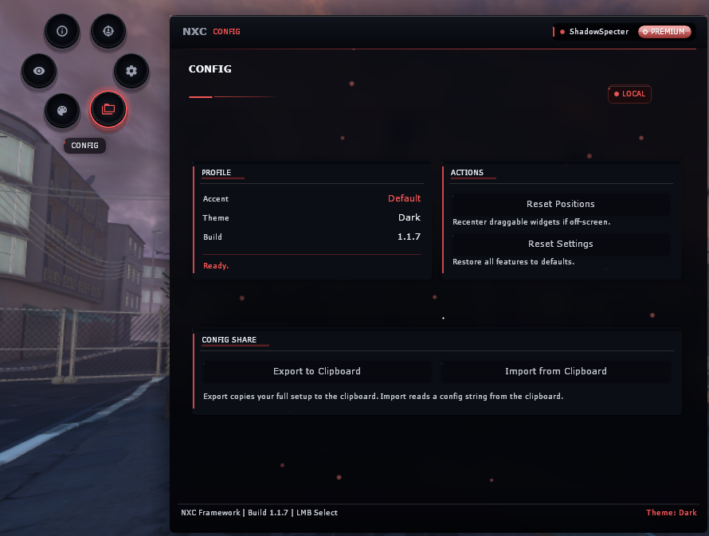
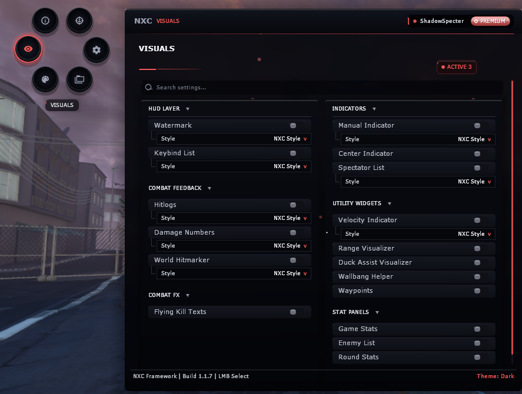
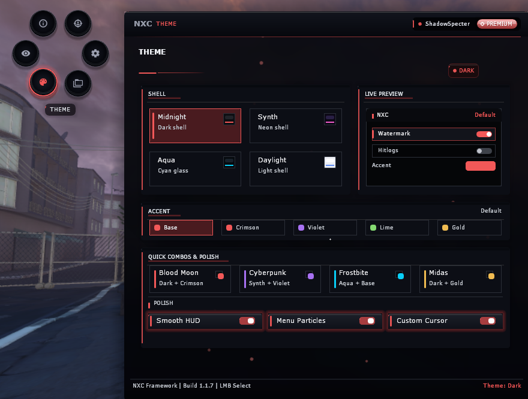

# Fatality community — NXC config and HUD settings

## Evidence and attribution

Original PNGs downloaded from the creator's public showcase, inspected on 2026-11-16. The screenshots identify build **1.1.7**. This is **NXC.Lua, a community framework for Fatality**, not stock Fatality UI. The page's publication date is not established.[7]

## Config page

A top pair of cards separates profile metadata from actions. A lower full-width card pairs clipboard export and import. Reset Positions is distinct from Reset Settings, with short descriptions explaining the scope of each. The page includes a local-status badge, a readiness line and build/theme metadata.[7]

This screenshot has **no visible named-profile list or Save button**. It is evidence for clipboard sharing and layout reset UI, not a complete save/load system.[7]

## HUD settings page

The body uses two columns of collapsible sections. Each family groups its enabling control with an inset style selector. A settings search field spans the page above the columns. A vertical scrollbar remains visible at the right.[7]

The captured controls include watermark, keybind-list, feedback, indicator and statistics groups. They are **settings**, not rendered examples of the actual in-game panels; do not claim the screenshot verifies every advertised HUD style.[7]

## Theme page

A 2×2 preset grid sits beside a preview card; accent choices form one horizontal strip below; theme combinations and polish toggles sit in a lower group. Selected tiles have a tinted fill and colored border. Neutral reproduction labels: Theme A–D, Accent A–E.[7]

Approximate original-image pixels: window base **#0f0e14**, inset surface **#0c0e15**. These are local samples, not recovered theme constants.

## What to borrow / avoid

Borrow the separation of layout reset from settings reset, the inline explanatory copy and compact enable+style grouping. Avoid assuming a public screenshot proves clipboard import validation, persistent saving, or any runtime behavior. The decorative radial navigation is unrelated to stock Fatality's tab bar.

## Sources
[7] https://nxc-lua.com/showcase — NXC Lua creator showcase

Related: [Config profiles](../widgets/config-profiles.md), [Settings search](../widgets/settings-search.md), [Fatality source reference](fatality-cs2-source.md), [Media sweep](../visuals/reference-media-sweep.md)
