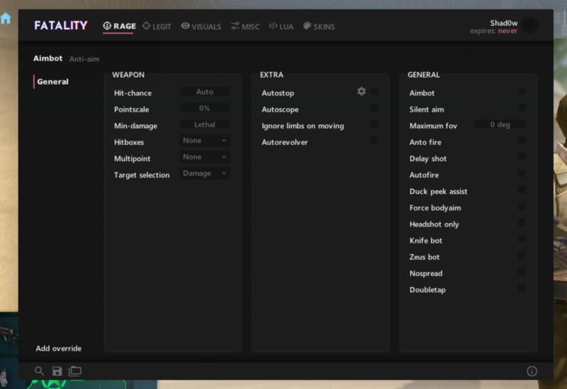
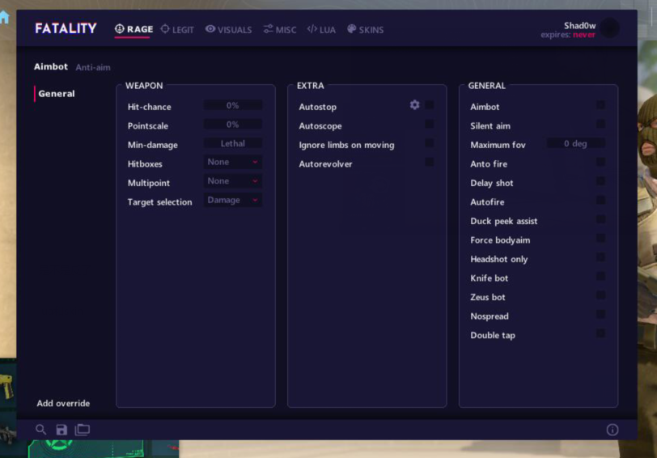

# Fatality — first tab, grey and indigo

## Summary

The first tab of the Fatality menu, captured twice: once on a **charcoal grey** base and once on a **deep indigo** base, with the same pink-red accent and the same layout. **The owner names this their favourite colour scheme, and the best overall picture of what they want from a GUI without transparency.** (For transparency, they point to Neverlose instead: see [Neverlose — five colour themes](neverlose-themes.md).)

The two captures differ only in colours, so the layout can be one design with two background sets. Feature names in the screenshots belong to the original product; this note describes layout and colour only, with placeholder labels. Exact values from the product's source are in [Fatality CS2 — menu drawing code](fatality-cs2-source.md); the palette sampled below agrees with them.

## Layout

About 770 × 505 px in the capture, square corners, fully opaque.

- **Header bar** (about 48 tall): bold uppercase wordmark with wide letter spacing at the left; six tabs, each an icon plus an uppercase label. The active tab is bright with a short 2 px accent underline; inactive tabs are dim grey. At the right, a profile block: name in bold white, a second dim line whose value is in the accent ("expires: **never**"), and a round dark avatar.
- **A 1 px dark line** (`#0d0d0d` / `#0a0a14`) separates the header from the body.
- **Sub-tabs** (top left of the body): two plain text items, the active one bold white, the other dim. No underline or pill.
- **Section column** (left, about 100 wide): a list of section names. The selected one is bold white with a **2 px accent bar** at its left edge. An "Add …" text action is pinned at the bottom of the column.
- **Three panels** side by side, about 200 wide each, filling the height of the body. Each has an uppercase title at its top left, sitting **on the top border** (the source shows a small break in the border behind it), then rows.
- **Rows**: about 23 px apart. Label at the left in near-white; the control at the right edge of the panel:
  - **value fields** (about 70 × 14): an inset rectangle in the body colour with the value centred in dim text ("Auto", "0%", "Lethal"). These are probably sliders at their minimum or with a text override; guessed, not confirmed.
  - **combos**: the same inset field with the value left-aligned and a small accent chevron at the right.
  - **checkboxes**: a tiny inset square (about 10 px) at the right edge, empty when off.
  - a **gear icon** before the checkbox on rows with extra settings.
- **Footer bar** (about 28 tall, header colour): search, save and folder icons at the left, an info icon at the right.

## Palette

Sampled with `tools/sample_colors.py` from the owner's screenshots (PNG, slight scaling): fairly accurate for flat areas. The accent marks are 1–2 px thin, so their samples are blended with the background; the source confirms the real accent is `#eb055a`.

| Role | Grey | Indigo | Notes |
|---|---|---|---|
| Body (window base) | `#151515` | `#110f24` | behind panels and the section column |
| Header, footer, panels | `#1c1c1c` | `#191635` | one shade for all raised surfaces |
| Panel edge | `#141414` | `#211e3d` | grey: a darker edge; indigo: a lighter one |
| Inset field / checkbox | `#141515` | `#110f24`–`#121027` | same as the body: fields are "holes" through the panel |
| Header separator | `#0d0d0d` | `#0a0a14` | 1 px |
| Text primary | near-white | near-white | labels, active tab, panel titles |
| Text dim | mid grey | grey-violet | inactive tabs, sub-tab, value text in fields |
| Accent (thin marks, blended) | `#b96371` | `#a22063` | underline, section bar, chevrons, "never" |
| Accent (true value) | `#eb055a` | `#eb055a` | from the source |

The indigo values match the misc tab capture (`#191635`, `#110f24`), which confirms that palette.

## Widgets

- [Tabs and navigation](../widgets/tabs-and-navigation.md): header icon tabs with an underline; text sub-tabs; a section list with a left accent bar.
- [Group boxes](../widgets/group-boxes.md): three full-height panels, title on the top border, 1 px edge.
- [Toggles and checkboxes](../widgets/toggles-and-checkboxes.md): tiny inset squares at the right edge (variant A).
- [Combos and dropdowns](../widgets/combos-and-dropdowns.md): inset field with an accent chevron.
- [Sliders](../widgets/sliders.md): shown here only as an inset value field (see above).
- [Row settings popup](../widgets/row-settings-popup.md): gear icon before the checkbox.

## What makes it work

- **Three surface levels, not more**: body (darkest), raised surfaces (header, footer, panels, one shade lighter), and inset controls cut back down to the body colour. This is the "contrast between surfaces and controls" the owner likes, with no shadows or transparency.
- **The palette is just two shades plus an accent**, so swapping grey for indigo is a two-value change. Any other hue (green, blue) would work the same way.
- **Accent used only for "where you are"**: active tab underline, selected section bar, combo chevrons, one status value. Off checkboxes have no accent at all.
- Uppercase wordmark, uppercase tabs and uppercase panel titles give hierarchy without extra lines.
- Every control right-aligned to the panel's edge, every row the same height: clean columns.

## What to avoid / weaknesses

- Off checkboxes are almost invisible (inset square on a panel only 7 levels lighter). Fine for a dense menu, but give them a 1 px edge if they need to be found quickly.
- The value fields don't say what kind of control they are (slider, number, text). Add a fill or a thumb when the value isn't at its minimum.
- Lots of empty panel space below short lists; panels fill the height whatever their content.

## Implementation notes

Start from [Style baseline](../implementation/imgui-style-baseline.md). Its defaults are the misc tab's sampled palette, which puts the lighter shade on the window, so for this look set `WindowBg` to the body colour (`#110f23`), `ChildBg` to the panel colour (`#191534`), `FrameBg` back to the body colour for the inset look, and the accent to `#eb055a` (exact values from the [source](fatality-cs2-source.md)). Header tabs per [Tabs and navigation](../widgets/tabs-and-navigation.md); checkboxes and combos from [Custom widgets](../implementation/custom-widgets.md). Keep both palettes as named presets.

Related: [Fatality CS2 — menu drawing code](fatality-cs2-source.md), [Fatality — misc tab](fatality-misc-tab.md), [Neverlose — five colour themes](neverlose-themes.md), [Color and contrast](../principles/color-and-contrast.md), [Layout and density](../principles/layout-and-density.md), [Group boxes](../widgets/group-boxes.md)
