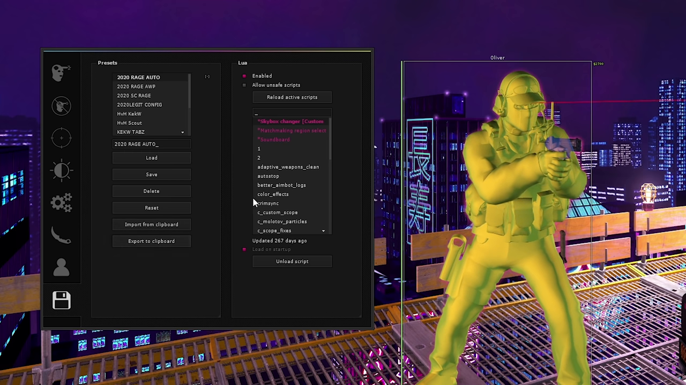
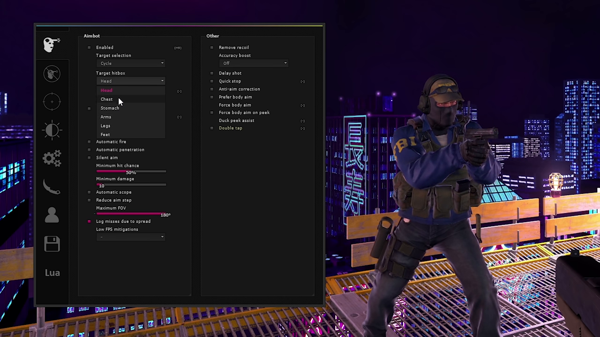

# gamesense — preset page and inline key fields

## Evidence

Inspected legacy CS:GO review, published **2021-01-21**. Read this as a historical UI reference, not evidence of the current CS2 product.[3]

## Configuration layout

The left card contains a scrolling preset list, a name field, then a single-width stack of Load, Save, Delete, Reset, Import from clipboard and Export to clipboard actions. A separate script-management card occupies the right column; it is not part of the preset list.[3]

This is the **explicit-action page** alternative to Neverlose's popup: a selected record and its actions are always visible together. The list, name field and action column share an alignment axis. The selected name appears both in the list and in the editable field.[3]

## Key fields

The **01:35** frame shows tiny bracketed fields aligned at row ends, including a bound mouse-button label and unbound tags. These use text rather than a large standalone keycap, leaving the label and checkbox visually dominant.[3] The captured frame does **not** establish capture cancellation, mouse-button exclusions or mode-menu behavior.

## Palette and density

Approximate compressed-frame samples: card base **#171717**, button interior **#1f1f1f**. Thin rectangular borders, square checks and restrained accent text keep the page dense. Avoid replacing the bracket tags with large rounded buttons when reproducing this specific style.

## Reusable lessons

For neutral examples, use profiles General, Display and Audio, and row labels Option A / Option B. In a new design, separate destructive reset/delete actions from routine save/load; the original screenshot's equal-weight action stack is visually economical but easy to misuse. That separation is a recommendation, not a feature shown here.

## Sources
[3] https://www.youtube.com/watch?v=6WYeedbSXfM — Gamesense legacy review

Related: [gamesense menu](gamesense-menu.md), [Keybinds](../widgets/keybinds.md), [Config profiles](../widgets/config-profiles.md), [Media sweep](../visuals/reference-media-sweep.md)
