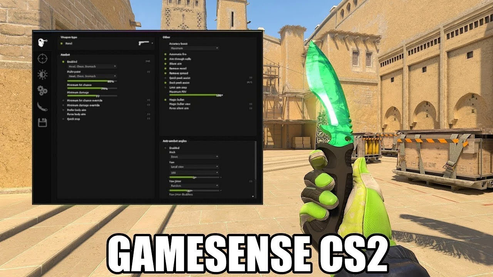
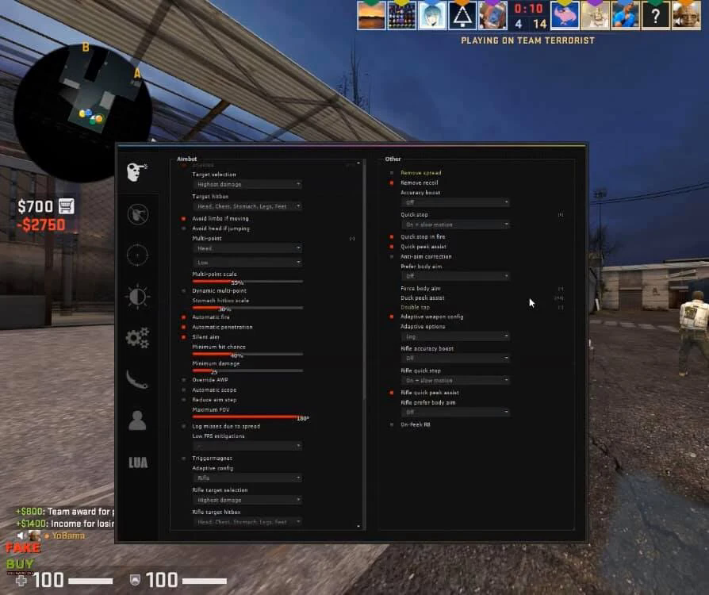
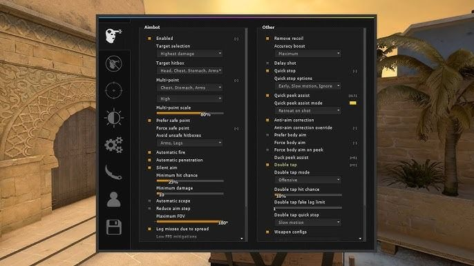
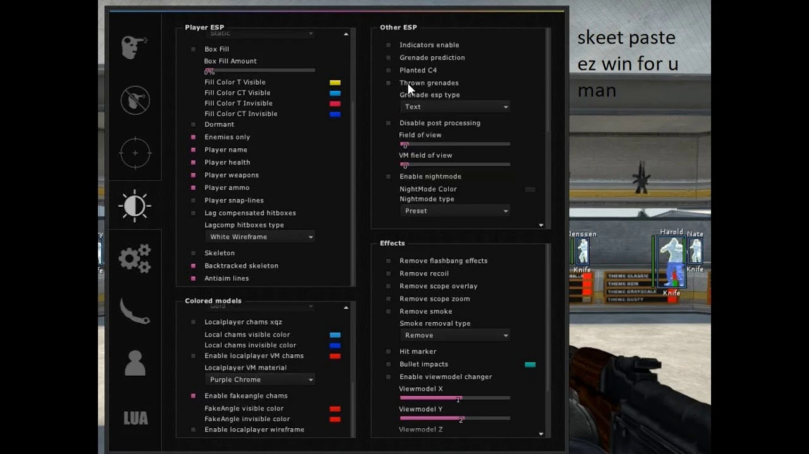
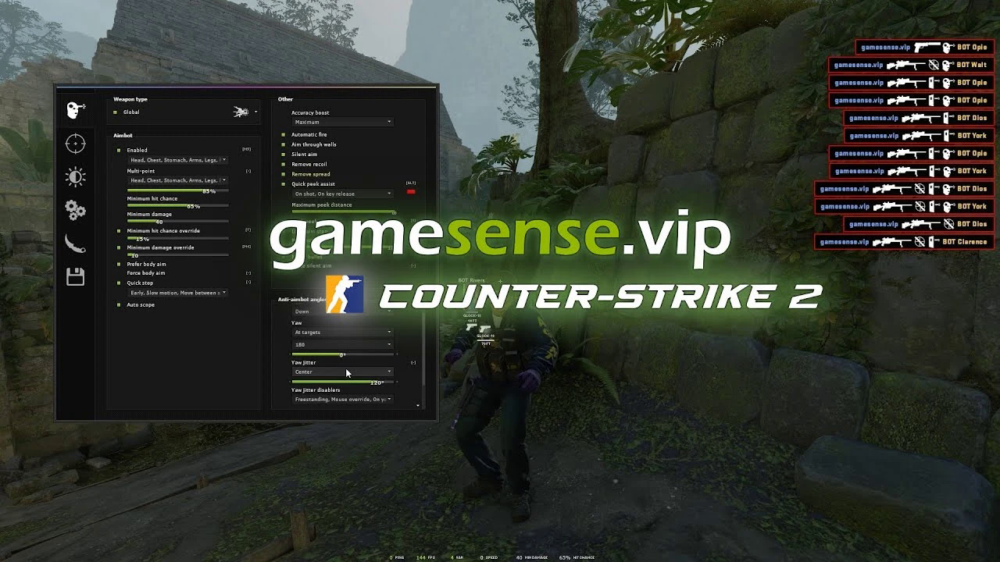

# gamesense — main menu

## Summary

The classic "skeet" menu: near-black, flat, tiny type, an icon rail on the left, and a thin multi-hue stripe across the top. Almost everything is a 1 px line or a flat fill. Color appears only in the accent (checkbox fill, slider fill) and the top stripe. It is a distinctive style the owner asks for by name, not a default: use it when a request says gamesense or skeet. (The generic minimal baseline is [velocity.cat](velocity-cat-menu.md).) Code: [gamesense-style menu](../implementation/gamesense-style-menu.md).

Sources:

- **Screenshots** (the real look). Five frames from videos, all upscaled or compressed, so sizes are ±1 px and colors approximate. The accent changes between them (green, red, orange, pink), which shows the accent is the only user color.
- **The repo** is a third-party 2019 recreation on Dear ImGui 1.53 with ImGui's own source edited in place. No license, so it is studied, not copied. Only its drawing code was read: the window frame, group box, checkbox, slider and combo edits in `ImGui/imgui.cpp`, and `Gui/Gui.cpp` for the style. Its values are noted below where they help, but the screenshots win where they differ.

| | |
|---|---|
|  |  |
|  |  |

## Layout

- **Window**: fixed size, about 4:3 (roughly 600 × 505 in the red capture). No title bar, no visible title text.
- **Frame**: a 5 px bevel around the whole window, sampled as dark / light / mid / light / dark (`#101010 #2e2e2e #252525 #2e2e2e #111111`). The repo draws the same idea as six nested 1 px rects (black, `#1a1a1a`, three of `#282828`, `#1a1a1a`). This bevel is the only "depth" in the whole menu.
- **Top stripe**: a 2 px line just inside the frame, the full width of the window: a bright line over a dimmer one. The hue runs cyan → magenta → yellow-green left to right. It's the product's signature; everything else is grey.
- **Icon rail**: about 75 px wide, darker than the content (`#0a0a0a`). Large (about 32 px) grey glyphs, one per tab, about 64 px apart. The **selected tab** is not highlighted with color: its cell takes the content's color and the rail's right-hand divider line breaks around it, so the tab "opens into" the page. The selected icon is near white; the others are dim grey.
- **Content**: two columns of group boxes with about 15–20 px gutters. A column can hold one tall group or two stacked groups; groups scroll on their own when they overflow (thin 4 px scrollbar, small arrows at both ends).
- **Group box**: fill `#111111` on a `#101010` page, so the box is defined almost entirely by its **1 px `#2d2d2d` border**. The title is bold, near white, top-left. In the classic layout it sits on the top border with the line broken under it; the CS2 frames put it just inside the box instead.
- **Rows**: two columns inside a group. A narrow column holds the checkbox square; labels start at a fixed indent (about 20 px from the box) whether or not the row has a checkbox, so every label lines up. Controls under a label (combo, slider) start at the same indent and are a fixed width (about 150 px), much narrower than the group. The right edge of the group holds key tags (`[-]`, `[HP]`) and color swatches, right-aligned.

## Palette

| Role | Hex | Notes |
|---|---|---|
| Rail / window base | `#0a0a0a` | sampled, red capture |
| Page (content background) | `#101010` | sampled |
| Group fill | `#111111` | sampled; one step above the page |
| Group border | `#2d2d2d` | 1 px, sampled |
| Frame bevel | `#101010 #2e2e2e #252525 #2e2e2e #111111` | outside → inside, sampled |
| Combo fill | `#212121` | sampled; the repo uses `#303030` with a lighter `#404040` value cell |
| Slider track | `#333333` | sampled |
| Checkbox off | `#36383a` | sampled; the repo uses a vertical gradient `#31332f` → `#20211f` |
| Text (labels) | `#cac8c9` | brightest label pixels |
| Title | `#d6d4d5` | bold |
| Key tag | `#646464` | `[-]` markers |
| Accent (green) | `#74db33` → `#4e9521` | top → bottom gradient, exact from the repo; the screenshots' green matches |
| Accent (red capture) | about `#c0362c` | approximate; one of the user presets |
| Warning label | about `#a2a198` | a label tinted yellow-grey for a risky option (seen once) |

## Widgets

- **Checkbox** ([Toggles and checkboxes](../widgets/toggles-and-checkboxes.md)): a tiny square, about 8 px, with a 1 px dark border. On = accent gradient (lighter top, darker bottom); off = dark grey gradient. No check mark. The label is plain text to the right and doesn't change color when on.
- **Slider** ([Sliders](../widgets/sliders.md)): label above; a thin track (about 6 px) with the accent gradient filling from the left; no thumb. The value is drawn in small bold text with a dark outline, **centered on the end of the fill and overlapping the track's lower edge**, so it moves with the value. Units are part of the value ("85%", "180°").
- **Combo** ([Combos and dropdowns](../widgets/combos-and-dropdowns.md)): label above; a flat dark box about 20 px tall with the current value (or a comma list for multi-select) in light grey, clipped, and a tiny filled down-triangle at the right.
- **Key tag**: `[-]` (unbound) or a short key name in brackets, right-aligned on the row, dim grey. No box.
- **Color swatch** ([Color pickers](../widgets/color-pickers.md)): a small flat rectangle (about 14 × 8) right-aligned on its row.
- **Tabs** ([Tabs and navigation](../widgets/tabs-and-navigation.md)): the icon rail described above.

## What makes it work

- **Restraint.** Grey on grey, 1 px lines, one accent. Nothing competes with the labels, so a dense page of 30+ options stays readable.
- **Two-column rows.** A checkbox column plus a fixed label indent means labels form one clean left edge whether a row has a checkbox or not.
- **Narrow controls in wide groups.** Combos and sliders are fixed at about 150 px, so the eye doesn't travel and the right edge stays free for key tags and swatches.
- **The value rides the fill.** The slider needs no thumb or value box; the number sits where the fill ends.
- **One signature detail.** The top stripe is the only decoration, and it's enough to make the menu recognizable.
- **Selection by merging, not by color.** The selected tab joins the page, which is calmer than an accent highlight.

## What to avoid / weaknesses

- Text is tiny (about 11 px) and low-contrast labels on `#111111` get hard to read on high-DPI screens. Scale with the display, don't copy the pixel size.
- Group boxes barely differ from the page (`#111111` on `#101010`); without the border they vanish. Keep the border.
- No hover states to speak of. Add a subtle label brighten on hover when you build it.
- The repo edits ImGui's own source (`imgui.cpp`) to restyle widgets. Don't do that: write the widgets as functions, as the [recipe](../implementation/gamesense-style-menu.md) does.

## Implementation notes

[gamesense-style menu](../implementation/gamesense-style-menu.md) (`code/gamesense_menu.h`): palette, `ApplyStyle`, the beveled frame with the stripe, the icon rail, group boxes, checkbox, slider, combo, key tag and swatch, and a demo menu with placeholder labels.

Related: [References](INDEX.md), [Fatality — misc tab](fatality-misc-tab.md), [Pink sidebar menu](pink-sidebar-menu.md), [Layout and density](../principles/layout-and-density.md), [Color and contrast](../principles/color-and-contrast.md), [Style baseline](../implementation/imgui-style-baseline.md)
