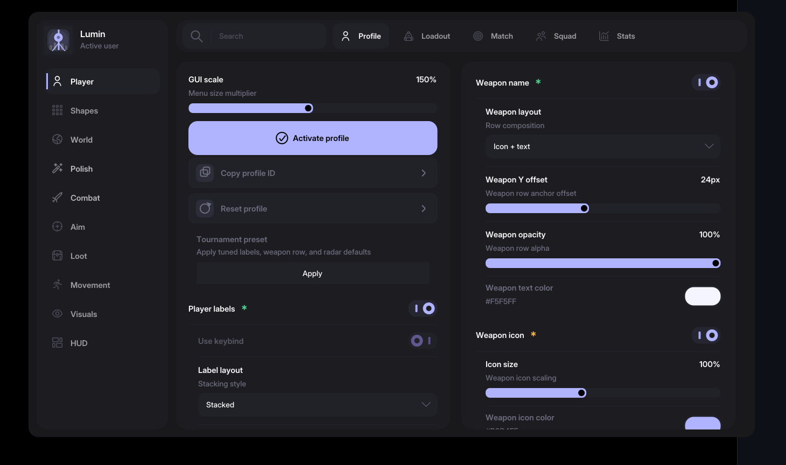

# Lumin framework — main menu

## Summary

A C++20 Dear ImGui menu framework with a standalone Direct3D 11 demo (MIT). It has a soft, rounded, neverlose-like look: charcoal-violet surfaces, a pale periwinkle accent, a sidebar with icons, header sub-tabs with a search field, and two scrolling cards of tall rows where each row has a title, a grey description and a control. It runs in its own window and is UI only. The demo's login screen is a sample gate (`demo` is accepted). Values below are read from `framework/settings/*.h` and `framework/widgets/widgets.cpp`.

- Repo: https://github.com/poncippg-spec/Lumin-Free-Imgui-Menu (27 stars, last push 2026-08)
- Build: Windows, VS 2022, `framework.sln`, Release x64. ImGui, FreeType and stb are vendored.

## Layout

- Window 570 × 354 at scale 1, drawn at **150 % by default** (`dpi = 1.5`). Every size goes through an `s_()` scale helper, so the whole menu rescales from a "GUI scale" slider. Window rounding 12, padding 10.
- **Left sidebar** card: a brand block (logo tile, name, grey status line), then a vertical list of icon + label tabs. The selected tab gets a lifted fill and a short **accent bar on its left edge**.
- **Header strip** across the right: a wide search field, then sub-tabs (icon + label). The active sub-tab sits on a lighter rounded pill.
- **Content**: two cards side by side, each scrolling on its own. Rows are 40 px tall (toggle rows) and taller when a control sits under the title. 1 px separators (`#23232c` at 72 %) run between rows. Sub-rows are indented under a parent toggle row.

## Palette

Exact, from `colors.h` and the toggle code.

| Role | Hex | Notes |
|---|---|---|
| Window base (`layout`) | `#19191c` | |
| Card (`child`) | `#1c1c21` | one step above the base |
| Control bg (`widget`) | `#212128` | slider tracks, dropdown fields, toggle track when off |
| Border / separator | `#23232c` | separators drawn at 72 % alpha |
| Text primary | `#ffffff` | titles, values, the active tab |
| Text secondary (`text`) | `#6e6e81` | descriptions, inactive tabs; an off toggle's title is drawn at 82 % of it |
| Accent | `#b0b4ff` | pale periwinkle: slider fill, primary button, toggle knob when on |
| Toggle track when on | `#262532` | a dark violet tint, *not* the accent |
| Toggle knob when off | `#60588e` | muted violet |

## Widgets

- **Toggle** → [Toggles and checkboxes](../widgets/toggles-and-checkboxes.md): a 36 × 21 pill with a 7 px knob that has a 3.65 px dark hole (a ring), and a small vertical tick on the opposite side of the track. The track stays dark when on; only the knob and tick turn accent. Position eases at speed 20, colours at 18. Each click also pushes a toast notification ("enabled"/"disabled").
- **Status marker** after a title: a small coloured asterisk (green, amber). Hovering it shows a tooltip with the row's description → [Tooltips](../widgets/tooltips.md).
- **Slider** → [Sliders](../widgets/sliders.md): title and description stacked on the left, the value (`150%`, `24px`) right-aligned on the title line, a full-width pill track under them with an accent fill and a **black knob dot** at the end of the fill.
- **Dropdown** → [Combos and dropdowns](../widgets/combos-and-dropdowns.md): title and description, then a full-width field (`#212128`) with the value on the left and a thin chevron on the right.
- **Colour row** → [Colour pickers](../widgets/color-pickers.md): title plus the hex value as the description, and a wide rounded pill swatch on the right. The picker draws a checker base for alpha, a segmented hue bar, and an SV square with 12 px rounding.
- **Buttons**: one large accent **primary button** (icon + label, dark text on the accent), with a click ripple: a circle grows (radius speed = width × 7) past the button edge, then fades. **Action rows** are icon tile + grey label + chevron on a `#212128` card; the accent fades in on hover (speed 9). A **card button** stacks title, description and a full-width dark button.
- **Keybind**, **text field** and **search filter** widgets also exist (not shown in the capture) → [Keybinds](../widgets/keybinds.md), [Settings search](../widgets/settings-search.md).

## What makes it work

- Three surfaces only a few levels apart (`#19191c` → `#1c1c21` → `#212128`) with no borders. Depth comes from fill steps, and the 1 px row separators carry the structure.
- One accent used for "this is on / this is the value" and nothing else. The on-toggle keeps a dark track, so a column of enabled toggles does not become a column of accent blocks.
- A title over a description on every row makes the list easy to scan without section headers.
- Animation state is kept per widget id (`anim_container<T>(id)`) and eased toward a target every frame, so nothing pops in.

## What to avoid / weaknesses

- Rows are tall (40 px and up) and the descriptions take a second line, so few settings fit on screen. That suits a launcher or settings app; a dense in-game menu needs the [layout and density](../principles/layout-and-density.md) rules instead.
- A toast for every toggle click gets noisy fast.
- The primary button is a big block of saturated accent, much heavier than anything else on the page.
- The sidebar's left accent bar plus the filled selected row is two selection cues for one state (an owner-approved pattern, see [Avoiding AI defaults](../principles/avoiding-ai-defaults.md), but one cue is enough here).

## Implementation notes

The framework wraps ImGui internals in its own `c_gui` / `c_draw` helpers (`item_size`, `item_add`, `button_behavior`, `easing`) the same way the [custom widgets](../implementation/custom-widgets.md) do. To borrow the toggle, port its geometry into a `RowBegin` row (see [menu_widgets.h](../implementation/custom-widgets.md)) and use [Animation helpers](../implementation/animation-helpers.md) for the per-id easing. Keep the dark on-track; it is the most reusable idea here.

Related: [Toggles and checkboxes](../widgets/toggles-and-checkboxes.md), [Sliders](../widgets/sliders.md), [Combos and dropdowns](../widgets/combos-and-dropdowns.md), [Colour pickers](../widgets/color-pickers.md), [Tabs and navigation](../widgets/tabs-and-navigation.md), [Motion](../principles/motion.md), [Neverlose — visuals page](neverlose-visuals-page.md), [neverlose-ui](neverlose-ui.md)
