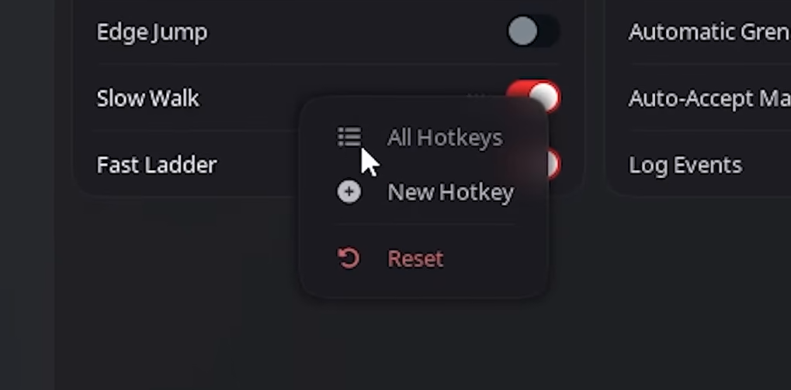
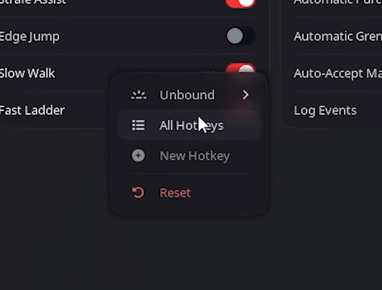
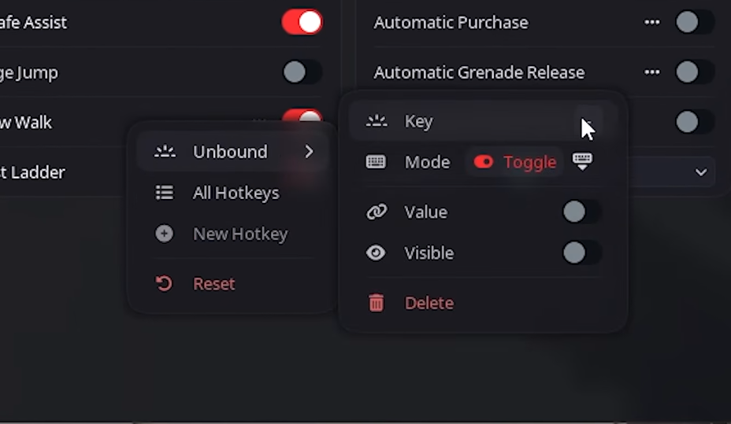
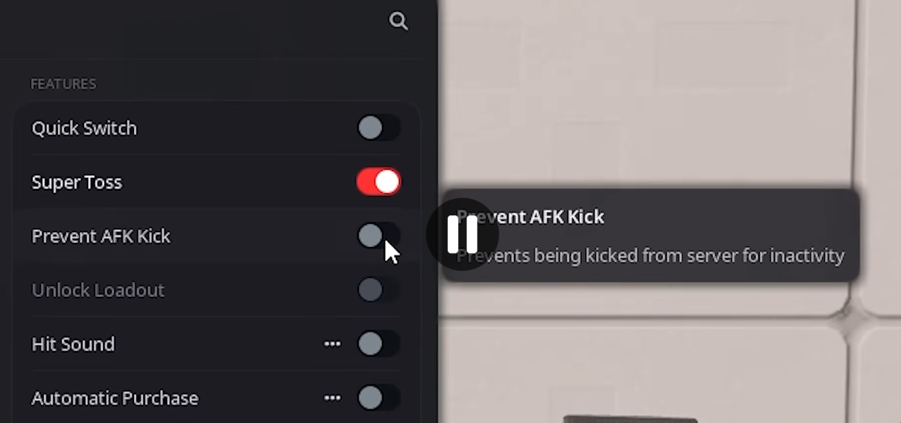
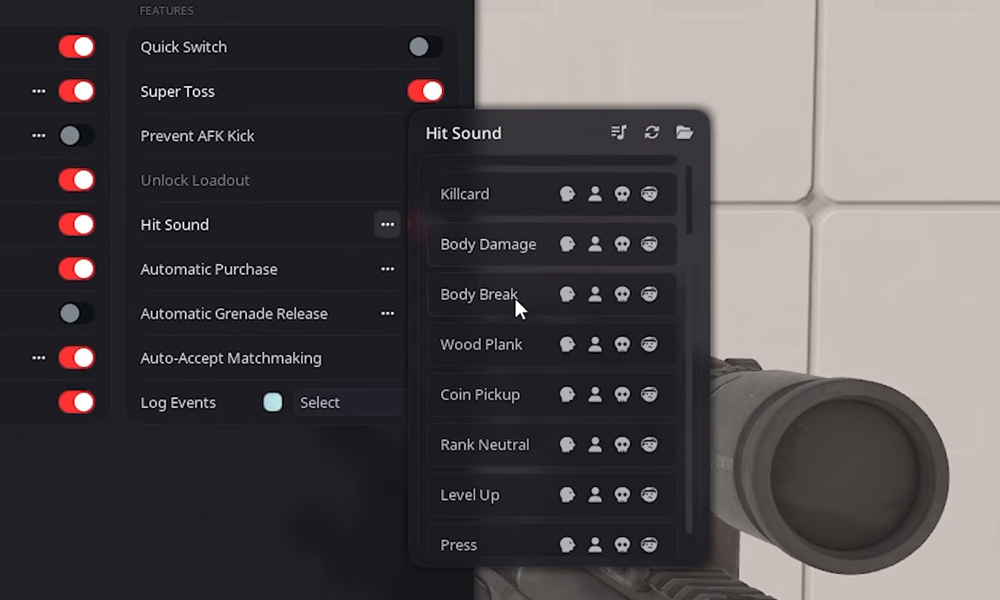
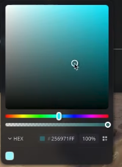

# Neverlose — hotkey menu, tooltips and list popup

## Summary

Popups from the neverlose menu that the owner rates as the best of their kind: the **right-click hotkey menu** with a hover submenu per hotkey, the **tooltip** that docks beside the menu, a **list popup** behind a row's "⋯" button, and the **color picker**. They share one look: a dark rounded panel, icon + label rows with a lighter hovered row, thin separators, and red used only for "on" states and destructive actions. Code: [Popup menus](../implementation/popup-menus.md).

The captures are video frames at different zoom levels, so proportions are measured and absolute sizes are estimated (taking a menu row as about 40 px). Colors are approximate.

## The hotkey flow

1. **Right-click any setting row** to open the hotkey menu at the cursor.
2. With no hotkeys yet, it shows **All Hotkeys** (dimmed), **New Hotkey**, a separator and **Reset** in muted red.
3. **New Hotkey** adds an entry called **Unbound** at the top of the menu, with an icon on the left and a `>` chevron on the right. New Hotkey now dims, so only one unbound entry exists at a time. That last point is inferred from the captures.
4. **Hovering the entry** opens its submenu to the right, top-aligned with the row:
   - **Key**: click it, then press a key. The right side shows the bound key, or an empty box.
   - **Mode**: a chip with a small switch icon and the mode name, both in red ("Toggle"), and a keyboard-with-arrow icon after it. That icon probably picks from a list of modes (unconfirmed).
   - separator
   - **Value**: a switch. The value the setting takes while the hotkey is active.
   - **Visible**: a switch. Whether the hotkey shows in the HUD [keybind list](../visuals/keybind-list.md).
   - separator
   - **Delete** in muted red with a trash icon.
5. Several hotkeys per setting are possible: each is one entry with its own submenu.

Why it works: the setting row stays clean (no key box on every row). Everything about a hotkey lives one right-click away, and each hotkey's details stay hidden until you hover it. Disabled items dim instead of disappearing, so the menu's shape never changes.

## Tooltip

- Appears beside the **menu window's right edge** (about 4 px out), vertically centered on the hovered row. It does not follow the mouse, so it never covers the row or the control.
- Two lines: a bold white title (the setting's name), then a sentence in light grey. About 12 px padding, radius about 8.
- Background: the popup color at about 85% opacity (`#38363a` measured over a light wall, consistent with `#1c1b21` at 85%), with a soft dark shadow.
- A disabled row (dim label, dim knob) still gets its tooltip, which is where a "why is this off" explanation can go.

## List popup ("⋯" on a row)

- The "⋯" button gets a small rounded highlight (`#2c2b31`) while its popup is open.
- The popup opens to the **right of the button**, top-aligned a row above it, overlapping the menu's edge.
- Header: bold white title on the left; three icon buttons on the right (list, refresh, folder).
- Body: a scrolling list of **cards**, one per entry: name on the left, four small icon buttons on the right (per-entry options; their meaning is unconfirmed). Cards are `#232228` with a 1 px lighter edge and about 8 px gaps; the list has a thin scrollbar at its right edge.

## Color picker

The owner's reference for how the menu's color picker should look. Measured on a 200 × 273 capture, close to native size:

- **Panel**: about 188 wide, radius about 8, padding about 8. It is **translucent**: its fill reads warm brown (`#37322f`) over a warm scene, so the backdrop tints it. Consistent with a dark fill at roughly 85% over a blur (the alpha is a guess).
- **SV square**: the full content width (about 172 × 170), radius about 8. The cursor is a small white ring with the current color inside.
- **Hue bar**: about 8 px tall, fully rounded. The knob is a **white pill**, taller than the bar.
- **Alpha bar**: the same size, a checkerboard under a transparent-to-color gradient. The knob is a white circle with a dark edge.
- **Bottom row**, left to right:
  - a format toggle ("∨ HEX") in dim text
  - a small square of the current color, then the value as hex with alpha (`#256971FF`), in a dark inset field
  - the alpha as a percentage ("100%") in its own field
  - a grid icon, probably for saved colors (unconfirmed)
- **Saved / recent colors** in a row of small rounded squares under it (one in the capture).

What makes it good: the controls stack in order of how often you use them (field, hue, alpha, exact value). Every edge is rounded the same, and the white knobs are the only bright things.

## Palette

| Role | Hex | Notes |
|---|---|---|
| Popup background | `#1b1a20` | hotkey menus, list popup |
| Popup edge | `#212127` | 1 px, slightly lighter than the fill; dark shadow outside |
| Hovered row | `#27262c` | rounded, inset from the popup edge |
| Mode chip | `#222228` | |
| Separator | `#212026` | 1 px, inset from both sides |
| Text | `#cfced4` | menu labels |
| Text, disabled | `#95949b` | |
| Icon | `#c1c0c7` | same tier as the text |
| Accent ("on") | `#ff3134` | switch track, mode chip icon and text |
| Destructive | `#b27378` | Reset, Delete: muted red, not the full accent |
| Switch off | track `#0f1116`, knob `#7c868f` | |
| Tooltip | `#1c1b21` at about 85% | over the scene |
| Row text (main menu) | `#e2e3ea` | brighter than popup text |

## What makes it work

- **Destructive actions in muted red**, separated by a line, at the bottom. They read as different without shouting.
- **Dim, don't hide.** All Hotkeys and New Hotkey dim when they don't apply.
- **Hover to drill in.** The submenu needs no click, and the chevron says it's there.
- **Docked tooltips** keep the area under the cursor clear and always appear in the same place.
- **Icons on every row** make the menus scannable; the labels are short.

## What to avoid / weaknesses

- Hover submenus are fiddly with a mouse that cuts diagonally across other rows; give the submenu a small grace period or a hover triangle.
- The keyboard-with-arrow icon in the Mode row has no label; its purpose isn't obvious.
- The four icon buttons on each list card are unlabeled; they need tooltips.

Related: [Keybinds](../widgets/keybinds.md), [Tooltips](../widgets/tooltips.md), [Row settings popup](../widgets/row-settings-popup.md), [Toggles and checkboxes](../widgets/toggles-and-checkboxes.md), [neverlose-ui](neverlose-ui.md), [Neverlose — HUD](../visuals/neverlose-hud.md), [Keybind list](../visuals/keybind-list.md)
