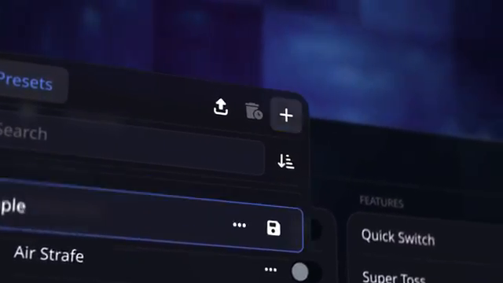
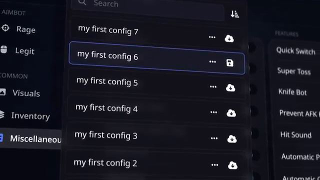
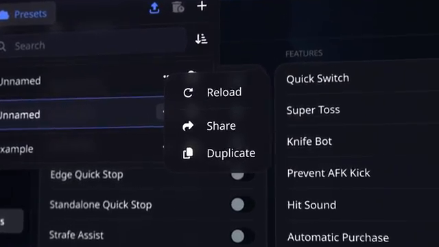
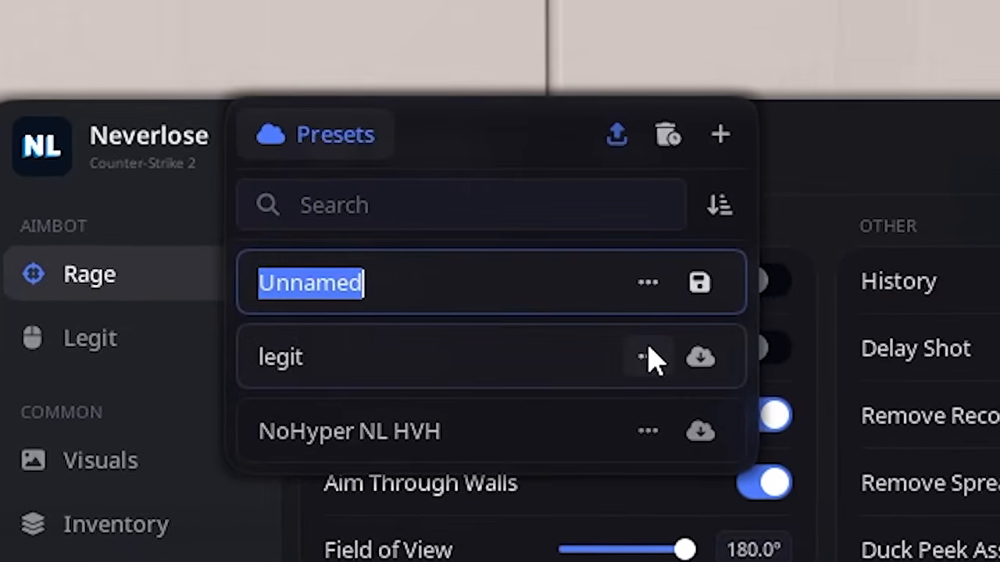
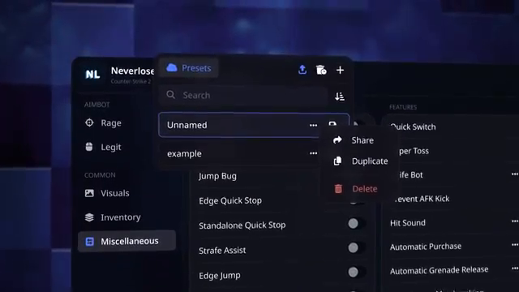

# Neverlose — preset manager and sharing

## Evidence

The official tutorial was published **2026-11-10**; its configuration chapter runs **00:22–01:58**. A second inspected video, published 2025-11-11, gives a much clearer close-up of inline renaming.[1][2] The newer tutorial frames are 640×360; the older close-up is 1280×720.

## Layout and controls

- The manager opens beneath the menu's current-profile area rather than consuming a permanent tab. It has a title/toolbar, search field, sort affordance and scrollable rows.[1][2]
- Each row combines the profile name, an overflow button and a compact save/cloud-shaped action. In the close-up, the selected row's name becomes an inline text field with a blue focus edge and a floppy-disk icon.[2]
- The **01:18** frame exposes Reload, Share and Duplicate in the row menu. The **01:54** frame places Delete below the ordinary actions in red.[1]
- The **01:24–01:48** sequence moves through a share link and web sharing flow.[1]

## Palette

Approximate pixels sampled from the compressed 2025 close-up: row surface **#1b1a23**, search surface **#191925**, muted blue title/icon pixel **#5865a2**. These are capture pixels, not product design tokens.

## Transferable design

Use neutral profile names such as General, Display and Audio. Keep selection, rename and save visually distinct. Put rare/destructive actions in the overflow menu. For a new design, show unsaved changes and confirm deletion without obscuring the selected profile.

## Sources
[1] https://www.youtube.com/watch?v=TE_AsKy5GBU — Neverlose official: Misc and Skinchanger Part 2
[2] https://www.youtube.com/watch?v=jxzYimZ2Dns — NoHyper: Neverlose update showcase

Related: [Config profiles](../widgets/config-profiles.md), [Row settings popup](../widgets/row-settings-popup.md), [Media sweep](../visuals/reference-media-sweep.md)
