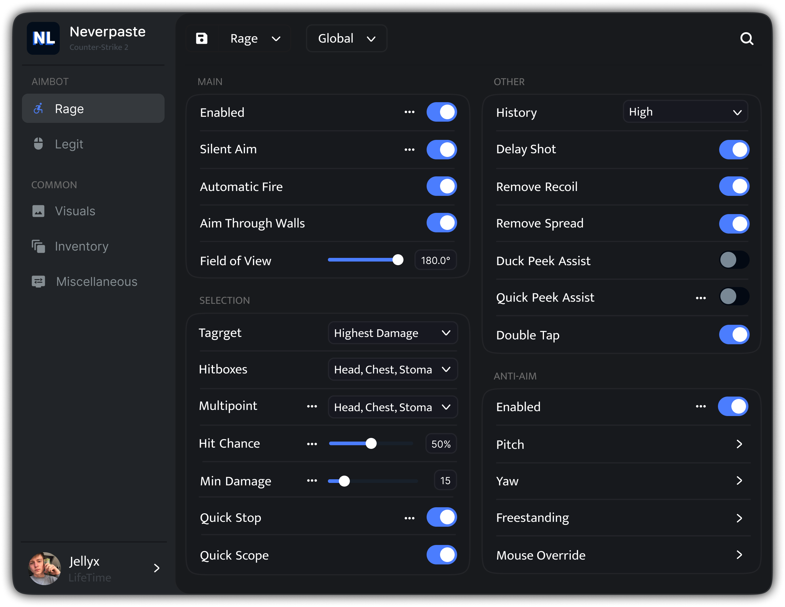
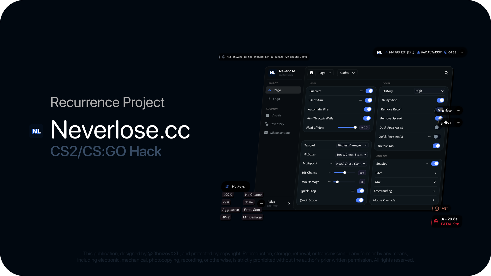

# Neverlose Recurrence — menu (Figma concept)

## Summary

A community **redesign concept** of the neverlose CS2 menu, drawn in Figma rather than captured from the product. It keeps neverlose's shell (brand block, grouped sidebar, profile chip, cards of rows), but swaps the red accent for a cool blue and makes every surface translucent with a hairline edge. The same file has the matching HUD set, written up in [Neverlose Recurrence — HUD](../visuals/neverlose-recurrence-hud.md).

**All values below are exact**, read from the decoded `.fig` document (Figma's binary "kiwi" format), not sampled from pixels. Sizes are in design units: the menu frame is 624 × 479. The PNG is a 4× export with 10 units of shadow padding on every side.

## Layout

- **Window**: 624 × 479, radius 12.5, fill `#080c10` at 90 %, a 1 px **inside** stroke of white at 5 %, a black drop shadow (radius 10, no offset) and a **20-unit background blur**.
- **Sidebar** (133 wide, the window's own fill, no separate panel):
  - **Brand block** at (12, 8): a 27 × 27 tile in `#030d1a`, radius 5, holding a white two-letter mark; the product name beside it in white, and the game name under it at 7 px in `#434951`.
  - A 1 px divider in `#16181c` under the brand block, inset 8 units each side.
  - **Section labels** in small caps, `#6c6c6c`, about 6 units tall. The first starts at y 54, the second at y 139.
  - **Nav items** 29 units apart: a 13-unit icon and an 11 px label, both `#858d92`.
  - **Selected item**: a 117 × 24 pill in white at 10 %, radius 5. The label turns white and **only the icon takes the accent**.
  - **Footer**: a divider at y 435, then a round 27-unit avatar, the user name (11.5 px, white), a second line in `#3c4046`, and a chevron at the right.
- **Content panel**: inset from the sidebar at x 133, 491 × 479, fill `#101012` at 50 %, the same 5 % hairline and radius. It reads as a second glass sheet over the first.
  - **Top bar** (43 tall): a joined control holding a save icon and a profile combo, separated by a 1 px `#1c1c1e` line (87 × 23, radius 5), then a second outline combo (67 × 23), then a search icon at the far right. A `#16181c` divider under it.
  - **Two columns of cards**, 234 and 230 wide, 9 units from the panel edge and 9 apart. A card is `#15141d` at 30 %, a 5 % hairline, radius 11.5.
  - **Section label** above each card, 13 units over its top edge.
- **Rows**: 30–31 units apart. The label is at x 12 (11 px), the controls are right-aligned to 12 units from the card edge, and a 1 px divider in white at 5 % sits between rows. The dividers are inset 12 units, so they stop short of the card's edges.

## Palette

| Role | Hex | Notes |
|---|---|---|
| Window | `#080c10` @ 90 % | 20-unit backdrop blur behind it |
| Content panel | `#101012` @ 50 % | over the window, so the two stack |
| Card | `#15141d` @ 30 % | |
| Field (combo, value box) | `#1c1b26` @ 40 % | |
| Hairline edge | `#ffffff` @ 5 % | window, panel, cards, fields, row dividers |
| Solid divider | `#16181c` | sidebar and top bar only |
| Brand tile | `#030d1a` | |
| Selected nav pill | `#ffffff` @ 10 % | |
| Text primary | `#ffffff` | labels, values |
| Nav label / icon | `#858d92` | |
| Section label | `#6c6c6c` | small caps |
| Dim second line | `#434951` / `#3c4046` | brand subtitle, footer |
| Accent | `#4b7dfe` | switch on, slider fill; icons use `#4b7bed`, a near-identical value |
| Switch off track | `#030913` | knob `#798895` (sampled) |
| Slider track | `#18202a` | |

## Widgets

- **Switch**: 25 × 16 stadium, `#4b7dfe` with a white knob when on; near-black `#030913` with a grey knob when off. See [Toggles and checkboxes](../widgets/toggles-and-checkboxes.md).
- **Slider**: a 3-unit track (`#18202a`) with an accent fill and a 9-unit white knob, about 70 wide, then a separate **value box** (`#1c1b26` @ 40 %, hairline, radius 5, 8 px text) right-aligned. On one row the slider runs to its maximum and the track is entirely fill. See [Sliders](../widgets/sliders.md).
- **Combo field**: 103–107 × 19, the field fill and hairline, radius 5, 10 px text and a small 6 × 3.5 stroked chevron. **A multi-select list that is too long fades out** with a horizontal gradient on the text (opaque until 86 %, clear at 92 %) instead of an ellipsis. See [Combos and dropdowns](../widgets/combos-and-dropdowns.md).
- **"⋯" row trigger**: three 2-unit white dots, 3 units apart, placed just left of the row's control. It shows which rows have extra settings. See [Row settings popup](../widgets/row-settings-popup.md).
- **Drill-in row**: a row with only a chevron (`>`) at its right edge, for a setting that opens a sub-page instead of holding a control.
- **Cards** with a small-caps label above them, not a title inside. See [Group boxes](../widgets/group-boxes.md).

## What makes it work

- **Three stacked glass sheets, one edge rule.** Window 90 %, panel 50 %, card 30 %: each layer is lighter mostly because it lets more of the layer below through. Every layer gets the same 1 px white 5 % inside edge, so the structure reads even where the fills are almost the same.
- **The accent appears only where a value is on.** Switch fills, slider fills and the selected nav icon. Labels, chevrons, value text and the selected pill are all white or grey.
- **Row dividers inset from the card edge** keep the card's rounded outline clean.
- **Text fade instead of an ellipsis** keeps the field's width fixed and still hints that there is more.
- **Small type everywhere** (11 px labels, 10 px fields, 8 px values) with generous 30-unit row pitch. Small text with loose spacing looks tidy, not cramped.

## What to avoid / weaknesses

- **Two accent values** (`#4b7dfe` for controls, `#4b7bed` for icons) are almost certainly an accident; use one.
- **Low-contrast hierarchy**: section labels (`#6c6c6c`) and nav text (`#858d92`) are close in value. Over a bright backdrop, 30 % cards can disappear entirely, because the only real separation is the 5 % edge.
- **Mixed fonts**: Mukta for labels, Inter for values, plus a Mukta Malar fallback on some rows. Choose one family. See [Typography and icons](../principles/typography-and-icons.md).
- The sidebar has no separate surface, so it depends on the content panel's edge to separate from the content.

## Implementation notes

The [glass sidebar menu](../implementation/glass-sidebar-menu.md) is the closest baseline: it already does low-alpha blurred layers and a sidebar. To match this design, add the 5 % inside stroke to the window, panel and cards (`AddRect` with the rect shrunk by 0.5 px). Give the panel and card their own fills over the window, and swap its tokens for the palette above. For the text fade on long combo values, draw the text clipped to the field, then cover its last 6 % with `AddRectFilledMultiColor` from clear to the field colour (or use the Fatality fade described in [Fatality CS2 — source](fatality-cs2-source.md)). The icons are Google Material Symbols (`accessible_forward`, `mouse`, `image`, `auto_awesome_motion`, `display_settings`, `save`, `search`).

Related: [Neverlose Recurrence — HUD](../visuals/neverlose-recurrence-hud.md), [Neverlose — visuals page](neverlose-visuals-page.md), [Neverlose — themes](neverlose-themes.md), [neverlose-ui](neverlose-ui.md), [velocity.cat — main menu](velocity-cat-menu.md), [Depth, glass and glow](../principles/depth-glass-and-glow.md), [Color and contrast](../principles/color-and-contrast.md), [Tabs and navigation](../widgets/tabs-and-navigation.md), [Toggles and checkboxes](../widgets/toggles-and-checkboxes.md), [Sliders](../widgets/sliders.md), [Combos and dropdowns](../widgets/combos-and-dropdowns.md), [Group boxes](../widgets/group-boxes.md), [Row settings popup](../widgets/row-settings-popup.md)
