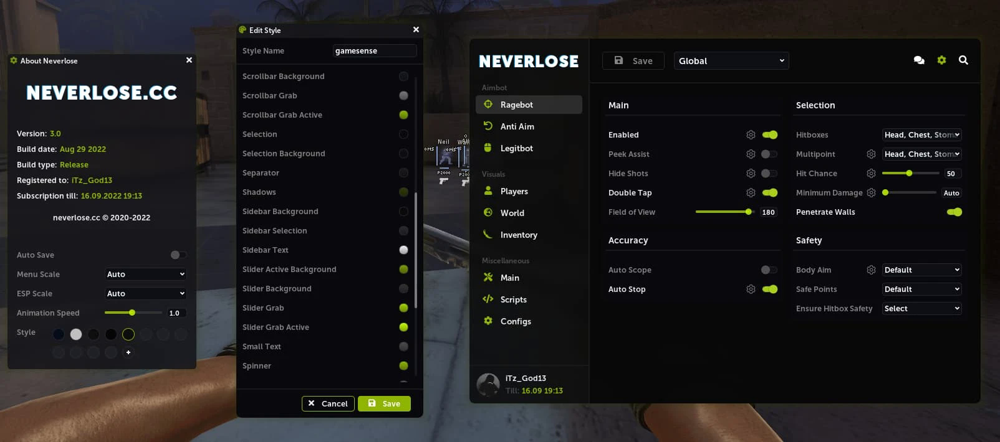
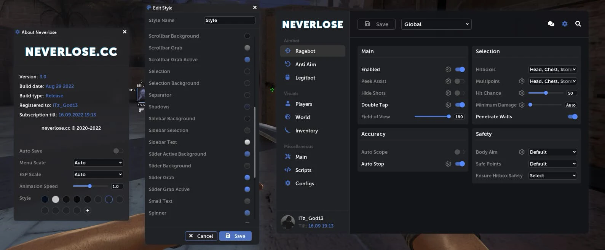
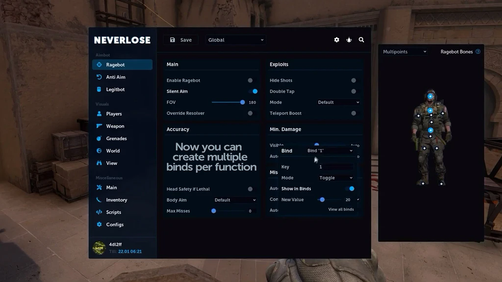
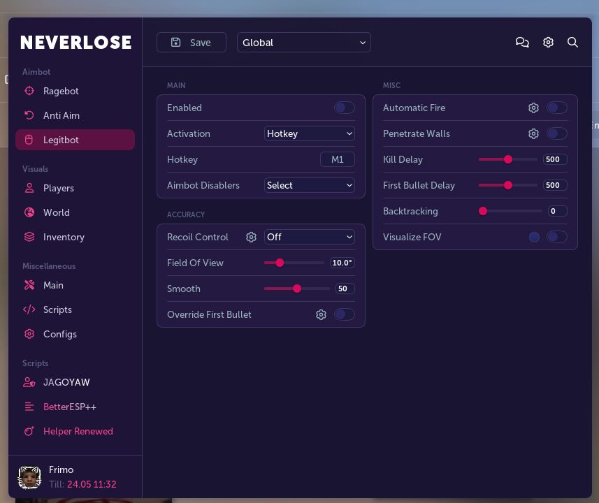
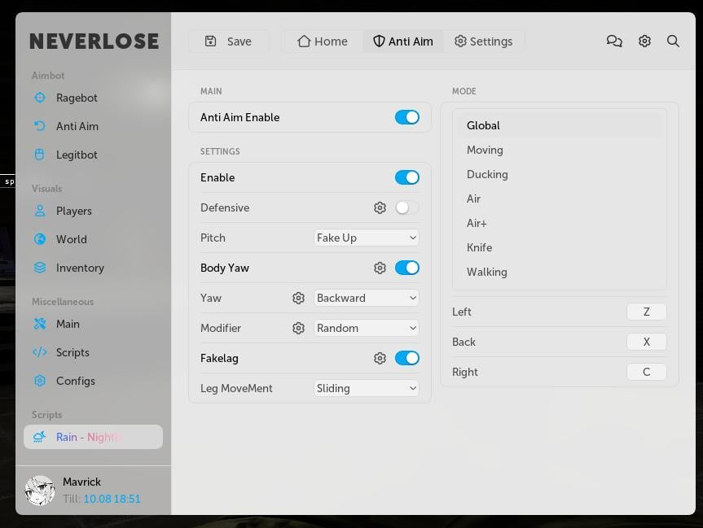

# Neverlose — five colour themes

## Summary

Five captures of the Neverlose menu, each in a different colour theme: lime on black, blue on charcoal, an older navy version with a **model preview with highlighted bone points**, pink on deep purple, and a **light, translucent** theme. The layout hardly changes between them: the same sidebar, top bar and two columns of settings groups. **Only the palette and the group-box style change.** That makes this the vault's main evidence that one layout with swappable palettes is enough.

The owner points to Neverlose for anything involving transparency, and to [Fatality](fatality-rage-tab.md) for an opaque menu.

Feature names in the screenshots belong to the original product; this note describes layout and colour only, with placeholder labels. Colours were sampled with `tools/sample_colors.py`; three captures are compressed WebP video frames, so treat all values as approximate, and translucent surfaces shift with the scene behind them.

## The shared layout

- **Sidebar** (about 190 wide): the bold uppercase wordmark at the top; navigation in groups, each under a small dim label; each item is an icon plus a label. The **selected item** is a rounded pill in a lighter or accent-tinted shade. A **profile footer** is pinned at the bottom: round avatar, name, and a dim second line whose value is in the accent.
- **Top bar** (no title): an outlined **Save** button (icon + label), a **profile combo** ("Global"), and three icon buttons at the far right (chat, settings, search). The settings icon is in the accent in the green and blue themes.
- **Content**: two columns of settings groups. Rows are about 31–37 px apart; label at the left, controls at the right: an optional **gear icon**, then the main control.
- **Row label brightness shows state**: rows that are on, or set, have white labels; rows that are off have dim labels. This is visible in every dark theme and costs nothing.

### Controls (all themes)

- [Toggles](../widgets/toggles-and-checkboxes.md): pill switches. On: accent track, white knob at the right. Off: dark track, grey knob.
- [Sliders](../widgets/sliders.md): thin track, accent fill, round accent knob, and a small **value box** to the right ("50", "180", "10.0°", "Auto").
- [Combos](../widgets/combos-and-dropdowns.md): dark field with a chevron; multi-select shows a comma list truncated at the field's edge.
- [Keybinds](../widgets/keybinds.md): a key shown in a small bordered box at the row's right edge ("M1", "Z").

## The five themes

### 1. Lime on black

- **Groups**: no card. A title in white, then a 1 px underline across the column; rows sit directly on the content background.
- Two extra windows sit beside the menu:
  - **About** window: product name in large bold capitals, a list of "Label: value" lines with the values in the accent, then settings rows: a switch, two combos ("Auto"), an animation-speed slider, and **Style**: a row of round preset swatches; the selected one has an accent ring, and a "+" swatch adds a new one.
  - **Edit Style** window: a name field at the top, then a scrolling list of **every colour role** as a label with a round swatch filled with that role's colour (scrollbar background, scrollbar grab, scrollbar grab active, selection, selection background, separator, shadows, sidebar background, sidebar selection, sidebar text, slider active background, slider background, slider grab, slider grab active, small text, spinner, and more). Footer: an outlined **Cancel** button and a filled accent **Save** button, each with an icon.

| Role | Hex |
|---|---|
| Sidebar | `#101114` |
| Content | `#080808` |
| Top bar | `#121318` |
| Group underline | `#0d0c11`–`#161616` |
| Selected nav pill | `#2c2c2c` |
| Accent (lime) | `#b2d61f` (`#acd60d`–`#b9e60a`) |
| Edit Style window | `#09080d` |
| About window | `#18171c` |

### 2. Blue on charcoal

- Same screen as the lime one, same About and Edit Style windows.
- **Groups**: **filled cards**, one shade lighter than the content, with the title in a row at the top of the card and a separator under it.

| Role | Hex |
|---|---|
| Sidebar | `#202226` |
| Content | `#131519` |
| Card | `#202226` (same as the sidebar) |
| Selected nav pill | `#343434` |
| Accent (blue) | `#4b8dfa` (`#6696ff` on the slider knob) |
| About window | `#28272a` |

### 3. Navy, with a model preview and bone points

An older version of the menu (video frame; the large text in the middle is a caption in the video, not part of the menu).

- **Groups**: filled cards like the blue theme, with a title row and a separator.
- **Selected nav pill**: a horizontal gradient from a brighter blue at the left to a darker one at the right.
- **Bind popup** (opened from a row): a title ("Bind") with a combo choosing which bind to edit (several binds per row are possible), then rows: Key (a field showing the key), Mode (combo: Toggle), "Show in list" (switch), New value (slider + value), and a "View all" text link at the bottom right. See [Keybinds](../widgets/keybinds.md).
- **Model preview window**, floating to the right of the menu (its own window, about 215 × 390, same dark surface):
  - Top bar: a combo at the left choosing a group, a title at the right, and a "?" help icon in the accent.
  - A full-body character model, front-on, idle, centred.
  - **Bone points**: every selectable point is a small **white "+" cross** on the model. **Selected points** are filled accent circles (about 10 px) with the white cross inside and a soft translucent accent halo. There are **no bone lines**, only points at the joints: head, neck, chest, stomach, pelvis, shoulders, elbows, hands, knees and feet.
  - This is the first capture in the vault of the bone highlighting the owner wants; see [Model preview](../widgets/model-preview.md).

| Role | Hex |
|---|---|
| Sidebar | `#0c141f` |
| Content / preview window | `#0a060e` |
| Card | `#020c17` |
| Selected nav pill | `#074377` → `#062f4e` gradient |
| Accent (bright blue) | `#04a2f9` |
| Bone point (selected) | accent fill, white cross, halo |
| Bone point (other) | white "+" |

### 4. Pink on deep purple

The closest Neverlose theme to Fatality's colours.

- **Groups**: a **small uppercase label above** each group, then an **outlined card** (1 px lighter edge) with **1 px dividers between rows**.
- **Selected nav pill**: an **accent-tinted** pill (dark magenta), white label, accent icon.
- A user-added sidebar group lists extra pages with their **icons and labels in the accent**.
- Off switches are a muted purple, not grey, so they belong to the palette.

| Role | Hex |
|---|---|
| Sidebar | `#1e1437` |
| Content | `#191432` |
| Card | `#231941` |
| Card edge | `#3c375f` |
| Selected nav pill | `#5c1143` (accent-tinted) |
| Accent (pink) | `#d70a5a` |
| Switch off | track `#1e1941`, knob `#2d2864` |

### 5. Light and translucent

- **Sidebar**: a translucent grey (frosted glass over the scene). Content area: a near-opaque light grey.
- **Groups**: the same "label above, outlined card, row dividers" style as the pink theme. The first card's row is a lighter white.
- **Top bar**: the profile combo is replaced by a **segmented tab group**: three segments with an icon and a label each, in one bordered strip; the active segment is shaded darker.
- **Right column**: a **list box** (a bordered inset list of presets, the selected row shaded) and below it rows with a **key in a bordered box** at the right.
- A user-added sidebar item has a pink-to-blue **gradient pill** with gradient text.
- Dark text on light surfaces; the accent is a bright cyan-blue on switches and the profile footer's value.

| Role | Hex |
|---|---|
| Sidebar (translucent) | `#b2b1af` |
| Content | `#e7e7e5` |
| Card | `#e6e6e6`, highlighted row `#f9f9f9` |
| Accent (cyan-blue) | `#02a4f7` |
| Switch knob | `#ffffff` |

## Three group-box styles

The themes use three ways to draw a settings group, worth keeping as options:

| Style | Seen in | Look |
|---|---|---|
| **Underline** | lime | title, 1 px line, rows on the page background; the flattest |
| **Filled card** | blue, navy | card one shade above the page, title row inside, separator under it |
| **Label above, outlined card** | pink, light | small caps label outside, 1 px edge, dividers between rows; the most structured |

## What makes it work

- **The palette is a short list of named roles** (the Edit Style list shows them). A theme is just new values for the same roles, so the whole menu re-themes at once.
- **Accent use stays the same in every theme**: switch tracks, slider fills and knobs, the selected nav icon, footer value, Save button. Changing the accent never changes what it means.
- **Surfaces stay close in value** (sidebar, content and card are a few levels apart), so the accent carries the visual weight.
- **Label brightness doubles as state**: you can scan a column for white labels to see what's on.
- In the light theme, translucency is used only on the sidebar; the content stays near-opaque so text stays readable.

## What to avoid / weaknesses

- **Lime and cyan accents are very bright** against near-black; they read well on switches but would be tiring on large areas. Keep them to small marks.
- In the blue theme the cards and sidebar share one shade, so the sidebar doesn't separate from the cards. Pick distinct values for each role.
- The model preview's points have **no labels**; hovering should name the point.
- The light theme's sidebar takes its colour from whatever is behind it, so its contrast varies. Add a tint layer under the blur so it never gets too light or too dark.

## Implementation notes

Define the palette as a struct of named roles (the Edit Style list is a good checklist) and keep several presets, as [velocity.cat](velocity-cat-menu.md) does. Shell and widgets: [Glass sidebar menu](../implementation/glass-sidebar-menu.md) and [Custom widgets](../implementation/custom-widgets.md). Bind popup: [Popup menus](../implementation/popup-menus.md). Translucency: [Depth, glass and glow](../principles/depth-glass-and-glow.md).

Related: [Fatality — first tab, grey and indigo](fatality-rage-tab.md), [Neverlose — visuals page](neverlose-visuals-page.md), [Neverlose — popups](neverlose-popups.md), [neverlose-ui](neverlose-ui.md), [Model preview](../widgets/model-preview.md), [Color and contrast](../principles/color-and-contrast.md), [Group boxes](../widgets/group-boxes.md)
