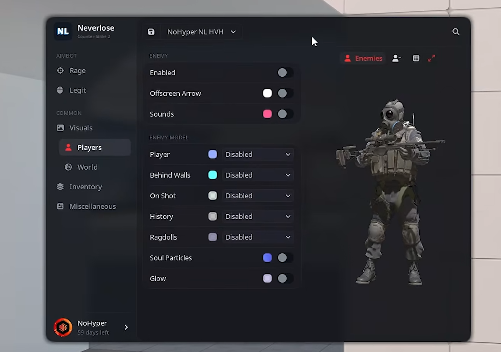
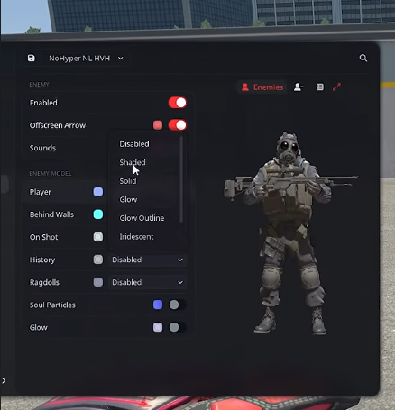

# Neverlose — visuals page with model preview

## Summary

The whole neverlose menu shell on its character-visuals page: a sidebar with grouped navigation, a slim top bar with a profile selector, settings cards on the left, and a **live preview of the character model** on the right. The owner wants this preview pattern in any visuals section about character models, **with bones highlighted**. This capture has no bone highlighting; the navy theme in [Neverlose — five colour themes](neverlose-themes.md) does. See [Model preview](../widgets/model-preview.md).

Video frames, about 1.1–1.2× native size (estimated). Sizes below are as measured on the capture. The window is translucent over the scene, so colors shift with what's behind it and are approximate.

## Layout

- **Window**: about 1100 × 845 on the capture, radius about 12, a soft shadow, translucent fill over a backdrop blur.
- **Sidebar** (about 235 wide, `#22252a`, a hair lighter than the content):
  - **Brand block** at the top: a dark rounded logo tile with a two-letter mark, the product name in bold white, and a tiny dim subtitle.
  - **Grouped navigation**: small uppercase dim section labels ("AIMBOT", "COMMON"), then items with an icon and a label, about 51 px apart. A parent item can expand into indented sub-items.
  - **Selected item**: a rounded pill (`#31343e`), white label, and a **red icon**. Unselected items have grey labels (`#b2b6bc`) and grey icons.
  - **Footer**: a round avatar, the user name, a dim second line, and a `>` chevron, pinned to the bottom.
- **Top bar** (about 75 tall): a square save button, then a **profile chip** (current profile name plus a chevron, in a bordered rounded rect), and a search icon at the far right. No title.
- **Content**: section labels in small dim caps above **cards** (`#1d1e24`, 1 px slightly lighter edge, radius about 8). Rows are about 54 px apart (about 47 native) with 1 px separators. A row has its label on the left and its controls right-aligned: a color swatch (rounded square about 22 px), then a switch or a combo field ("Disabled" plus a chevron, about 185 wide).
- **Preview column** (right half): no card, just the model on the content background. At its top right sit a **chip** for the active group (red icon and red text on a faint red-tinted pill) and three icon buttons: a second group, a list, and an expand arrow in red.

- **Combo list**: opens under the field, wider than the field's text, popup color, plain text rows (no icons), the hovered row in white, and a thin scrollbar.

## Palette

| Role | Hex | Notes |
|---|---|---|
| Sidebar | `#22252a` | |
| Content background | `#1c1d23` | top bar is the same |
| Card | `#1d1e24` | edge `#22232b`, row separators `#232228` |
| Selected nav item | `#31343e` | pill |
| Combo field | `#21222c` | |
| Section label | `#6e727a` | small caps |
| Nav label | `#b2b6bc` | selected: `#ffffff` |
| Row label | `#ffffff` | |
| Dim subtitle | `#696b71` | brand subtitle, footer second line |
| Accent | `#ff3035` | selected nav icon, active chip, switch on |
| Switch off | track `#0e1016`, knob `#80868d` | |

## What makes it work

- **Preview next to the settings it changes.** The model shows the result of the left column immediately, so the user never has to leave the menu.
- **Swatch + control on one row.** Every model setting has its color right next to it.
- **Accent only for "where you are" and "what's on"**: nav icon, active chip, switches.
- **Profile switching in the top bar**, always one click away, instead of in a settings page.

## What to avoid / weaknesses

- The preview column has no frame and no ground. The model floats, and on a busy backdrop it loses its edge. A subtle floor shadow or vignette would help.
- The preview's icon buttons have no labels; they need tooltips.

Related: [Model preview](../widgets/model-preview.md), [Neverlose — popups](neverlose-popups.md), [Tabs and navigation](../widgets/tabs-and-navigation.md), [Combos and dropdowns](../widgets/combos-and-dropdowns.md), [Color pickers](../widgets/color-pickers.md), [neverlose-ui](neverlose-ui.md)
