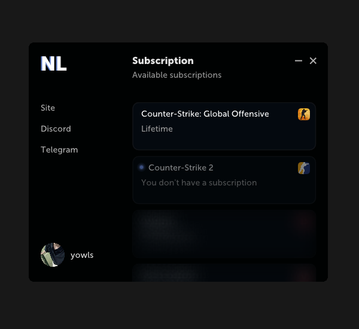
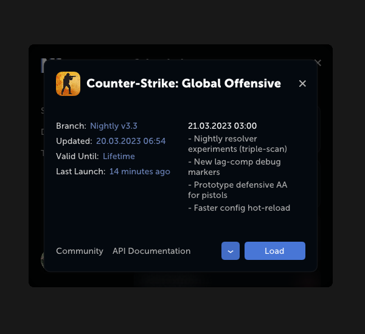

# NL loader — dashboard and product modal

## Summary

A recreation of the neverlose loader window (Win32, D3D11, Dear ImGui, C++20, MIT). It is a small launcher-style app rather than an in-game menu: a list of product cards and a detail modal. It is UI only; the "load" step only plays an animation. It is in the vault for its **near-black palette with a muted blue accent**, real **background blur** behind the modal and lower cards, and well-tuned **window open/close animation**. Values are read from `src/ui/Theme.h`, `Anim.h`, `Dashboard.cpp` and `GameModal.cpp`.

- Repo: https://github.com/rektov/NL (40 stars, last push 2026-08)
- Build: CMake presets on Windows (`cmake --preset default`). The non-UI logic (parsing, scroll, animation) has doctest unit tests that build on Linux too (`cmake --preset tests`).
- Font: Inter by default; the author optionally swaps in a commercial geometric sans.

## Layout

- Borderless window 500 × 400 inside a 600 × 550 host area, corner radius 15. No title bar: a bold two-letter wordmark top-left, minimise and close glyphs top-right.
- **Left column** (~150 px, no fill of its own): the wordmark, three plain text links, and an avatar + username pinned to the bottom.
- **Right column**: a page title (bold) with a grey subtitle, then a vertical list of **cards**, 80 px tall with 10 px gaps, rounded 10, 1.5 px outline. Each card has a title, a status line under it, and a 20 px icon tile (rounded 5) top-right. Cards for inactive items are drawn at 50 % and get a small dot before the title. Cards below the fold are **blurred**, not clipped.
- **Modal**: a card about 450 × 340 centred over the dimmed, blurred dashboard. Header: 40 px icon + bold title + close glyph. Body: two columns, a key/value list on the left (keys white, values in the link blue) and a dated changelog on the right. Footer: text links on the left, a small square dropdown button (branch picker) and a wide accent **Load** button on the right.

## Palette

Exact, from `Theme.h`.

| Role | Hex | Notes |
|---|---|---|
| Window base | `#000303` | effectively black |
| Card / popup bg | `#04090f` | a blue-black, one step up |
| Card outline | `#111317` | 1.5 px on cards |
| Popup border | `#0a0d12` | |
| Text primary | `#ffffff` | titles |
| Text tiers | `#d9d9d9`, `#b3b3b3`, `#999999` | soft, dim, muted |
| Caption | `#73737a` | |
| Accent | `#5d7bc8` | muted blue |
| Button | `#4876d6` | brighter blue; hover is +10 % |
| Link / value | `#6c84ba` | key/value values, links |
| Progress fill | `#ed8f33` | orange on a 6 % white track: the one warm colour |

## Widgets

- **Cards as list rows** → [Group boxes](../widgets/group-boxes.md): no separators; outline plus a slightly lighter fill. Inactive cards dim to 50 % and slide down below active ones (animated re-ordering).
- **Branch dropdown**: a 30 px row list (icon 14, padding 10) opened from the square button; rows animate in over 0.20 s → [Combos and dropdowns](../widgets/combos-and-dropdowns.md).
- **Buttons**: a filled accent button and a square icon button, rounded 6; links are plain text that brighten on hover.
- **Progress bar**: orange fill on a 6 % white track, shown during the load animation.

## Motion

→ [Motion](../principles/motion.md)

- **Window open**: a 200 px rounded square splash for 2 s, then it grows to full size in 0.32 s with a custom ease (cubic-bezier 0.22, 1, 0.36, 1 with a settle after 55 %), then the content fades in over 0.40 s. Close fades in 0.28 s.
- **Modal**: fades in and out, with a short block on re-opening so a double click does not reopen it.
- **Load sequence**: the content fades out (0.28 s), the modal shrinks to a small card (0.32 s), the logo fades in (0.36 s), a progress bar fills over 1.8 s, and the result holds for 2.2 s.
- Card dimming eases at speed 2; scrolling at speed 60.

## What makes it work

- Near-black base with a blue-black card colour: the cards read as surfaces without visible grey.
- Blue is used three ways (accent, button, value text) but all three are desaturated, so the page stays calm. The single orange progress bar stands out because nothing else is warm.
- Blur on the overflow cards and behind the modal shows "there is more here" without a scrollbar.
- Generous, consistent spacing tokens (`padXs 8`, `padSm 12`, `padMd 18`, `padLg 20`, gaps 8/16/35) kept in one `ThemeSpace` struct.

## What to avoid / weaknesses

- It is a launcher layout: tall cards, few items. Do not copy its row height into a settings menu.
- `ApplyTheme` sets the scrollbar grab to the accent; on a black window that is a bright stripe. A dim grab fits better.
- The blur is a D3D11 shader pass (`src/gfx/Blur.*`), so it does not port to other backends as is → [Portability](../principles/portability.md).

## Implementation notes

The theme is a plain struct of `ImVec4`s plus a spacing struct, applied once to `ImGuiStyle`; that split (colour tokens and spacing tokens kept apart) is worth copying into the [style baseline](../implementation/imgui-style-baseline.md). For the blur, see [Depth, glass and glow](../principles/depth-glass-and-glow.md); the [neverlose-ui](neverlose-ui.md) repo has a comparable D3D11 blur. The open animation maps onto [Animation helpers](../implementation/animation-helpers.md) with a custom bezier ease.

Related: [Motion](../principles/motion.md), [Depth, glass and glow](../principles/depth-glass-and-glow.md), [Color and contrast](../principles/color-and-contrast.md), [Group boxes](../widgets/group-boxes.md), [neverlose-ui](neverlose-ui.md), [Neverlose — five colour themes](neverlose-themes.md)
