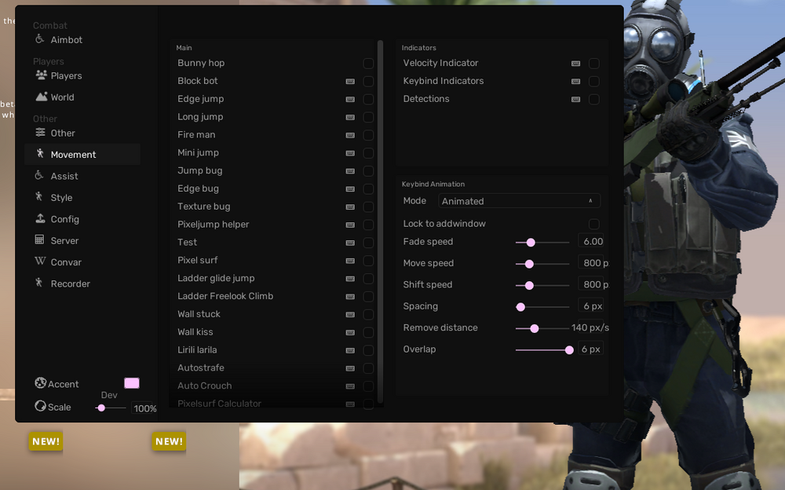

# Pink sidebar menu — feature tab

## Summary

A near-black, almost colorless menu with a pale pink accent used only on slider knobs, fills and one swatch. It has a grouped sidebar on the left and two columns of panels: a long scrolling list of toggle rows, and settings panels. The product isn't named, and its feature names in the screenshot are not part of this note. It's in the vault because it shows a very restrained neutral palette, a per-row keybind affordance, sliders with value boxes, and a settings panel for animating an on-screen [keybind list](../visuals/keybind-list.md).

## Layout

- **Window**: about 775 × 530 px, square-ish corners, no title bar. A thin darker gutter (`#0d0d0d`) separates the panels from the base.
- **Sidebar** (about 180 px wide): small dim **section headers** ("Combat", "Players", "Other" style) above groups of items, each an icon plus a label. The active item gets a slightly lighter full-width background (`#171717`–`#191919`) and white text; the others are light gray. At the bottom: an **Accent** row with a color swatch, a **Scale** row with a mini slider and "100%", and a small "Dev" label.
- **Left panel** ("Main"): a tall list of toggle rows. Each row has the label on the left, then a small **keyboard icon** (the bind affordance) and an outline checkbox on the right edge. It has a thin scrollbar, and the last rows **fade out** toward the bottom edge to show there is more.
- **Right column**: an "Indicators" panel (three toggle rows with bind icons), then a "Keybind animation" panel with:
  - **Mode**: a full-width combo ("Animated") with a small chevron.
  - A plain checkbox row.
  - Six slider rows: label on the left, then a short slider (about 70 px, pink fill and knob), then a **value box** (outlined, dark) on the right with the number and unit ("6.00", "800 px/s", "6 px").
- Panel titles are tiny gray text at the top-left of each panel. There are no visible panel borders, only a slight value step.

## Palette

Sampled with a scratch sampler (region maximum for text) from a compressed screenshot: approximate.

| Role | Hex | Notes |
|---|---|---|
| Gutter / base | `#0d0d0d` | between panels |
| Window, sidebar, panels | `#101010` | barely distinct from the base |
| Active sidebar item | `#171717`–`#191919` | |
| Checkbox / value-box border | `#1e1e1e`–`#242424` | 1 px outlines |
| Slider track (empty) | `#383838` | |
| Scrollbar | `#353535` | |
| Section header | `#404040` | |
| Row label | `#979797`–`#acacac` | |
| Text active | `#ffffff` | active sidebar item |
| Accent | `#fbc1fe` / `#ffc7ff` | slider knob and fill, accent swatch |

## Widgets

- [Checkboxes](../widgets/toggles-and-checkboxes.md): right-aligned outline squares (about 13 px) with no fill when off (the "on" state isn't visible in the screenshot).
- **Keybind icon**: a small gray keyboard glyph just before the checkbox on rows that accept a bind. It's a cheaper, always-visible alternative to the [row settings popup](../widgets/row-settings-popup.md) for one specific setting.
- [Sliders](../widgets/sliders.md): a short track with a pink fill left of a round pink knob (about 10 px), gray to the right, plus a separate **value box** you can type into. Units are shown in the box.
- [Combo](../widgets/combos-and-dropdowns.md): full-width field with a thin border and a small chevron.
- [Sidebar with section headers](../widgets/tabs-and-navigation.md).
- [Color swatch](../widgets/color-pickers.md) for the global accent in the sidebar footer.

## What makes it work

- **Almost no color.** Grays from `#0d0d0d` to `#ffffff` do all the structure, and pink appears only where a value is set. The knobs are what you see first.
- Section headers in the sidebar make a 12-item navigation easy to scan.
- The scroll fade at the bottom of the long list signals overflow without a heavy scrollbar.
- Value boxes make exact numbers visible and editable, which suits timing and speed settings.
- Putting the global **accent and UI scale** in the sidebar footer keeps them reachable from every tab.

## What to avoid / weaknesses

- **Value boxes clip their text** ("800 p" instead of "800 px/s"). Size boxes for the longest value, or drop the unit into the label.
- The panels (`#101010`) on the base (`#0d0d0d`) are nearly identical, so the panel edges are hard to see. One more value step would help.
- Labels are mixed case and inconsistent ("Velocity Indicator" vs "Keybind Indicators").
- A very long single list (20+ rows) with no subgrouping. Splitting it into two or three panels would be easier to scan.

## Implementation notes

- Start from the [Style baseline](../implementation/imgui-style-baseline.md) with a neutral gray palette and accent `#fbc1fe`.
- Rows: `CheckRow` in [Custom widgets](../implementation/custom-widgets.md) with a keyboard glyph drawn just before the box.
- Slider + value box: a short custom bar (like `AccentSlider`), then `SameLine()` and an `InputFloat` with a 1 px frame border and no buttons.
- Scroll fade: after drawing a scrolling child, draw a gradient (`AddRectFilledMultiColor`) from transparent to the panel color over its bottom 30–40 px.

Related: [Keybind list](../visuals/keybind-list.md), [Color and contrast](../principles/color-and-contrast.md), [Layout and density](../principles/layout-and-density.md), [Sliders](../widgets/sliders.md), [Fatality — misc tab](fatality-misc-tab.md)
