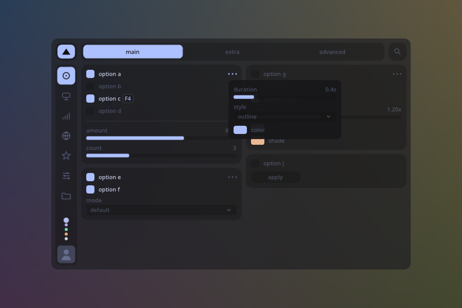
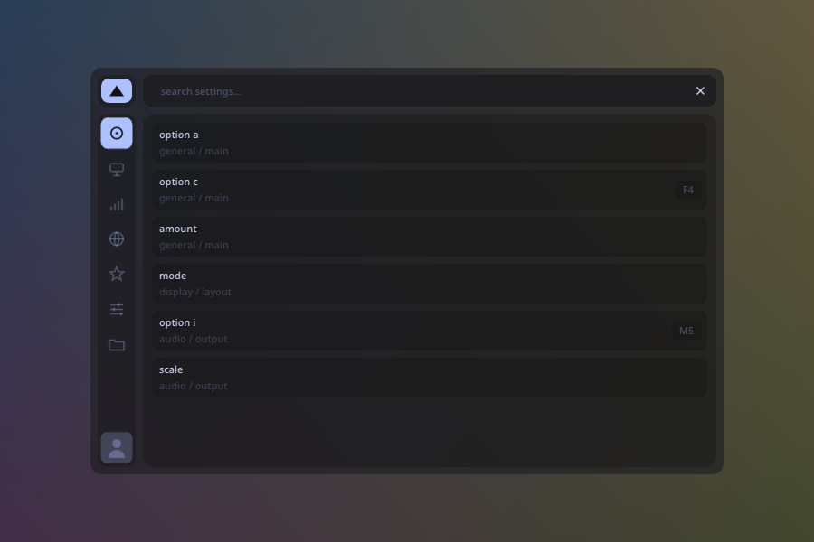

# velocity.cat — main menu



*Recreation rendered from [glass_sidebar_menu.h](../implementation/glass-sidebar-menu.md), not a screenshot of the original. Placeholder labels; the backdrop gradient stands in for the blurred scene behind the window.*

## Summary

A compact, frosted-glass menu: a translucent dark window over a backdrop blur, a narrow icon rail on the left, a sub-tab bar with a sliding accent pill on top, and two columns of **untitled** cards. It is very sparse on screen because about half of all toggles hide their secondary settings behind a "⋯" popup on the row. All text is lowercase and uses one font size. Five one-click theme presets swap the whole palette. It is the vault's **minimal baseline**: its recipe, [Glass sidebar menu](../implementation/glass-sidebar-menu.md), is the starting point when a request says minimal, clean or simple.

Every value below (sizes, colors, animation speeds) was **read from the source code**, not sampled from a screenshot, so it is exact.

## About the source

- The repo's README says it is the leaked source of a commercial CS2 cheat. It has **no license**, so treat its code as all rights reserved: study the design, don't copy the code. The [recipe](../implementation/glass-sidebar-menu.md) in this vault was written independently in Dear ImGui.
- The menu does **not** use ImGui. It uses a custom immediate-mode toolkit, `xui`, on a custom D3D11 renderer, `xdraw`, with Inter (15 px) and SVG icons rasterized with nanosvg.
- Only the UI files were read for this note: `project/external/xdraw/xui/xui.hpp` (style struct and widget API), `xui.cpp` (widget drawing), `xdraw.hpp` (the `tokens` namespace), `core/rendering/impl/menu/menu.core.cpp` (window, rail, top bar, themes, search) and the tab files under `menu/` (layout only). Everything else in the repo is out of scope for this vault.

## Layout

700 × 450 px window, 12 px corner radius. Every gap is **8 px**: window edge to panels, rail to content, bar to body, column to column, card to card.

```
┌──────────────────────────────────────────────────────────────┐
│ ┌──┐ ┌──────────────────────────────────────────────┐ ┌──┐  │  8 px gaps everywhere
│ │▲ │ │[ main ]   extra     advanced                 │ │⌕ │  │  35 px bar
│ └──┘ └──────────────────────────────────────────────┘ └──┘  │
│ ┌──┐ ┌───────────────────────┐ ┌───────────────────────┐    │
│ │◉ │ │■ option a          ⋯ │ │□ option g          ⋯ │    │
│ │▭ │ │□ option b             │ │□ option h             │    │
│ │▮ │ │■ option c [F4]     ⋯ │ │ scale          1.20x │    │
│ │◍ │ │ amount           65% │ │ ▬▬▬▬▬▬▬▬▬▬▬▬▬▬▬▬▬▬▬ │    │
│ │☆ │ │ ▬▬▬▬▬▬▬▬▬▬▬▬▬▬▬▬▬▬▬ │ └───────────────────────┘    │
│ │≡ │ └───────────────────────┘ ┌───────────────────────┐    │
│ │▱ │ ┌───────────────────────┐ │□ option j             │    │
│ │• │ │■ option e          ⋯ │ │ [ apply ]             │    │
│ │• │ │ mode                  │ └───────────────────────┘    │
│ │👤│ │ [default          ⌄] │                               │
│ └──┘ └───────────────────────┘                               │
└──────────────────────────────────────────────────────────────┘
```

- **Rail** (42 px wide), two stacked cards:
  - Top: a 42 × 35 card holding an accent pill (inset 4 px, radius 8) with the logo in the dark color.
  - Below it, one tall card: seven 35 × 35 icon buttons stacked from the top (4 px apart), then five 6 px theme dots (3 px apart), then a 35 px avatar (radius 7) at the bottom.
- **Top bar** (35 px tall): a sub-tab card that fills the width, plus a separate 35 × 35 search card at the right. Sub-tabs split the card evenly (each one is the width divided by the count) and an accent pill slides under the active one. Sub-tab sets depend on the tab and hold 1–6 items.
- **Body**: two equal columns, each `(content_w − 8) / 2` wide. Cards stack in each column with 8 px between them. **Cards have no titles**: each one is just a rounded, slightly darker panel (10 px padding, 12 px radius), and grouping comes only from which rows share a card.
- **Search mode** replaces the body. The search card grows leftward over the sub-tabs (smoothstep, speed 18) into a full-width input with the hint "i want to find..." and a close ✕. Results are 44 px rows: name over a dimmer category line, plus a key badge on the right if the setting has a bind. Enter opens the first result, which jumps to its tab and sub-tab and pulses that row's label in the accent for 1.2 s.



## Palette

Six tokens drive everything; each widget color is a token with a different alpha. Default preset ("periwinkle"):

| Role | Token | Hex | Alpha | Used for |
|---|---|---|---|---|
| Accent | `accent` | `#adc0ff` | 100% | active rail button, sub-tab pill, checked box, slider fill, logo pill |
| Dark | `dark` | `#111111` | 100% | icon and text **on** accent fills |
| Text primary | `text` | `#dde5ff` | 92% | labels when on or hovered |
| Text dim | `text_dim` | `#adc0ff` | 32% | default labels, inactive icons, values. It is the **accent at low alpha**, not a gray |
| Card / inset | `card` | `#111111` | 32% | cards, checkbox and slider tracks, combo fields, buttons |
| Elevated | `elevated` | `#1f1f23` | 46% | base for the window and popups |
| Window bg | `elevated` | `#1f1f23` | 69% | drawn over a backdrop blur |
| Popup bg | `elevated` | `#1f1f23` | 67% | drawn over its own blur |
| Hover fill | `card` | `#111111` | 47% | buttons, combo fields |
| Selected item | `accent` | `#adc0ff` | 16% | selected combo row |
| Separator | `accent` | `#adc0ff` | 12% | 1 px lines in cards |

Theme presets (the five dots on the rail). Each preset swaps all six tokens. The card and elevated alphas shift slightly per preset (82–92 and 118–126 out of 255).

| Preset | Accent | Dark | Text | Elevated |
|---|---|---|---|---|
| periwinkle (default) | `#adc0ff` | `#111111` | `#dde5ff` | `#1f1f23` |
| lavender | `#bea4ff` | `#121117` | `#ebe5ff` | `#221f2b` |
| mint | `#7ae0b5` | `#0e1413` | `#def6ee` | `#192723` |
| peach | `#ffab70` | `#16110f` | `#ffe8d6` | `#2b201a` |
| silver | `#d2d6e0` | `#121214` | `#e8ebf2` | `#232327` |

In every preset, `dark` is a near-black tinted toward the accent's hue, and `text` is a near-white tinted the same way.

## Widgets

- [Checkbox](../widgets/toggles-and-checkboxes.md) (variant C): 16 px square, radius 4, `card` fill. When on, the whole square fades to solid accent (smoothstep, speed 8). It has **no checkmark**. The label sits 8 px to the right and goes dim → primary when on or hovered. Right-click opens a bind menu (toggle / hold on / hold off). A bound key shows as a small badge after the label with an accent-tinted border.
- [Row popup "⋯"](../widgets/row-settings-popup.md): three 1.5 px dots at the right edge of the row; dim → accent on hover or when open. Opens a 220 px popup 4 px below the dots, with its left edge at the dots, so it overhangs the card. Inside go the sliders, combos and color swatches that belong to that toggle. **70 of the 153 checkboxes in the source have one.**
- [Slider](../widgets/sliders.md): label top-left and value top-right on one line, then a 7 px pill track below. The fill is solid accent and has **no visible thumb**. The value tints toward the accent on hover (65%) and while dragging (85%). Click the value to type a number. While the slider is hovered, the arrow keys step it by 1 (ints) or by 1% of the range (floats). The fill eases to the new value at speed 20.
- [Combo](../widgets/combos-and-dropdowns.md): label above a 20 px field (radius 4) that shows the current value and a thin 6 × 3.5 px chevron, which flips when open. The dropdown is a blurred popup with 22 px items: selected has a 16% accent fill and its text shifts 40% toward the accent; hover has a darker fill. Items fade and slide 8 px into place one after another (the last one starts at half the open animation). A multi-select variant also exists.
- [Color swatch](../widgets/color-pickers.md): 26 × 16 px, radius 4, with a checkerboard under translucent colors and the label to the right. Almost all swatches live inside row popups, not on the main surface.
- **Button**: `card` fill, radius 8, label centered dim → primary; fills accent while held. Usually 96 × 22.
- [Icon rail and pill sub-tabs](../widgets/tabs-and-navigation.md): the active rail icon gets a full accent square (radius 8) with a dark icon; hovered icons tint toward the accent. The sub-tab pill slides at speed 18; the active label turns dark, and hovered inactive ones get an `elevated` fill at 35% alpha.
- [Search](../widgets/settings-search.md): see Layout.
- [Cards](../widgets/group-boxes.md): untitled; height fits the content; a card can scroll, with a 6 px scrollbar that pushes the content inward only while it is visible.

## Motion

Every widget runs a lerp of the form `v += (target − v) · min(speed · dt, 1)`, with the speed chosen per widget:

| What | Speed | Curve |
|---|---|---|
| Window open / close | 14 / 16 | ease-out-cubic; the window **scales from its center**, and the blur fades in with it |
| Popup open / close | 14 / 16 | ease-out-cubic on height (grows down from the anchor) and alpha |
| Sub-tab pill slide | 18 | linear lerp on x |
| Search expand | 18 | smoothstep on width |
| Checkbox fill | 8 | smoothstep |
| Hover tints | 10–15 | linear |
| Slider fill | 20 | linear on the displayed value |

On first load there is also a splash screen with the logo and a loading bar. When the window opens, a small mascot image peeks over its top edge, 36 px in from the right and 96 px tall, scaling with the open animation. That one is pure personality and easy to drop.

## What makes it work

- **Six tokens, alpha does the rest.** Cards, fields, hover states, selection and separators are all `card`, `accent` or `elevated` at different alphas. That is why a single preset switch can recolor everything coherently, and why it never looks muddy.
- **Dim text is the accent at 32%**, not a gray, so the whole UI is tinted by the theme even when nothing is active.
- **One gap value (8 px) for everything** outside the cards. Combined with the equal-width sub-tabs and equal columns, it reads as a strict grid with almost no visible structure.
- **Progressive disclosure on every row.** The main surface is mostly checkbox rows. Their details live one click away in "⋯" popups, so each tab stays short and scannable, and color swatches don't clutter the surface.
- **Untitled cards.** The cards group rows without header text, and lowercase single-size text keeps it calm. This works because the cards themselves are visibly distinct (darker, rounded).
- **Accent fills, not outlines**: the active rail button, sub-tab pill and checked box are all solid accent with dark content on top. A solid color block is easy to spot at a glance.
- **Search** across every setting, with its tab path and bind shown. It is rare in this genre and a real usability win.

## What to avoid / weaknesses

- **The glass depends on the blur.** At 69% window alpha and 32% card alpha, the menu only looks good over a blurred backdrop. Over a sharp, busy scene with no blur, labels compete with the background. Without blur, raise the window alpha to about 90% and make popups near-opaque (the recipe does the latter).
- **Unchecked boxes nearly vanish**: `card` on `card` is about 32% black on 32% black. Fine for a minimal look, but weak for accessibility. Consider a faint border or a slightly lighter box.
- **Dim text at 32% alpha** is low contrast for long labels. It's OK here because labels are short and brighten on hover.
- **Popups can overhang the window.** A 220 px popup anchored at the right edge of the right column extends past the window. Clamp it to the window or flip it leftward.
- **No titles at all** can make dense tabs hard to scan. A tab with 3+ cards per column would benefit from small headers.
- **Hidden settings are hard to discover.** The "⋯" pattern hides them; search compensates.

## Implementation notes

- ImGui recipe: [Glass sidebar menu](../implementation/glass-sidebar-menu.md) (`glass_sidebar_menu.h`). It covers the tokens and presets, the rail, the sliding pill bar, search mode, untitled cards, the filled-square checkbox with key badge, the "⋯" row popup, label-over sliders and combos, swatch, button and separator.
- Blur: ImGui has none built in. See [Depth, glass and glow](../principles/depth-glass-and-glow.md) and [Draw-list recipes](../implementation/drawlist-recipes.md); [neverlose-ui](neverlose-ui.md) has a D3D11 implementation.
- Window scale-in from the center isn't in the recipe. A cheap stand-in is an alpha fade with `ImGuiStyleVar_Alpha`.

The same source also has HUD elements (watermark, keybind list, toasts, hit marker, countdown badge, area outline): see [velocity.cat — HUD](../visuals/velocity-cat-hud.md).

Related: [velocity.cat — HUD](../visuals/velocity-cat-hud.md), [Glass sidebar menu recipe](../implementation/glass-sidebar-menu.md), [Row settings popup](../widgets/row-settings-popup.md), [Settings search](../widgets/settings-search.md), [Color and contrast](../principles/color-and-contrast.md), [Depth, glass and glow](../principles/depth-glass-and-glow.md), [Layout and density](../principles/layout-and-density.md), [Motion](../principles/motion.md), [neverlose-ui](neverlose-ui.md), [Fatality — misc tab](fatality-misc-tab.md)
