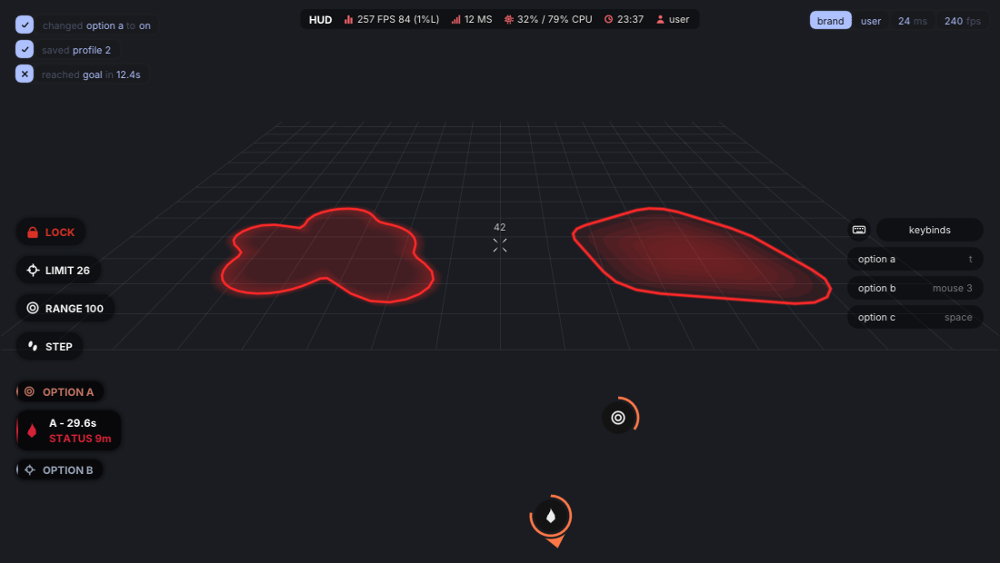

# Visuals

Visual elements that live **outside the menu**: on-screen HUD pieces (status pills, keybind lists, watermarks, toasts, hit markers, countdown badges) and in-world elements drawn on the scene (ground areas, chams, tracers). This section covers how they look, how they move and how to draw them. All code draws in its own window with placeholder data, and nothing here reads or attaches to a game.

*Rendered from [HUD elements](../implementation/hud-elements.md). The floor grid uses the recipe's own demo camera. Left area: floor-mesh method. Right area: screen-hull method.*

## New media sweep

- [Fatality Halloween — proximity warnings](fatality-halloween-proximity-warning.md): molotov striped-to-filled footprint and grenade trajectory/local red glow; native 1080p/60 clips, full frames and readable annotation crops.

- [Kizaru — molly area treatment and tracers](kizaru-molly-and-tracers.md): owner-selected lifetime-colour direction, actual area frames, sampled magenta tracers and two video excerpts.

- [unmatched — rank overlays](unmatched-rank-overlays.md): original Neverlose/gamesense demos augmenting existing scoreboard rows.

- [Reference media sweep — indicators, configs and world HUD](reference-media-sweep.md): start here for the November 16 additions; footage, screenshots and source dates.
- [Neverlose 2026 — world visuals and windows](neverlose-2026-world-and-windows.md): trajectory/endpoint examples, radius/presentation controls, window settings and event rows.
- [Neverlose community — compact indicators](neverlose-perfect-indicators.md): legacy script showcase with watermark, narrow bind panel and center indicators.
- [Fatality community — Bilibili HUD preview](fatality-placeholder-hud.md): small segmented arc, glyph cluster and menu-open/menu-closed placement.
- [Projectile timing](projectile-timing.md): arrival versus active lifetime; evidence requirements for landing-timer references.

## Start here

- [HUD principles](hud-principles.md): legibility over any background, edge placement, state color, and appear/disappear motion. Read before designing any element below.

## Elements

- [Status pills](status-pills.md): icon + short label in a dark stadium; active state recolors the content. For "what's on right now".
- [Keybind list](keybind-list.md): a header plus one row per active bind, animated in and out. Includes the tunables a real menu exposes.
- [Segmented capsules](segmented-capsules.md): a glass capsule holding small inner cells. It is the shared language for watermarks, event toasts and bind rows.
- [Hit markers](hit-markers.md): brief feedback marks that snap in and fade, with an optional value that pops.
- [Countdown badges](countdown-badges.md): icon disc with a timer arc and an arrow that points toward the thing it tracks; clamps to screen edges.
- [Ground area markers](ground-area-markers.md): outlining an area on the floor. Compares a world-space floor mesh with a screen-space hull.
- [Chams](chams.md): recolouring a model so its silhouette reads: flat, rim, contour, flow, behind-wall. The four decisions behind every variant.
- [Tracers](tracers.md): the streak left by a shot: hot core, tinted glow, taper, lifetime, muzzle and impact anchors.
- [Info bar](info-bar.md): one flat strip of red icon + value segments (brand, FPS, ping, load, time, user). The flat alternative to a capsule watermark.
- [Glow lines](glow-lines.md): a line that reads as a lit tube (core, cubic glow, center highlight, tapered width, end fades). For paths, trails and predicted arcs.
- [Screen effects](screen-effects.md): full-screen vignette, chromatic aberration and rain on the lens. Mood only; drawn under the HUD.

## Case studies

- [Owner HUD captures](owner-hud-captures.md): screenshots of status pills, a keybind list and a floor area marker from a product not yet identified.
- [velocity.cat — HUD](velocity-cat-hud.md): watermark, keybind list, event toasts, hit marker, countdown badge and hull area marker, read from source.
- [Neverlose — HUD](neverlose-hud.md): frames from a match video: info bar, indicator cards with accent bars, small keybind list, monospace hit log, in-world labels and a tracer close-up. Measured and sampled.
- [Neverlose Recurrence — HUD](neverlose-recurrence-hud.md): the owner's favourite **indicators**: a Figma concept restyle of the neverlose HUD with exact values: one glass recipe (black 70 %, 5 px blur, halo), fading 2 px accent bars, muted state colours, a value-first hotkey grid, avatar-capped spectator chips.
- [Fatality — in-game visuals](fatality-visuals.md): read from source: blurred 74 % toasts in the menu palette, 1 px boxes with dark halos, 4 px bars with riding numbers, outlined pixel-font labels, a blinking off-screen arrow.
- [neverwin — visuals](neverwin-visuals.md): read from a compiled DLL: the SDF panel shader (squircle corners, shadow, glow, glass, accent bar), the shared glow pass, the tube line, screen effects, an icon set and HUD tunables.

Up: [README](../README.md)
