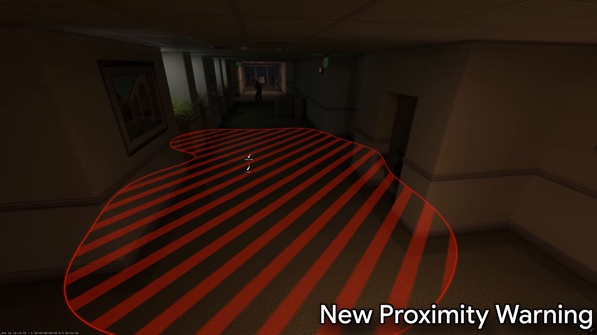
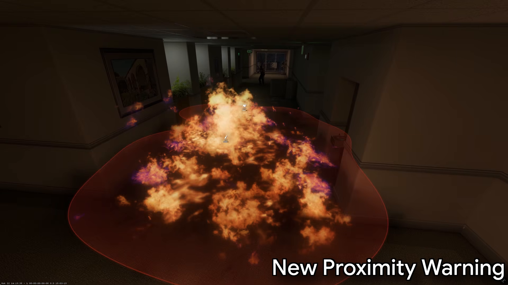
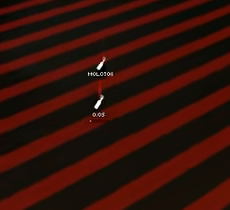
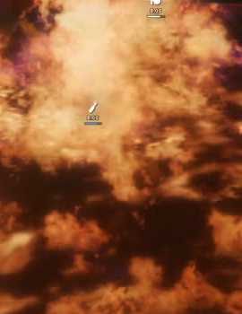
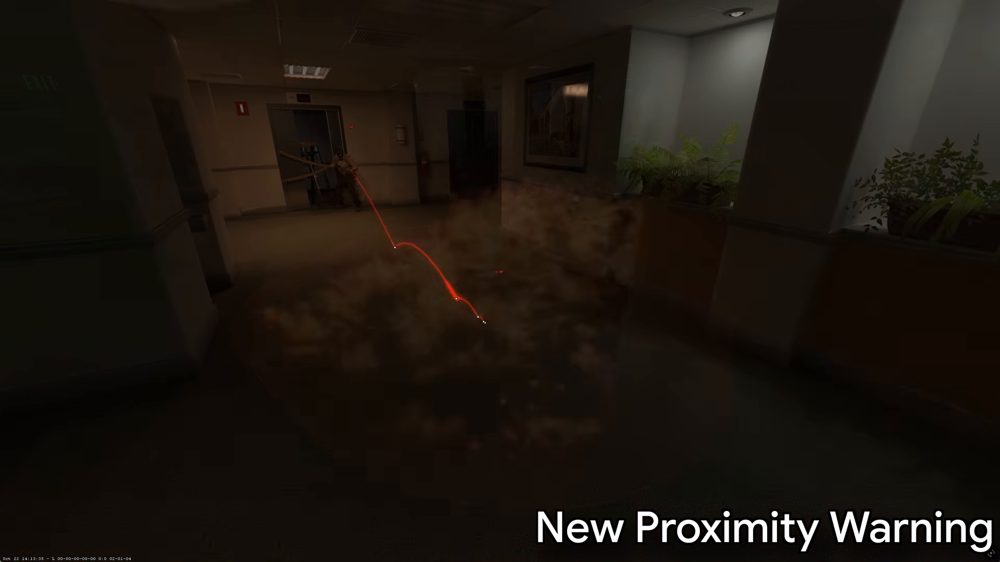
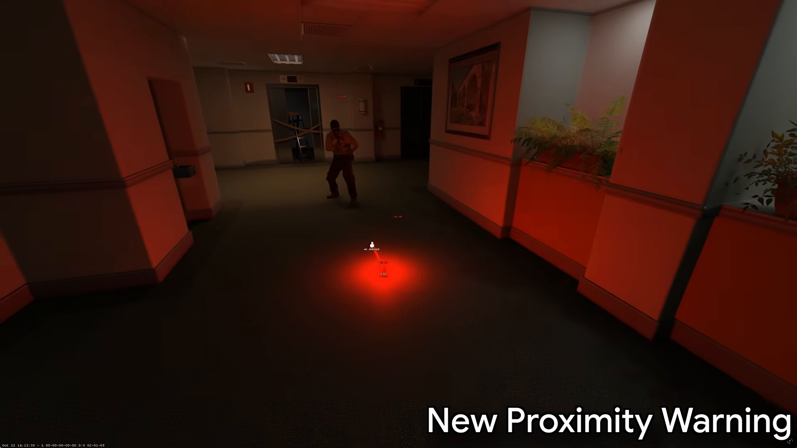
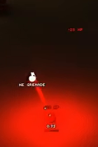

# Fatality Halloween update — proximity warnings

## Source and inspection

**Fatality CS2 - Halloween Update**, uploaded by **1tsuki**, published **2026-10-25**. The video itself labels these demonstrations “New Proximity Warning.”[1]

The supplied intervals were **00:53–01:01** for the molotov and **01:02–01:06** for the grenade. Downloaded and inspected at **1920 × 1080, 60 fps**, with surrounding frames from **00:51–01:08**. The supplied boundaries are approximate: 00:53 still shows the preceding demonstration, the fire remains visible at 01:02, and the grenade sequence follows. The saved excerpts preserve the exact requested intervals; the stills include later state changes.[1]

## Molotov: striped warning → active filled area

[Silent 00:53–01:01 excerpt, original dimensions and frame rate](../assets/fatality-halloween-proximity-molly-53-61.mp4).

- **Before ignition:** saturated red diagonal bands clipped to a smooth, irregular, concave footprint, with a thin red perimeter. The gaps leave the scene visible. The footprint is foreshortened against the corridor floor.[1]
- **During the transition:** the visible treatment changes from stripes to a translucent reddish filled region as fire becomes visible. The active boundary remains smooth and lobed; flames remain visible inside it.[1]
- **Separate annotations:** white item glyphs and small labels sit near the world objects/area. A native-resolution crop at 00:58 reads `MOLOTOV` and shows a seconds-style readout beneath a second glyph. At 01:00 a flame glyph has a seconds readout and a short bar. These are distinct from the large striped/filled footprint.[1]

[Later active-area frame, 01:02](../assets/fatality-halloween-proximity-molly-late.png).

## Grenade: trajectory → local red glow → detonation

[Silent 01:02–01:06 excerpt, original dimensions and frame rate](../assets/fatality-halloween-proximity-nade-62-66.mp4).

- **Approach:** a thin red trajectory with bright small points shows a changing path through the corridor. This line is separate from the local warning treatment.[1]
- **Near the grenade:** a very bright red hotspot fades outward over the floor. At 01:05 nearby walls and the ceiling also show a red wash.[1]
- **Annotations:** a white grenade glyph and `HE GRENADE` label are visible above the warning, with another small seconds-style annotation closer to the object. A separate red `HP` readout is also visible.[1]
- **Detonation:** the 01:06 still shows the explosion. The clip ends at 01:06; the still preserves that boundary state.[1]

[Detonation frame, 01:06](../assets/fatality-halloween-proximity-nade-detonation.png).

## Applying the look in standalone software

Suggested construction:

- Model the warning as explicit **pending / active / ended** states. Stripes can communicate pending danger, with a low-alpha fill for an already active region.
- Clip stripes to a floor-space footprint so the gaps, bands and outline share the same projected boundary. Keep their orientation tied to the scene rather than painting a fixed screen-space hatch across the image.
- Keep object names, seconds labels and short bars independently readable above the area treatment. Use neutral labels in new software and define precisely what each timer means.
- Treat the grenade's trajectory, local hotspot, surrounding red wash and object annotation as separate layers. Use renderer support for the scene-surface lighting, or approximate the hotspot with a projected gradient in an ImGui-only preview.
- Start the footprint geometry from the [ground-area marker construction](ground-area-markers.md).

## Asset provenance

The [manifest](../assets/fatality-halloween-proximity-manifest.json) records exact source timestamps, native-resolution crop rectangles, clip transforms, dimensions, frame rates and SHA-256 values. The [source record](../assets/fatality-halloween-proximity-sources.json) preserves retrieved video metadata. The full downloaded video stays outside the shared library; only selected reference material is included.

## Sources

[1] https://www.youtube.com/watch?v=1p26pgyDTS0 — User-supplied molotov and grenade proximity warning footage

Related: [Ground area markers](ground-area-markers.md), [Projectile timing](projectile-timing.md), [Countdown badges](countdown-badges.md), [Glow lines](glow-lines.md), [Fatality visuals](fatality-visuals.md), [Visuals](INDEX.md)
