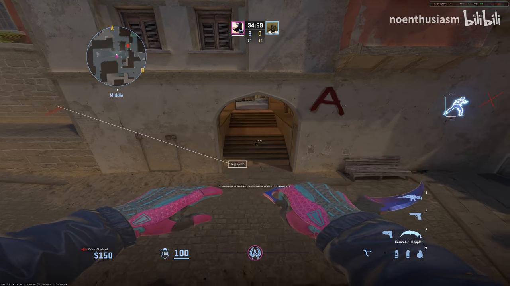
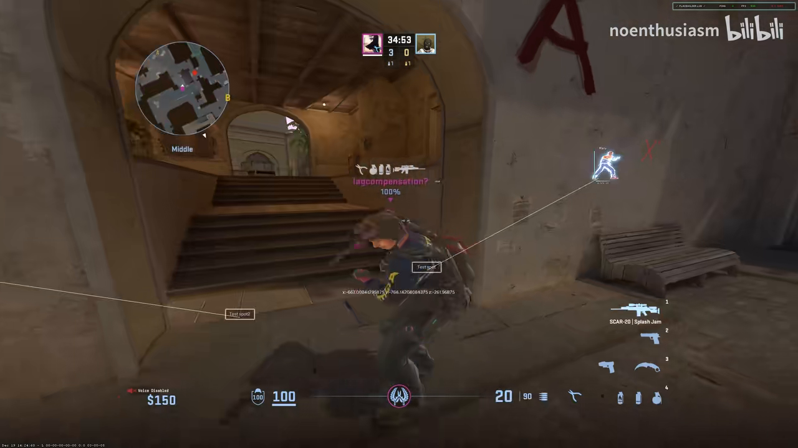

# Fatality community — Bilibili compact HUD preview

## Evidence

Bilibili video **BV1EK6uYwE45**, published **2024-12-30**, by noenthusiasm. The description labels the work unfinished. The page also links a later PlaceHolder.Lua release.[6]

## Visible design

A small white segmented arc sits below the screen center with tiny glyphs/marks arranged beneath it. Its sparse geometry remains visible over the scene without a large rectangular panel. The nearby player annotation combines a small weapon silhouette and text. The menu-open and menu-closed frames preserve useful placement context.[6]

This is a **community-addon visual reference**. The mark in the upper corner belongs to Bilibili/the uploader.

## Reusable lesson

A segmented arc can reserve the center for aiming/focal content while keeping a small state cluster underneath. For a neutral mockup, assign segments to Option A–D and document those assignments explicitly.

## Sources
[6] https://www.bilibili.com/video/BV1EK6uYwE45 — Fatality community Lua preview

Related: [Countdown badges](countdown-badges.md), [Status pills](status-pills.md), [Fatality visuals](fatality-visuals.md), [Media sweep](reference-media-sweep.md)
