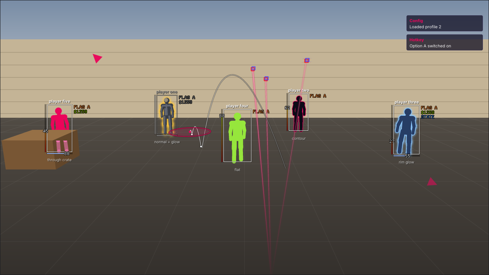

# Fatality — in-game visuals

## Summary

The elements Fatality's CS2 product draws outside its menu, read from the drawing code of the same repo as [Fatality CS2 — menu drawing code](../references/fatality-cs2-source.md). That repo is a leak, so this note records values and look only, with no code copied. As this vault's scope rule requires, it describes **only how each element is drawn from plain inputs** (a rectangle, a fraction, a list of labels, an angle). Nothing here covers where the data comes from.

The style is deliberately **old-school and crisp**: 1 px lines, thin bars, a tiny pixel font with an outline, and the menu's accent kept for the toasts. Compared with [Neverlose — HUD](neverlose-hud.md), it is plainer and more "classic".

*This vault's own rendition, from [Fatality-style in-world visuals](../implementation/fatality-visuals-code.md). The boxes, bars, labels, arrows and toasts follow the values below; the materials, tracers and grenade path are this vault's design in the same style.*

## Fonts

| Use | Font | Size | Effect |
|---|---|---|---|
| Labels next to boxes, bar values | **Smallest Pixel-7** (pixel font) | 11 px | 1 px dark outline |
| Name above a box | Segoe UI Bold | 13 px | drop shadow |
| Large indicator text | Verdana Bold | 27 px | drop shadow |
| Toasts | Josefin Sans (the menu font) | 12 px | none |

The pixel font with an outline stays readable at 9 px line spacing over any background. This is the main reason the overlay looks so dense yet clean.

## Toasts (notifications)

- **Size** 200 × 42, top-right corner of the screen, 40 px from the top.
- **Surface**: background blur behind a radius-4 rectangle, then the menu's `bg_bottom` (`#110f23`) at **74 %** opacity and a 1 px `outline` (`#3c355d`) border at 75 %. It is the menu's palette made translucent.
- **Content**: optional 16 px icon in the accent at (8, 5); a **title in the accent** (`#eb055a`) at (8, 8), shifted right 20 px when there's an icon; the message in `#f5f5f5` at (8, 24).
- **Motion**: a new toast slides **down 20 px into place** while fading in (0.25 s ease-in-out); older toasts are pushed down by 42 + 8 px. After **5 s** it slides another 20 px down and fades out (0.25 s).

See [Segmented capsules](segmented-capsules.md) for other toast styles in the vault.

## Box around a target

Given a screen rectangle:

- A **1 px box in the user's colour**, with a **1 px black line at 40 %** just outside and another just inside it. The dark halo keeps a thin coloured line visible on light and dark scenes alike, the same idea as the outlined pixel font.

## Bars beside a box

Given a fraction from 0 to 1 and a side (top, bottom, left, right):

- **Track** 4 px thick, black at 40 %, as long as the box side.
- **Fill** 2 px thick, inset 1 px inside the track, length = fraction × (length − 2), rounded down to whole pixels. One colour, or a **two-colour gradient** along the bar.
- **Number**: when a value is given (shown only when it isn't full), it's drawn in white pixel font **at the end of the fill**, so it rides along as the bar drains.
- Bars on the same side **stack 5 px apart** outward.
- **Health-style bar** (left side), two colour modes from two colours (defaults: dark red `#820000` and olive green `#82b400`):
  - *solid*: the whole fill is one colour, blended between the two by the fraction (green when full, red when empty);
  - *gradient*: the fill runs from the "empty" colour at the bottom to that blended colour at its top.
- **Draining motion**: when the value rises, the bar jumps up at once; when it falls, the fill slides down at a speed of 23 units per second × the size of the gap (at least 1), so a big drop drains fast at first and settles gently. The number is shown only at 93 % or below.

## Text and icons beside a box

- The **name** sits centred above the box (Segoe UI Bold, shadowed); further text stacks above or below it, centred.
- **Right side**: a stack of short status words in the pixel font, one per line, **9 px apart**, each in its own colour (examples in the code: orange, olive green `#82b400`, blue `#2e73c9`, white). Faded-out targets draw their labels in 50 % grey.
- **Left side**: small icons (10–16 px), each with a **1 px drop shadow** in black at 60 % of the icon's alpha.

## Off-screen arrow

Given a direction angle and three settings (size, distance in %, colour):

- An **isosceles triangle** (`size` tall, `size` wide at the base) placed on an **ellipse around the screen centre** that keeps the screen's aspect ratio. Its radius is the distance setting × (half the screen width − size), so arrows hug a screen-shaped ring rather than a circle.
- The triangle is rotated to point along the angle, and anti-aliased.
- Its alpha **pulses**: it ramps linearly from full to zero and back, 0.73 s each way, so arrows blink softly.

Compare [Countdown badges](countdown-badges.md), whose arrows also clamp to the screen edge.

## Settings with no drawing code in this source

The source's visuals menu lists **chams, bullet tracers ("beams"), grenade prediction, bullet impacts, glow and skeletons**, but this copy has **no drawing code for any of them**: only the settings exist. The settings still show what each element offers, but not how it looks:

- **Chams (model materials)**: a material per model group, chosen from **None, Normal, Flat, Rim Glow, Contour, Flow, Acrylic, Legacy, Sprite**. Each group has a primary colour, a secondary colour, and a third colour used where the model is hidden behind walls, plus a "through walls" switch. Groups exist for players, ragdolls, attachments and the player's own arms; extra options make your own model pulse or show a delayed copy. The visuals tab has a model **preview** box for chams (its image is commented out in this copy).
- **Beams (bullet tracers)**: on/off per group with one colour each, and a **width from 1 to 20 (default 8)**.
- **Grenade prediction**: on/off plus one colour for the hit point.
- **Bullet impacts**: two colours (defaults red and dark blue, for the two kinds of impact marker).
- **Glow**: an outline glow per group with one colour each, also for items in the world.
- **Spread circle**: off, gradient, rainbow or spinning rainbow, with two colours.

How these look will need screenshots or video from the owner; [the vault's rendition](../implementation/fatality-visuals-code.md) is a placeholder design until then. Until then, see [Tracers](tracers.md) for beams, [Chams](chams.md) for model materials, [Glow lines](glow-lines.md) for predicted arcs, and [Ground area markers](ground-area-markers.md) for areas on the floor.

## Startup overlay

The full-screen intro (blurred, dimmed backdrop with the accent "F" that breathes, then expands into the wordmark) is described in [Fatality CS2 — menu drawing code](../references/fatality-cs2-source.md#startup-animation).

## What makes it work

- **Every thin mark gets a dark halo**: outlined pixel text, black lines on both sides of the box, a dark track under each bar, shadows under icons. Thin and bright stays readable anywhere.
- **Whole-pixel geometry** (bar lengths rounded down, 1 px lines, a pixel font without anti-aliasing) keeps everything sharp at small sizes.
- **Toasts reuse the menu palette** at 74 % opacity over blur, so the menu and the overlay clearly belong together.

## What to avoid / weaknesses

- The pixel font is tiny; on high-resolution screens it needs integer scaling (2×) instead of a larger point size, or it blurs.
- The status-word colours are hard-coded and don't follow the accent.
- A blinking arrow draws attention all the time; consider pulsing only when the target is new.

Related: [Fatality-style in-world visuals](../implementation/fatality-visuals-code.md), [HUD principles](hud-principles.md), [Fatality CS2 — menu drawing code](../references/fatality-cs2-source.md), [Neverlose — HUD](neverlose-hud.md), [Segmented capsules](segmented-capsules.md), [Countdown badges](countdown-badges.md), [Screen effects](screen-effects.md)
