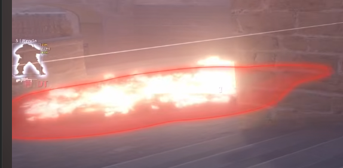

# Ground area markers

Outlining a region on the floor (an area of effect, a zone, a hazard) so its extent is readable at a glance. The input is a set of **emitters**: circles on the ground plane that together make up the area. Two ways to draw it give very different results.

## Method A: world-space floor mesh (owner capture)

The capture shows a smooth, **concave** outline that hugs the area and is foreshortened with the floor. That means the shape was built on the ground and then projected, most likely as a mesh or decal (the actual implementation is unknown).

- **Outline**: a bright saturated red line (sampled `#da554e`–`#bf5c58` along the edge, approximate) with a soft red glow on both sides.
- **Fill**: translucent red. The scene shows through, and the fire inside stays visible.
- **Shape**: rounded lobes where emitters meet; no sharp corners.

How to build it (as in the recipe):

1. Take the centroid of the emitters and cast N rays (64) across the ground plane.
2. For each ray, the radius is the **farthest exit** from any emitter's circle (a ray-circle intersection). That gives a star-shaped outline of the union, concave where it needs to be.
3. **Smooth over angle**: a couple of [1 2 1]/4 passes round off the seams between circles.
4. **Ease over time**: each radius moves toward its target at speed 6, so the area visibly grows and shrinks instead of popping. velocity.cat does the same per direction.
5. Build three rings on the ground: inner (r − 2·feather), edge (r) and outer (r + feather). Project every vertex.
6. Draw a fan for the flat interior, a band from inner to edge that gets denser toward the rim, a band from edge to outer that fades to 0 for the glow, then the outline polyline on top.

Because the feather is in world units, the glow is thinner far away and thicker up close. That is what makes it look painted on the floor.

## Method B: screen-space convex hull (velocity.cat, exact from source)

1. Sample 15 points around each emitter (velocity.cat eases each direction's radius at speed 6), then project them to the screen.
2. Take the **convex hull on screen** (monotone chain).
3. Draw the hull as a closed polyline (user color and thickness).
4. Optional glow: draw 8 copies of the hull shrunk toward its centroid (t = 0, 1/8, … 7/8) at alpha `fill · (1 − t)` on the glow layer. The copies stack up, so the result is densest in the middle and fades toward the edge: a cheap radial gradient. Then draw a thicker outline on the glow layer.
5. When the area ends, keep the last shape and fade it out at speed 3.

## Comparing them

| | A: floor mesh | B: screen hull |
|---|---|---|
| Shape | follows the union, concave allowed | always convex; fills the gaps between lobes |
| Perspective | correct (built on the floor) | outline is correct at the sample points, but the hull edges and the fill are screen-space |
| Edge glow | constant in world units | constant in pixels |
| Gradient | denser toward the rim (reads as a boundary) | denser in the center (reads as a blob) |
| Cost | N rays × emitters, plus a fan and two bands | a sort and a hull; 8 overlapping fills |
| Breaks when | the union isn't star-shaped from its centroid (two far-apart areas) | rarely; it's always a valid convex shape |

Use A when the exact boundary matters (standing at the edge of a zone). B is fine for a rough "something is here" mark at a distance. For areas that come in clusters, run A once per cluster.

## Rules

- The outline carries the information; keep the fill under about 20% alpha.
- Animate extent when the footprint changes. Reserve colour changes for meaningful state, such as remaining lifetime; avoid decorative pulsing. The owner specifically selected [Kizaru's area treatment](kizaru-molly-and-tracers.md) for this direction. The exact product colour-to-time curve is not recovered.
- Fade out using the last known shape.
- Keep the marker below other HUD elements in draw order. It belongs to the scene.

## ImGui approach

`AreaMarkerMesh` (method A) and `AreaMarkerHull` (method B) in [HUD elements](../implementation/hud-elements.md). Both take `Emitter {x, y, r}` on the ground plane and a `Projector`. The demo's projector is a simple look-at perspective camera written for the recipe. `Fan` and `RingBand` write per-vertex-colored triangles, which ImGui's built-in shape helpers can't do.

## Seen in

- [Fatality Halloween — proximity warnings](fatality-halloween-proximity-warning.md): smooth concave red striped region before ignition, then translucent fill around active flames; separate grenade hotspot and scene-surface red wash.

- [Kizaru — molly area and tracers](kizaru-molly-and-tracers.md): actual footage of a smooth filled area; owner-selected teal state and lifetime-driven colour direction. Exact colour-to-time mapping remains unmeasured.

- [Neverlose 2026 world/windows](neverlose-2026-world-and-windows.md): newly inspected radius controls and smoke recoloring, **not** a new verified floor-outline example. Keep this distinction when selecting references.

- [Owner HUD captures](owner-hud-captures.md): method A look.
- [velocity.cat — HUD](velocity-cat-hud.md): method B.
- [neverwin — visuals](neverwin-visuals.md): options only (method unknown): separate outline, shadow, gradient and glow opacities, a fade offset, a timer, and two color sets for safe and danger.

Related: [HUD principles](hud-principles.md), [Countdown badges](countdown-badges.md), [Depth, glass and glow](../principles/depth-glass-and-glow.md), [Draw-list recipes](../implementation/drawlist-recipes.md)
