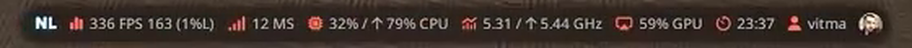

# Info bar

A single flat strip of **icon + value** segments that reports ambient information: brand, frame rate, latency, load, time, user. It is the flat alternative to the [segmented capsule](segmented-capsules.md) watermark: one background, no inner cells, and the icons do the labeling.

## Anatomy (Neverlose captures, measured at 1080p)

| Part | Value |
|---|---|
| Strip | one rounded rect, about 22 px tall, radius about 6, ~40% black, no border, no blur |
| Placement | bottom center, about 4 px above the edge (the product also offers top/bottom × left/center/right) |
| Padding | about 10 px left and right |
| Brand mark | 2 letters, bold, pure white, first segment |
| Segment | icon (about 10 px, accent red) + 4–5 px + text (about 11 px, light grey) |
| Between segments | about 12 px of empty space; no dividers |
| Secondary values | inline in the same text, after a slash, marked with a thin ↑ for "peak" ("32% / ↑79%"), or in parentheses ("163 (1%L)") |
| Units | uppercase, same size and color as the value ("12 MS", "59% GPU") |
| End | a round avatar about 16 px across, flush with the right padding |

## Why it works

- **Icon = category, text = value.** The accent goes only on icons, so the eye can jump to "the clock" or "the ping" by shape and color, then read the number.
- **One background for everything** makes it read as a single object, so it can carry 8 segments without looking like 8 widgets.
- **Ambient, not alerting.** No animation in steady state, no color change on values by default (the product's option list has warning and critical colors for when a value crosses a threshold; use those sparingly).

## Rules

- Keep it under about 30% of the screen width. Drop segments rather than shrinking text.
- Use tabular (fixed-width) digits, or ease the width, so a changing number doesn't make the whole bar jitter when it is centered.
- Smooth fast-changing values (frame rate) over about half a second before displaying them.
- If a value needs attention, recolor that segment's text only, not the whole bar.
- Put it at an edge the game doesn't use. Bottom center collides with most game HUDs; test top center too.

## Variants

- **Density** (neverwin option list): compact / default / spacious, which scales the padding and segment gap.
- **Segmented**: each value in its own cell, as in the [velocity.cat watermark](velocity-cat-hud.md). Heavier, but the cells can be accent-filled.

## ImGui approach

`InfoBar(dl, anchor, brand, items, n, ...)` in [HUD elements](../implementation/hud-elements.md). Each `InfoItem` is a glyph and a string. The bar is anchored by its bottom-center point, and its width eases toward the content width on a spring so digits changing don't make it jump.

## Seen in

- [Neverlose — HUD](neverlose-hud.md): the bottom-center bar.
- [neverwin — visuals](neverwin-visuals.md): the matching option list (6 anchors, 3 densities, the item list, warning and critical colors) and icon set.
- [Neverlose Recurrence — HUD](neverlose-recurrence-hud.md): a 328 × 28 stadium at the top right with blue icons, Inter 10 px white text and an avatar end-cap.

Related: [Segmented capsules](segmented-capsules.md), [Status pills](status-pills.md), [HUD principles](hud-principles.md), [Typography and icons](../principles/typography-and-icons.md)
