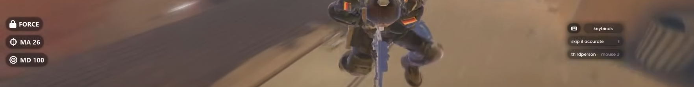
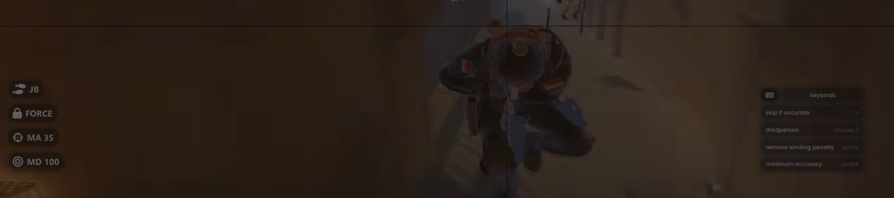

# Keybind list

An on-screen list of the bound settings that are currently active, each with its key. It tells the user what their keys are doing right now.

## Variant A: split header, uniform rows (owner captures)

- **Header**: two separate pieces, a circular disc with a keyboard glyph, then a wide pill with the centered title "keybinds" in lowercase.
- **Rows**: one stadium pill per bind, all the same width as the header assembly. The name is left-aligned in white; the key is right-aligned in dim white ("t", "mouse 3", "space").
- **Container**: the same about 45% black as the [status pills](status-pills.md). Rows are about 26 px tall with about 6 px between them. The font looks geometric (Poppins-like; unconfirmed).
- **Placement**: right edge, mid-height.
- In a darker capture the whole list is dimmed and a faint larger panel is visible behind it. This might be a "menu open" or edit state (unconfirmed).

## Variant B: segmented rows (velocity.cat)

- **Header**: a glass capsule with an accent icon cell (keyboard glyph in dark) and a title cell ("keybinds" in accent).
- **Rows**: each row is its own capsule as wide as its content, so the edge is ragged. A name cell is followed by an optional **value cell filled with the accent** (dark text) for binds that carry a number. Text color encodes the bind mode: toggle binds are dim, hold binds are accent.
- **Placement**: left edge, 10 px margin, vertically centered on the screen. The list's top position follows the center on a spring, so it stays centered as rows are added and removed.
- Details in [velocity.cat — HUD](velocity-cat-hud.md).

## Motion

| What | Value |
|---|---|
| Row fade in / out | 0.2 s / 0.15 s, ease-out |
| Row slot (y) | spring, stiffness 200, damping 20; snaps on first appearance so new rows don't fly in from 0 |
| Container | fades out (0.2 s) when there are no rows |
| Removed row | keeps drawing at its last slot while fading; rows below glide up immediately |

The [pink sidebar menu](../references/pink-sidebar-menu.md) exposes these as user settings (a mode combo: "Animated", plus fade speed 6.00, move speed 800 px/s, shift speed 800 px/s, spacing 6 px, remove distance 140, overlap 6 px, and a lock-to-window toggle). It shows the list is often made configurable.

## Rules

- Only list binds that are **active or held**. A list of everything bound is a settings page, not a HUD.
- Name left, key right. The key is the secondary tier.
- Keep row order stable (sort by name or by when each bind was activated), or rows will jump around.
- Hold-type binds can show a different text color from toggles, so the user knows releasing the key will turn it off.

## ImGui approach

`KeybindList(dl, top_right, title, rows, n, alpha, style)` in [HUD elements](../implementation/hud-elements.md) draws variant A. Each row's fade and spring live in a static `ImGuiStorage`, keyed by name. For variant B, build each row with `Capsule` from [Segmented capsules](segmented-capsules.md).

## Seen in

- [Neverlose community — compact indicators](neverlose-perfect-indicators.md): legacy footage of a narrow dark header and a name/state row; do not assume the script owns every visible overlay.

- [Owner HUD captures](owner-hud-captures.md): variant A, normal and dimmed.
- [velocity.cat — HUD](velocity-cat-hud.md): variant B.
- [Pink sidebar menu](../references/pink-sidebar-menu.md): settings panel for the list's animation.
- [Neverlose — HUD](neverlose-hud.md): small cell-based list near the screen center: one header cell, then an icon cell + name cell per row.
- [neverwin — visuals](neverwin-visuals.md): options only: default / inverted style, a header that resizes with its rows ("dynamic header"), right alignment, free position, and a per-bind "show in list" toggle.
- [Neverlose Recurrence — HUD](neverlose-recurrence-hud.md): a header pill above a two-column chip grid, **value first**, then the bind name; chips sized to their text.

Related: [Status pills](status-pills.md), [Segmented capsules](segmented-capsules.md), [HUD principles](hud-principles.md), [Motion](../principles/motion.md)
