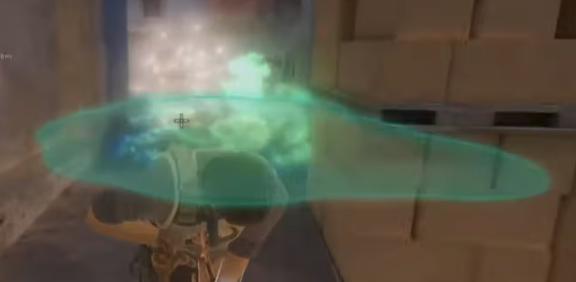
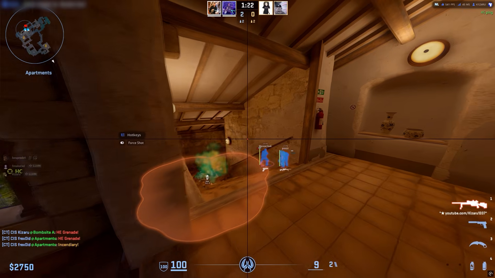
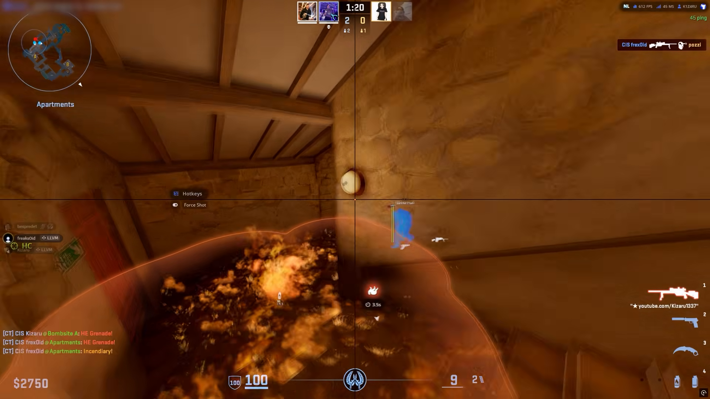
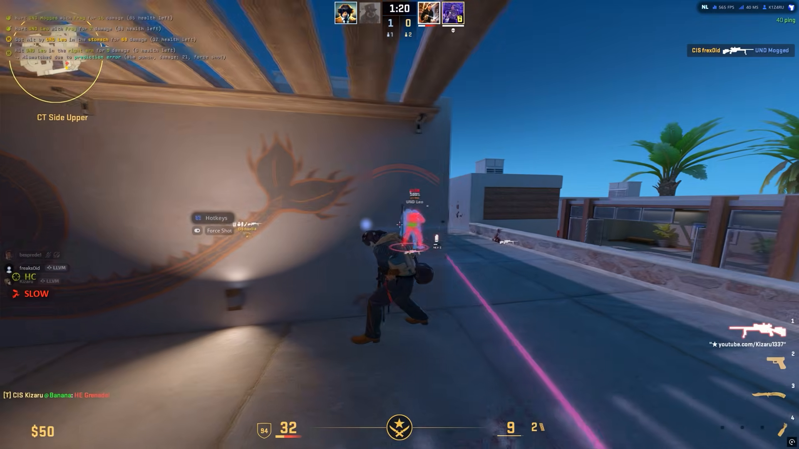
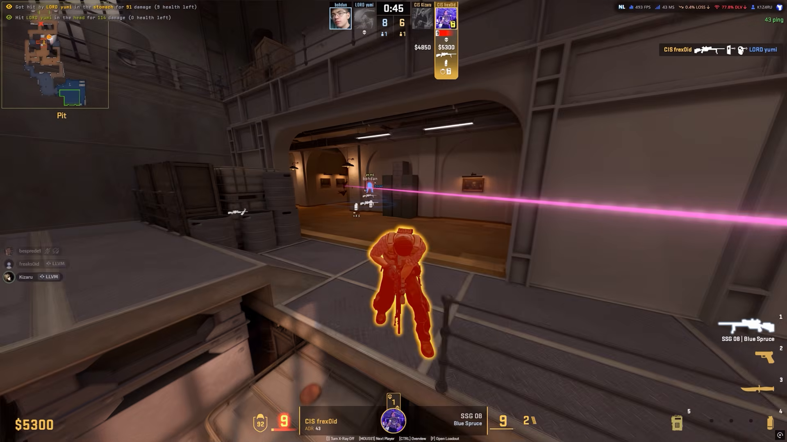
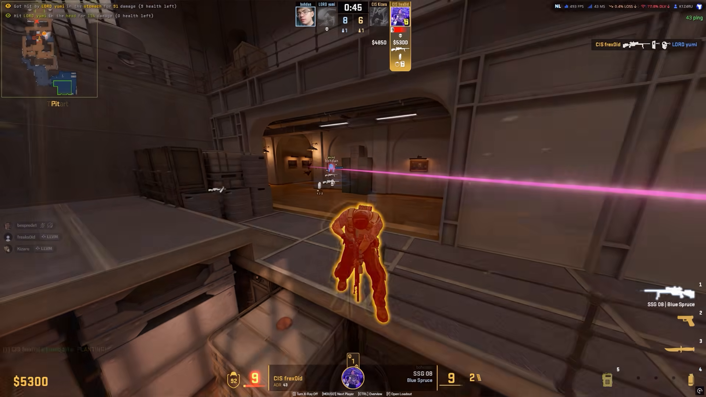

# Kizaru — molly area treatment and glowing tracers

## Owner-selected direction

The owner selected the linked video's **00:17–00:21** area treatment and specifically wants colour to communicate the area's remaining life. They also prefer Kizaru as a reference source because his footage generally uses Neverlose without excessive presentation effects.

**Keep this treatment:** a continuous rounded perimeter, translucent interior, restrained edge glow and a meaningful colour progression, instead of adding another large timer panel. The teal crop is owner-provided.

## Source and temporal evidence

Kizaru's linked tournament montage was published **2026-09-22**. It identifies Neverlose and Sofa League in its title/description. Downloaded and inspected at **1920×1080, 60 fps**.[1]

[Inspect the 00:17–00:24 excerpt](../assets/kizaru-molly-and-tracers-molly-17-24.mp4). This is a silent 1280×720 excerpt retaining 60 fps.

### What is visible

- A warm orange, softly filled region surrounds the active area in these source frames. Its continuous perimeter has rounded lobes rather than the appearance of a simple circular disc. The border is brighter than the fill, while the scene and flames remain visible through the overlay.[1]
- The footprint changes apparent size and shape with the viewpoint. The boundary remains associated with the scene rather than behaving like a HUD panel.[1]
- At **00:18.750**, a green/teal flame or local effect is visible **inside a still-orange boundary**. Flame recolouring and footprint recolouring must be treated as separate observations.[1]

### Lifetime-driven colour

The requested design is **lifetime-driven colour**. The owner's teal image preserves the preferred cool-colour state; the extracted frames preserve the warm state.

For a future implementation, use the actual remaining-life fraction to drive an explicitly chosen colour ramp. Preserve a stable boundary/fill hierarchy as the hue changes; avoid oscillating or flashing simply for decoration.

## Tracers worth borrowing

[Inspect the 01:44–01:46 tracer excerpt](../assets/kizaru-molly-and-tracers-tracer-104-106.mp4).

- The effect has a **saturated pink/magenta core and broad softer halo**, not an obligatorily white center. The brighter near portion and narrower distant portion give depth without needing a large impact billboard.[1]
- Approximate compressed-frame samples at **01:45.200**, x=1400: center y=500 **#ff7be3**; four pixels above **#e06db8**; eight above **#9b5e75**; twelve above **#825464**. These are composited video pixels, not material colours or measured alpha values.
- A pink line remains visible in samples from **01:45.000–01:45.400**.[1]

**Recreation target:** retain a small high-energy core, a smooth coloured halo, scene-anchored endpoints and bounded persistence. Tune width, falloff, lifetime and refresh policy against the excerpt.

## Provenance

[Asset manifest](../assets/kizaru-media-manifest.json): source timestamps, dimensions, transforms and SHA-256. [Source ledger](../assets/kizaru-media-sources.json). The owner image is distinguished from video-extracted frames.

## Sources
[1] https://www.youtube.com/watch?v=p4ZHKESlEt4 — Kizaru tournament footage: supplied reference

Related: [Ground area markers](ground-area-markers.md), [Tracers](tracers.md), [Glow lines](glow-lines.md), [Media sweep](reference-media-sweep.md)
