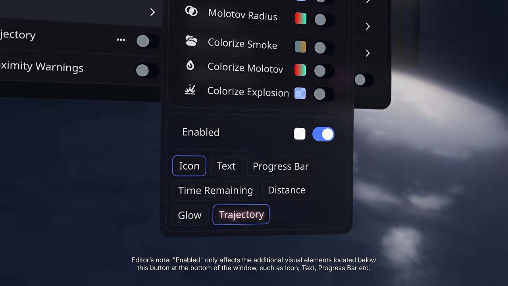
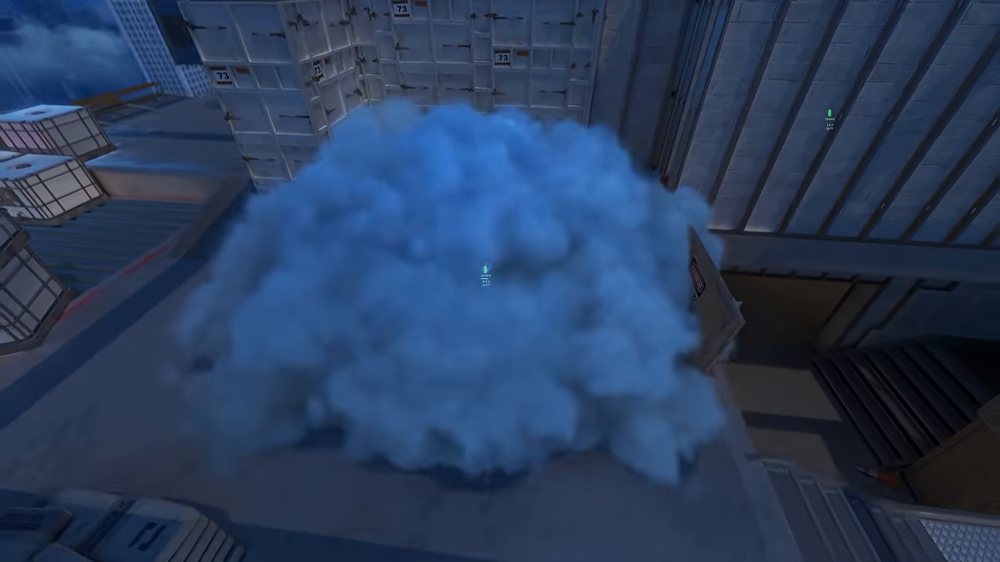
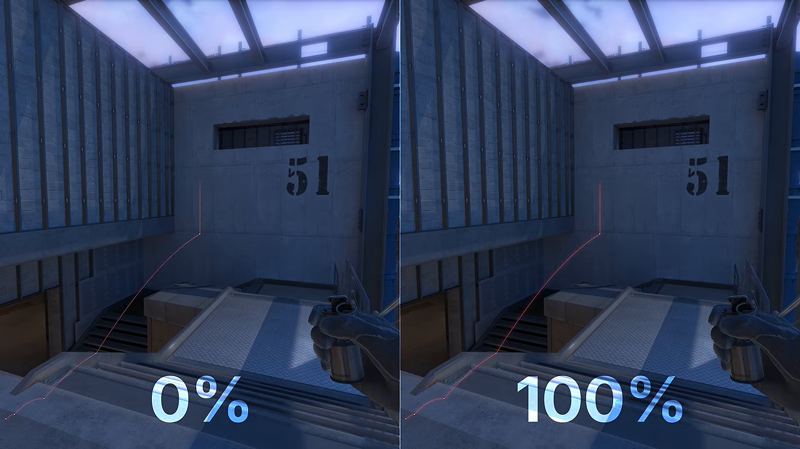
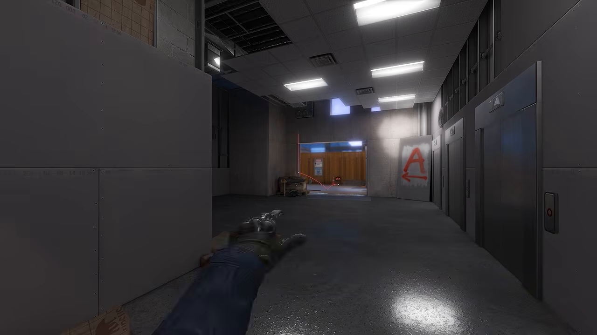
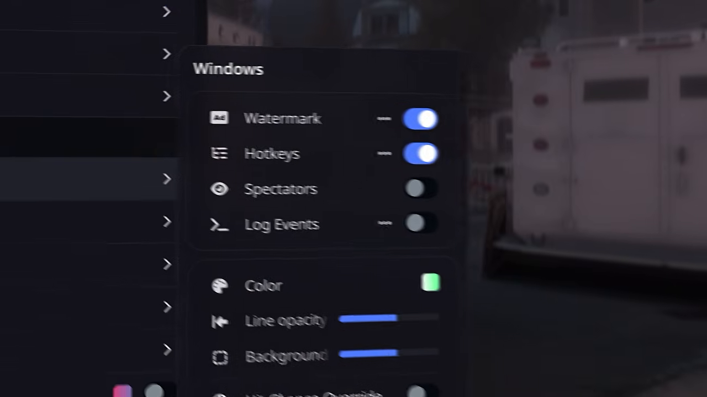
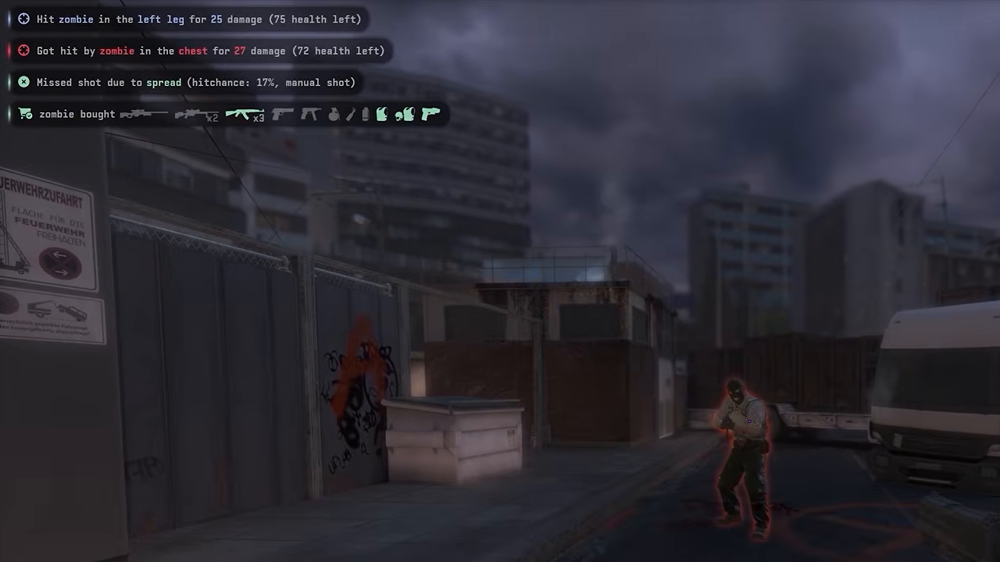

# Neverlose 2026 — world visuals and HUD windows

## Evidence

Frames inspected from the official **2026-07-07** visual-settings tutorial, downloaded at 1280×720. Useful chapters: **17:37–20:35** for world objects and projectiles; **20:35–22:16** for windows and effects.[4]

## Projectile presentation and radius controls

The popup exposes separate choices for icon, text, progress bar, time remaining, distance, glow and trajectory. Radius and scene-color controls are separate rows above the presentation group.[4]

The 19:50 split-screen compares a very faint path with a stronger colored line. Its large percentage captions label the opacity comparison. At 20:10 a thin colored path, small collision/endpoint marks and a compact endpoint annotation are visible; the distant text is too small to classify reliably as time or distance.[4]

## Informative HUD / event windows

The windows submenu groups watermark, hotkeys, spectators and event-log controls, then shared appearance settings. The event demonstration uses stacked dark rounded rows with a narrow colored mark at the left, a type icon and compact text. A purchase-summary row replaces prose with small item silhouettes and quantities.[4]

Neutral reproduction: use “Option A changed to 25” or “Profile loaded” rather than the product's original feature/event names. Keep icons secondary to the message, and avoid converting each word into an individual chip.

## Sources
[4] https://www.youtube.com/watch?v=fCtdJn4k7vs — Neverlose official: Visuals Part 1

Related: [Projectile timing](projectile-timing.md), [Ground area markers](ground-area-markers.md), [Info bar](info-bar.md), [Keybind list](keybind-list.md), [Media sweep](reference-media-sweep.md)
