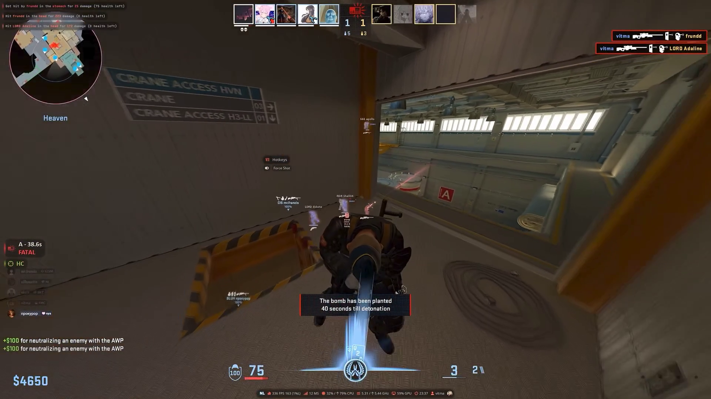
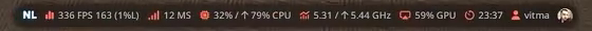
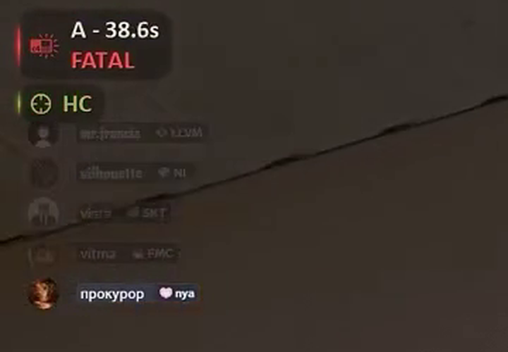
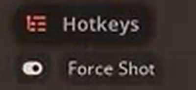
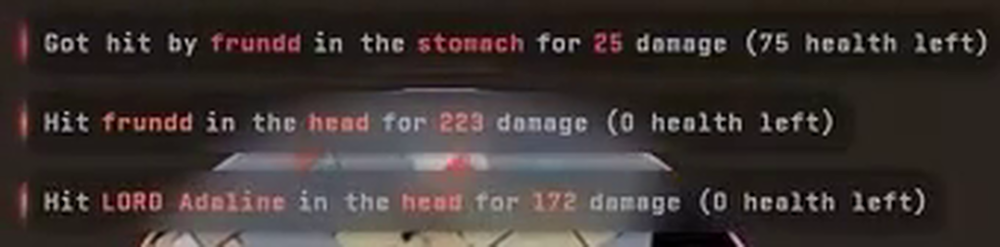
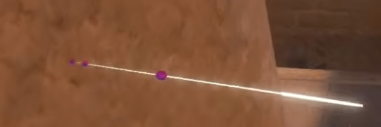

# Neverlose — HUD (video captures)

*Frame from the owner's screen recording (no player UI over it). Everything not drawn by the overlay belongs to the game's own HUD and is ignored here.*

## Summary

The on-screen elements of neverlose as seen in a match video. It is the live look behind the option lists in [neverwin — visuals](neverwin-visuals.md), whose watermark items and icon set match what is on screen here (FPS, ping, CPU, clock frequency, GPU, time, user). The owner especially likes the **info bar** at the bottom center, which has its own note: [Info bar](info-bar.md).

All measurements are from a 1920×1080 video frame, so sizes are ±1 px and colors are approximate (video compression, and every element is translucent over the scene). The red ellipses in the owner's original screenshot were added by the video's author and are not part of the HUD.

## Elements

### Info bar (bottom center)

One translucent strip, about 534 × 22 px, radius about 6, centered 4 px above the bottom edge. Left to right: a bold two-letter brand mark in white, then segments of **red icon + light text**: frame rate with its 1% low, ping, CPU load with peak, clock frequency with peak, GPU load, local time, user name, and a round avatar at the far right. Peaks are marked with a thin up arrow inside the text ("32% / ↑79%"). No separators: about 12 px of space between segments and 4–5 px between an icon and its text. Details in [Info bar](info-bar.md).

### Indicator stack (bottom left)

- **Cards**: a dark translucent rounded rect (radius about 6) per indicator, sized to its content, left-aligned at x ≈ 14, 4–6 px apart.
- **Accent bar**: a 3 px vertical bar on the card's left edge in the state color. It fades out toward its top and bottom ends, matching the "accent bar" output of the [neverwin](neverwin-visuals.md) panel shader (clear at 10% and 90% of the height, full at 50%).
- **Content**: icon in the state color, then the label. A two-line card shows a title in white and a status line in the state color below it ("A - 38.7s" over a red status word). One-line cards show the label in the state color.
- **States**: red for warning/fail (about `#e04a55`), olive green for OK (about `#b6c48c`), white for neutral. A card that is in progress shows a small spinning arc at its right end.
- Below the indicators sits a list of rows with a round avatar, a name and a small tag chip. Rows that are not "live" are drawn at about 25% alpha instead of being removed, so the list doesn't jump around.

### Keybind list (left of center)

Small and cell-based, close to variant A of [Keybind list](keybind-list.md): the header is one cell holding a red list glyph and the title "Hotkeys"; each row is split into a square icon cell (the bind's mode, drawn as a toggle glyph) and a separate name cell. Cells are dark translucent rounded rects about 18 px tall with 3–4 px between cells; the text is about 11 px, light grey. The list sits mid-screen at about (710, 425) and is draggable in the product.

### Hit log (top left)

One row per event, top-down from (8, 8). Each row is a dark translucent rect with a thin red accent bar on its left and a **monospace** sentence (a Stratum-like mono, about 10 px; the [neverwin DLL](neverwin-visuals.md) embeds Stratum2 Mono Bold) where the key words are red and the rest light grey. Rows are tightly spaced (about 27 px pitch).

### In-world labels and markers

- **Label stack per tracked object**: name above (small white, about 9 px), a thin horizontal bar below it, an item glyph under the bar, and short uppercase flags in red or white stacked to the right. All tiny and unboxed: they rely on a 1 px dark outline for contrast.
- **Hit marker**: a small four-arm × (about 12 px across) in white, visible next to the target in one frame. See [Hit markers](hit-markers.md).
- **Tracer**: see below.

### Tracer (close-up)

A thin white line with a hot core that fades toward its far end, a faint warm glow along it, and small magenta dots at points along it (impact or sample points, unconfirmed). It matches the tube shading in [Glow lines](glow-lines.md): bright core, highlight, end fade.

## Palette

| Role | Hex | Notes |
|---|---|---|
| Bar / card background | ~40% black | sampled `#2c231f` over a `#4a3e33` floor (approximate) |
| Text primary | `#cbc5c0` | light warm grey as seen through compression; likely white at about 80% |
| Brand mark | `#ffffff` | pure white, bold |
| Accent (icons, key words) | `#f0646a` | brightest icon pixels; the anti-aliased average is darker, about `#d9505a` (approximate) |
| Warning / fail | `#e04a55` | indicator status text (approximate) |
| OK | `#b6c48c` | olive green indicator (approximate) |

## What makes it work

- **One shape, one background value, one accent.** Every element is a dark translucent rounded rect at about the same alpha, with red used only for icons, accent bars and key words.
- **Icons carry the category, text carries the value.** In the info bar, the red icon tells you what a number is, so the text can drop most labels.
- **Unboxed, tiny in-world text** keeps the scene readable; boxes are reserved for screen-space elements.
- **Dim instead of remove** (the avatar list) avoids layout jumps.

## What to avoid / weaknesses

- Light grey on 40% black is low contrast over bright floors; the info bar has no outline or blur.
- The info bar's width changes with each digit because the font is proportional; it re-centers every frame and the brand mark jitters. Use tabular digits or ease the width (the recipe does the latter).
- Many small elements spread over all four edges and the center; it reads as busy in a full match.

## Implementation notes

The info bar is in [HUD elements](../implementation/hud-elements.md) as `InfoBar`. The indicator cards can be built from `StatusPill` with a left accent bar drawn as two `AddRectFilledMultiColor` halves (clear → color → clear).

Related: [Visuals](INDEX.md), [Info bar](info-bar.md), [neverwin — visuals](neverwin-visuals.md), [neverlose-ui](../references/neverlose-ui.md), [Status pills](status-pills.md), [Keybind list](keybind-list.md), [Hit markers](hit-markers.md), [Glow lines](glow-lines.md), [HUD principles](hud-principles.md)
