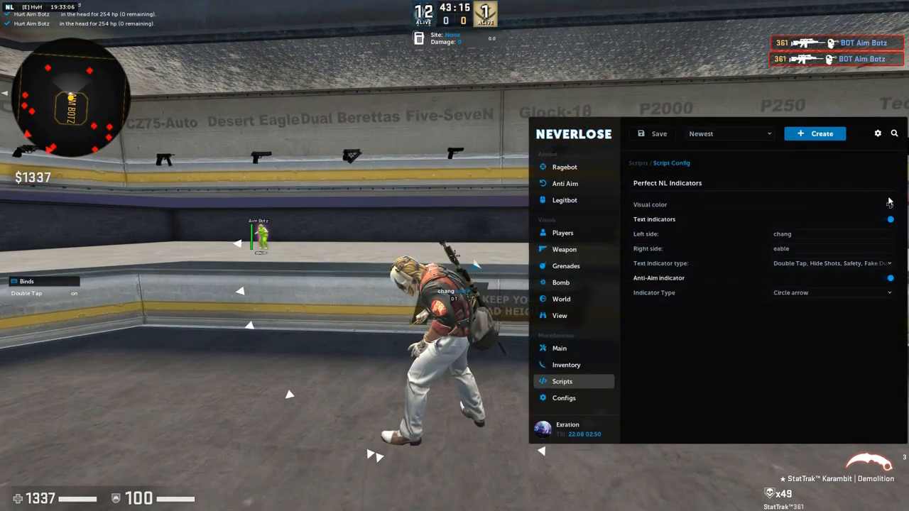
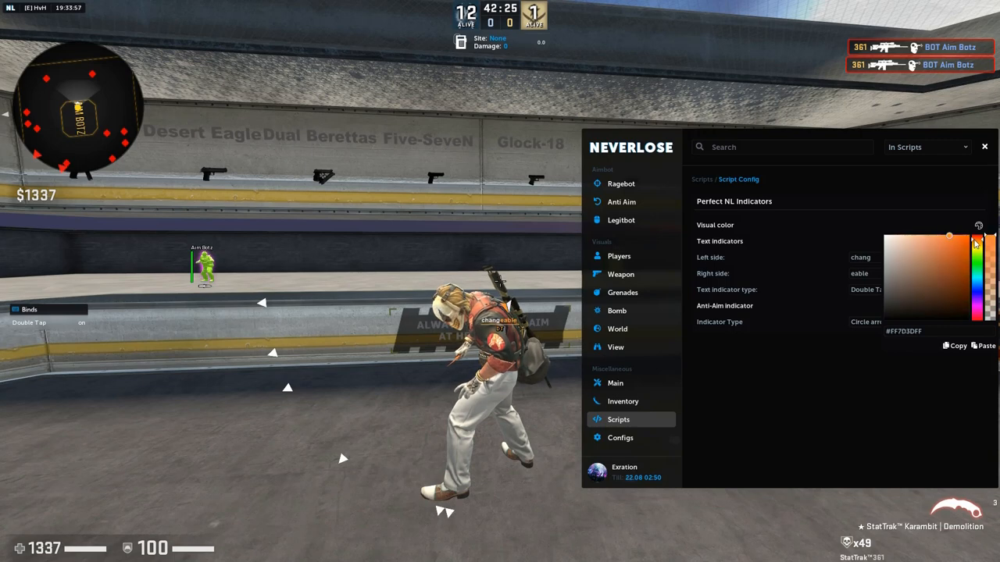

# Neverlose community — compact indicators and bind HUD

## Evidence

“Perfect NL Indicators Release [Neverlose]”, published **2021-06-24**. This is a **legacy CS:GO community script**, visibly configured in the script-settings page, not proof of the stock/current Neverlose indicator design.[5]

## Visible anatomy

- A tiny top-left information strip combines an NL brand tile, server text and a clock, with compact event lines underneath.[5]
- A separate left-side bind panel uses a narrow dark title bar and a name/value row. Its secondary state is aligned to the right; the row is much lighter visually than a full menu card.[5]
- Near the model/screen center, very small text and a short status abbreviation sit around the focal area. White directional triangles are distributed farther out rather than enclosed in individual boxes.[5]
- The script's page exposes visual color, text-indicator and directional-indicator controls; the later frame opens a color editor without replacing the full settings surface.[5]

## Why keep it

This adds a **low-background, typography-first** alternative to the vault's glass cards. It also preserves a genuine bind-list header/row relationship and a compact watermark example from a different Neverlose era. Use neutral labels “Option A” and “on” when recreating the row.

## Limits

Do not infer which visible overlay component is owned by the script versus the host without its source. A row reading “on” does not establish whether a key is held or toggled. Stills do not establish row-entry animation or timer semantics.

## Sources
[5] https://www.youtube.com/watch?v=0Ax94kiatgU — Perfect NL Indicators release

Related: [Keybind list](keybind-list.md), [Info bar](info-bar.md), [Status pills](status-pills.md), [Neverlose HUD](neverlose-hud.md), [Media sweep](reference-media-sweep.md)
