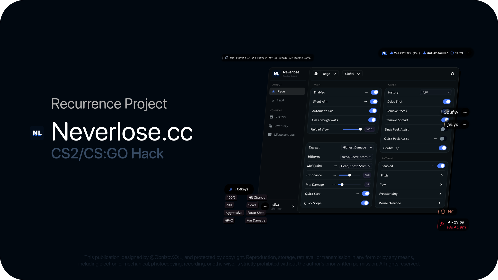
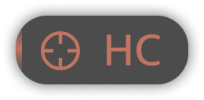
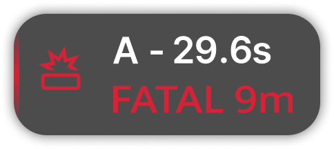
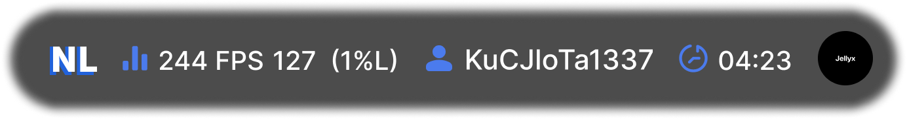
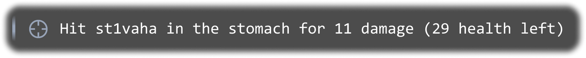
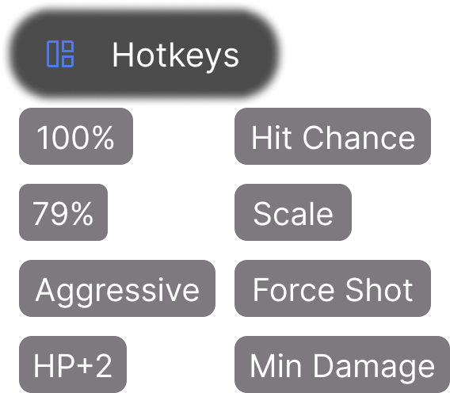
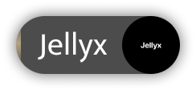
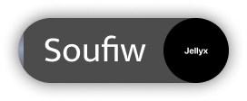
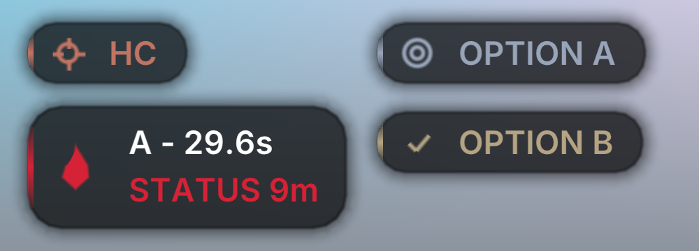

# Neverlose Recurrence — HUD (Figma concept)

## Summary

The HUD set from the same Figma concept as [Neverlose Recurrence — menu](../references/neverlose-recurrence-menu.md): indicator cards, a watermark, a hit log, a hotkey grid and spectator chips. It is a cleaner, cooler restyle of the real product's HUD in [Neverlose — HUD](neverlose-hud.md). The shapes are the same, but there is one shared glass recipe, a blue brand accent, and **muted, per-indicator state colours**. The owner especially likes the **indicators**; they are covered first and in the most detail.

**Values are exact**, read from the decoded `.fig` document, not sampled. Units are pixels on a 1920 × 1080 frame: the file places every element on three 1920 × 1080 gameplay frames. Exported PNGs are 4× with shadow padding. Much of the HUD text is outlined in the file, so those font sizes are estimated from cap height and marked "about".

## The shared glass recipe

Every element except the hotkey chips is built the same way:

| Property | Value |
|---|---|
| Fill | black at **70 %** (the watermark is 80 % in one frame) |
| Backdrop blur | radius **5** (Figma "background blur") |
| Drop shadow | black, **no offset**, radius 3–5, at 60–70 %; elements wider than ~300 px add a 4–5 px spread |
| Stroke | none |
| Corner radius | 10–12 (pills, indicators), 15 (watermark: a full stadium at 28 tall), 5 (hit log) |
| Accent bar | **2 px** (1.5 on spectator chips), full height, on the left edge, clipped by the card's corner |
| Text | white |

The shadow sits evenly on all sides because it has no offset, so it reads as a dark halo rather than a cast shadow. The halo is what keeps the 70 % black readable over bright sky; there is no outline.

## Indicators

 

Two sizes, stacked at the left edge: the one-line card at (11, 622), the two-line card 10 px under it at (10, 654). They sit about 58 % down the screen, under the hotkey grid. The cards are left-aligned and sized to their content.

| | One-line | Two-line |
|---|---|---|
| Size | 55 × 22 | 111 × 44 |
| Radius | 10 | 12 |
| Icon | 14.5 px at (7, 4) | 20 px at (7, 10) |
| Text | label at x 29, about 14 px, **in the state colour** | title at (36, 8) in white, about 14 px; status at (36, 26) **in the state colour**, a short uppercase word plus a value |
| Example state | `#c27463` muted salmon | `#d52236` strong red |

**The accent bar** is the signature. It is a 2 px wide, full-height rect on the card's left edge, filled with a **vertical linear gradient** in the state colour:

- transparent at 10 % of the height,
- fully opaque at 50 %,
- transparent again at 90 %.

The bar is clipped by the card's rounded corner, so it curves with the card's outline. The real product does the same (see [Neverlose — HUD](neverlose-hud.md)), and it matches the "accent bar" output of the [neverwin](neverwin-visuals.md) panel shader stop for stop. The hit log uses a flatter version: opaque from 42 % to 60 %.

**Colour rules.**
- The icon, the bar and the status text share one colour; the title stays white. You can read the state from the bar alone in peripheral vision, and from the text when you look at it.
- State colours are **desaturated and per indicator** (salmon, steel, tan), not a single traffic-light red and green. Only a critical state (the two-line card's red) is fully saturated, so it jumps out of an otherwise quiet stack.
- No background tint per state: the card stays 70 % black, so the stack looks uniform.

**Icons** are Google Material Symbols (`my_location`, `destruction`), filled, at the state colour.

## Watermark

A 328 × 28 stadium at the top right, 25 px from the top and right edges. Left to right:

- the white two-letter brand mark with a blue shape offset behind it,
- then segments of a **blue icon** (`#4b7bed`, 12–15 px) plus **white Inter Medium 10 px** text: frame rate with its 1 % low, user name, and clock,
- then a 21 px round avatar inset 3 px from the right end.

There are no separators, only spacing. It is the [Info bar](info-bar.md) pattern with the product's red swapped for the menu accent, moved from the bottom centre to the top right.

## Hit log

A 366 × 22 row at the top left (15, 19), radius 5 (squarer than the other elements). It has:

- a 2 px steel accent bar (`#98a4b8`) with a long flat plateau,
- a 14 px steel crosshair icon,
- one sentence in **Consolas 10.5 px, all white**.

Unlike the real product, no key words are highlighted. The monospace type is kept, which makes stacked log lines align.

## Hotkey grid

A header pill (79 × 22, the glass recipe, blue `auto_awesome_mosaic` icon, Inter 10.5 px title). Under it is a **two-column grid of chips**, not a list of rows:

- **Left column**, at x 49: the bind's **value or mode** (a percentage, a mode word, a short modifier).
- **Right column**, at x 117: the bind's **name**.
- Chips are 18 tall, radius 4, about 5 px horizontal padding, Inter 10 px white, with a 24 px row pitch.
- Each chip is sized to its text, so the columns are ragged on the right.
- The chips have no shadow and a lighter recipe: `#28202b` at 60 % (a faint plum tint) in two frames and neutral `#0d0d0d` at 60 % in the third.

Putting the value first means the number you care about mid-match lines up in one column. Compare the icon cell + name cell rows of [Neverlose — HUD](neverlose-hud.md) and the variants in [Keybind list](keybind-list.md).

## Spectator chips

 

Right edge, 20 px in, at y 319 and 342 (5 px gap). Each chip is 18 tall, radius 10, sized to the name. It has:

- a 1.5 px accent bar per person (tan `#b4a483`, steel `#98a4b8`),
- the name in Mukta 10 px white,
- an 18 px round avatar **flush with the right end**, so the chip ends in the avatar's circle.

The chips are right-aligned, so their left edges are ragged.

## Small "open menu" badge

At the bottom-right corner (about 1850, 1046) sits a 61 × 26 badge in the **menu's** style rather than the HUD's: an opaque `#0a0f12` fill, the 5 % white hairline, radius 5, a soft 4 px downward shadow. It holds a short label telling you how to open the menu. It links the HUD back to the menu's look.

## Layout on screen

- Top left: hit log.
- Top right: watermark.
- Left edge, upper middle: hotkey grid.
- Left edge, lower middle: indicators.
- Right edge, upper middle: spectators.
- Bottom right: the open-menu badge.

Everything hugs an edge with a 10–25 px margin, and the centre third of the screen is empty.

## Palette

| Role | Hex | Notes |
|---|---|---|
| Element fill | `#000000` @ 70 % | 80 % for the watermark in one frame |
| Hotkey chip | `#28202b` @ 60 % | neutral variant `#0d0d0d` @ 60 % |
| Halo shadow | `#000000` @ 60–70 % | radius 3–5, no offset |
| Text | `#ffffff` | |
| Brand accent (watermark, hotkey icon) | `#4b7bed` | menu accent `#4b7dfe` |
| Indicator: critical | `#d52236` | |
| Indicator: warning / active | `#c27463` | muted salmon |
| Neutral bar (hit log, spectator) | `#98a4b8` | steel |
| Spectator bar | `#b4a483` | tan |
| Open-menu badge | `#0a0f12` | 5 % white hairline |

## What makes it work

- **One glass recipe for every element.** Same fill, same blur, same halo, so a busy screen still reads as one system.
- **The fading accent bar.** It adds state colour with almost no ink, and its soft ends stop it from looking like a border.
- **Muted state colours with one saturated critical.** The eye goes to the red card first without the rest of the stack being loud.
- **Value-first hotkey grid.** It is scannable by value, and the chips size to their content with no wasted width.
- **Avatars as chip end-caps** make the spectator list compact: no separate column for faces.

## What to avoid / weaknesses

- **No outline on text.** White on 70 % black is fine, but the blur is only 5 px, so over bright, detailed scenes the small 10 px text loses some edge.
- **Hotkey chips are lighter than the header** (60 % plum against 70 % black) and have no shadow; over sky they get very faint.
- **Mixed fonts again**: Inter, Mukta and Consolas within one HUD.
- The salmon "warning" and the tan spectator bar are close in hue; with more states this palette needs a defined list, not ad-hoc colours.

## Implementation notes

The indicators are in the [HUD elements](../implementation/hud-elements.md) recipe, built to these exact values:

- `IndicatorCard(dl, pos, glyph, title, status, state)`: pass `status = nullptr` for the one-line card. State colours come from `IndicatorCritical()`, `IndicatorWarning()`, `IndicatorNeutral()` and `IndicatorOk()`.
- `IndicatorStack(dl, id, anchor, items, n)`: a left-aligned stack. Cards fade out when inactive (0.15 s), and the cards below spring up into the freed slot.
- `AccentBar(dl, p0, p1, rounding, width, colour, alpha, stops)`: the fading bar alone, clipped to any rounded rect's left edge. `BarStops{0.10f, 0.42f, 0.60f, 0.90f}` gives the hit log's flatter bar.

The other pieces map onto existing functions: `InfoBar` for the watermark (swap the accent colour) and `KeybindList` for the hotkeys (a value-first two-column variant would be new). The recipe has no backdrop blur; that needs a render-to-texture pass in a real renderer. Without one, raise the fill to about 80 % and keep the halo; see [Depth, glass and glow](../principles/depth-glass-and-glow.md).

Related: [Visuals](INDEX.md), [Neverlose Recurrence — menu](../references/neverlose-recurrence-menu.md), [Neverlose — HUD](neverlose-hud.md), [Status pills](status-pills.md), [Info bar](info-bar.md), [Keybind list](keybind-list.md), [Segmented capsules](segmented-capsules.md), [neverwin — visuals](neverwin-visuals.md), [HUD principles](hud-principles.md), [Depth, glass and glow](../principles/depth-glass-and-glow.md)
