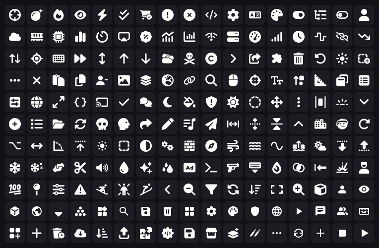

# neverwin — visuals (from a compiled DLL)

*187 of the 190 SVG icons embedded in the DLL, drawn white on 40 px tiles (radius 8). The three product logos are left out.*

## Summary

A compiled overlay DLL whose drawing layer is unusually well documented: it ships its HLSL shaders as source text, with comments. Those shaders show how a soft, glowing, rounded HUD look is built from one signed-distance-field (SDF) primitive, plus a Gaussian glow pass, a tapered glowing line and a few full-screen effects. The option names list the HUD elements and every tunable they expose.

**Provenance (read before reusing anything).** Its own shader comments say they reproduce another product's shaders "instruction for instruction" (they cite [neverlose](../references/neverlose-ui.md)'s shader addresses), and its UI strings name that product. Treat this as a third-hand copy of the neverlose look: study the techniques, don't copy the code. The rain effect looks adapted from a well-known public Shadertoy rain shader, which is licensed non-commercial (a guess from the function names and constants). Everything in this note is written independently.

## Source material

Static inspection with `strings`, `rabin2` and a carving script covered:

- the embedded SVG icons, fonts and HLSL source text;
- option and label strings that name visual elements and their tunables.

The numeric values below come from embedded shader constants; the option lists document available controls.

## Assets

| Asset | What it is | In the vault? |
|---|---|---|
| 190 SVG icons | solid white glyphs, mostly `viewBox 0 0 512 512`; a few are 24×24 stroke-style (play, stop, plus). The set looks like a solid icon font of the Font Awesome kind (a guess). | contact sheet only (above); 3 product logos excluded |
| Stratum2 Mono Bold (OpenType) | narrow monospace display face, used for numbers and labels | no: commercial font |
| Smallest Pixel-7 (TrueType) | tiny pixel font for small HUD text, readable at 7–10 px | no: freeware for personal use only |
| Arial / Arial Bold | loaded from the system font folder | no |
| one 500×500 JPEG | a product logo | no |

**Icon style worth copying:** one weight, solid fill, no outlines, centered in a square. At 16–24 px they read as silhouettes, which is what lets an icon sit inside a 20 px [status pill](status-pills.md) cell without detail mush.

## The one primitive: an SDF rounded rect with "kinds"

Every panel, pill, shadow and glow goes through one pixel shader that evaluates a rounded-rectangle distance `d` per pixel. The quad is enlarged by the shadow reach plus 2 px so the soft edge has room. A `kind` parameter picks what to output:

| Kind | Output | Used for |
|---|---|---|
| 0 shadow | `alpha · falloff(d) · outside` | soft drop shadow under a panel |
| 1 glow | as 0, times a vertical ramp (0 at 10% of the height, 1 at 50%, 0 at 90%) | glow that is brightest at mid-height, so a pill seems lit from its middle |
| 2 fill | `alpha · coverage` | the panel itself |
| 3 glass | blurred frame (sampled at this pixel) × tint, times coverage | frosted-glass panels |
| 4 accent bar | a thin bar with the same vertical ramp as its fill, and a glow at 75% of its alpha that also follows the ramp | the accent stripe on the side of a row or notification |
| 5 offset shadow | kind 0 evaluated at `p − offset` | directional drop shadow |
| 6 inner gradient | fill that blends to a second color as you move in from an offset edge | gradient headers and buttons |

The details that make it look good:

- **Squircle corners.** A `smoothing` value `s` in 0–1 turns the rounded corner into a superellipse: exponent `n = 2 + 3.6·s`, radius `r / max(1 − 0.6·s, 0.01)`. At `s = 0` it is an ordinary rounded rect. Higher `s` gives the continuous "iOS" corner, which looks softer than a circular arc at the same visual size.
- **Pixel-exact antialiasing.** Edge width is `w = |ddx d| + |ddy d|`. Coverage is `smoothstep` of `(d + w) / 2w`, so every edge is about 1 px soft at any scale.
- **Shadow falloff** is `1 − smoothstep((d + size/2) / size)`: half the shadow sits under the shape, half outside, so there is no hard line where the panel ends.
- **Matches ImGui.** The rounding is clamped to `min(half_w, half_h) − 1`, which is what ImGui's `AddRectFilled` does, so a shadow drawn by the shader lines up with a fill drawn by ImGui.

## Glow and blur passes

- **Glow:** draw the glowing parts (lines, markers, outlines) into a separate target, then run a separable Gaussian twice (horizontal then vertical), 25 taps (±12), weights `exp(−i²/2σ²)`. One pass blurs alpha; the final pass outputs `tint.rgb` with alpha `saturate(blurred · strength) · tint.a`. Every element that has a "glow" toggle (hit marker, scope lines, spread circle, trajectory, area radius) feeds this one layer, which is why their options are just `glow` + `glow_strength` (+ `glow_size` = σ).
- **Glass blur:** the same Gaussian with 17 taps (±8) over the frame, sampled by kind 3 panels.
- **Desaturate:** a fill shader that lerps the textured color toward its grey average by a parameter. Likely used to grey out disabled previews (a guess).

## Tapered glowing line

One quad per segment, shaded as a capsule SDF between two endpoints. Half-width and glow radius are both interpolated from start to end, so the line can taper. Core coverage is antialiased like the panel. Outside the core the glow is `(1 − e/glow_radius)³ · strength`. A highlight whitens the center by up to 25%, which makes it look like a lit tube rather than a flat stroke. Start and end fades run along a perspective-corrected `u`, so a line drawn into the distance fades evenly in world space. Full write-up: [Glow lines](glow-lines.md).

## HUD elements and their tunables

Placeholder names replace the product's feature names. "Glow" always means "feeds the shared glow layer".

| Element | Tunables found | Vault note |
|---|---|---|
| Hit marker | line count, gap, size, thickness, rotation, converge (on/off + time), drift, fade inner, fade outer, outline (on, color, size), glow (on, size, strength), color, second color for a stronger event, duration | [Hit markers](hit-markers.md) |
| Damage number | shown with the hit marker; toggle only | [Hit markers](hit-markers.md) |
| Keybind list | style (default / inverted), dynamic header, right-aligned, free x/y position, per-bind "show in list" | [Keybind list](keybind-list.md) |
| Watermark | position (6 anchors: top/bottom × left/center/right), density (compact / default / spacious), avatar, items (logo, user name, framerate, time, CPU/GPU/memory load, CPU cores with per-core colors, …), warning and critical colors for values | [Info bar](info-bar.md), [Segmented capsules](segmented-capsules.md) |
| Status indicators | list of items, normal / success / fail colors, background opacity, line opacity, a minimum value before a number shows | [Status pills](status-pills.md) |
| Area radius (ground) | style, fill color, outline (on, color, opacity), shadow (on, color, intensity), gradient opacity, glow opacity, fade time, fade offset, a timer, two color sets for "safe" and "danger" | [Ground area markers](ground-area-markers.md) |
| Impact boxes | small 3D boxes at a point: size, rounding, fill / outline / glow opacity, two colors for two sources, duration; optional sparks (count, radius, height, spread, lifetime, color, glow) | none yet |
| Trajectory line | color, thickness, glow (+ strength), shimmer, points (thickness, an exponent for their spacing), a color for "hits something" | [Glow lines](glow-lines.md) |
| Scope-style overlay lines | four lines around the center: gap, inner and outer length, thickness, rotation (none / tilted), a selection of which sides to draw, a scale that follows a 0–1 input, glow, animation speed | [Hit markers](hit-markers.md) (same geometry family) |
| Spread circle | color, thickness, glow (+ strength), radial gradient (+ alpha), smoothing (eases the radius) | none yet |
| Offscreen arrow | radius from screen center, size, fill, background color, shadow color | [Countdown badges](countdown-badges.md) (edge-pointing arrow) |
| Kill particles | type, count, spread, speed, lifetime, color, glow | none yet |
| Media widget | free x/y, hide when idle, spinning album cover | none yet |
| Screen effects | chromatic aberration (amount), vignette (amount; elsewhere strength, radius, roundness, feather, tint), rain on the lens (amount, size, speed, blur, fog) | [Screen effects](screen-effects.md) |
| Box/bar item editor | the layout editor for labels around a box: drag with the left mouse button to move an item, right-click to customize it, mouse wheel to resize; bars have their own color, shadow color and a progress-bar style | none yet |

Global scale options for the HUD sit next to the menu scale (75–200% plus auto), which is worth copying: HUD and menu scale separately.

## What makes it work

- **One primitive, many looks.** Fill, glass, shadow, glow and accent bar are the same SDF with a different output, so every element shares exactly the same corner shape and edge softness.
- **Light from the middle.** The mid-height ramp on glows and accent bars makes thin elements look lit rather than outlined.
- **One glow layer.** Glow is a post-pass shared by every element, with one strength knob each, so glows match across the HUD.
- **Every tunable is exposed**, including fade at both ends of a line and inner/outer fade of hit-marker arms. See [HUD principles](hud-principles.md) §6 on how much of this to expose.

## What to avoid / weaknesses

- The option count is huge (20 settings for one hit marker). For a product, pick good defaults and expose a few.
- Full-screen effects (rain, chromatic aberration, vignette) cost legibility. They should never sit under HUD text.

## Implementation notes

ImGui can't run a custom pixel shader per draw call without a renderer callback, so a CPU version is the practical route for this vault: build the squircle outline as a path (sample the superellipse per corner), fill it with `PathFillConvex`, and fake the shadow with stacked expanding outlines of falling alpha, as in [Draw-list recipes](../implementation/drawlist-recipes.md). For the real thing, add an `ImDrawCallback` that binds an SDF shader for one rect.

Related: [Visuals](INDEX.md), [Neverlose — HUD](neverlose-hud.md) (the live look, from video), [neverlose-ui](../references/neverlose-ui.md), [Depth, glass and glow](../principles/depth-glass-and-glow.md), [Glow lines](glow-lines.md), [Screen effects](screen-effects.md), [Hit markers](hit-markers.md), [Keybind list](keybind-list.md), [Ground area markers](ground-area-markers.md), [HUD principles](hud-principles.md)
