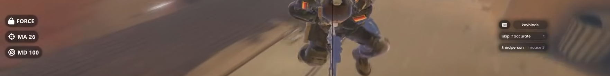
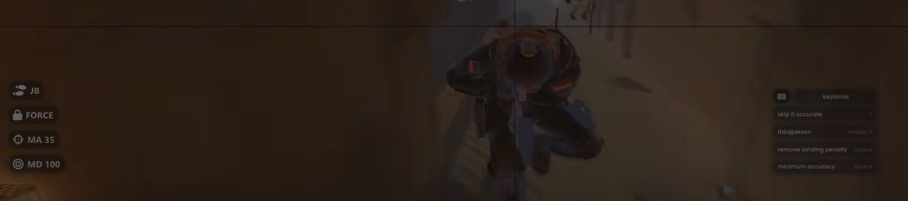
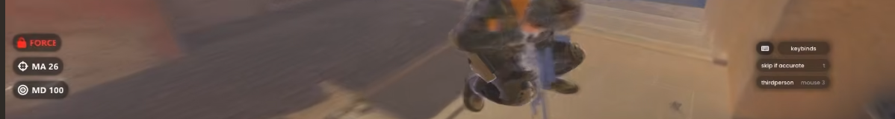
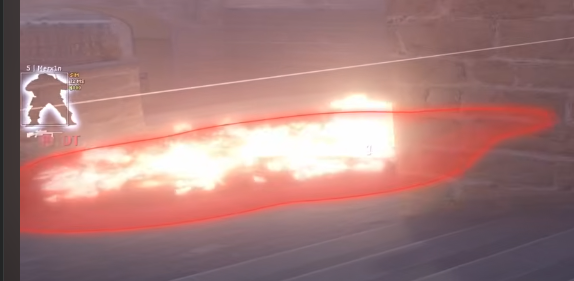

# Owner HUD captures

Four in-game captures the owner liked: three of the same HUD (status pills on the left, a keybind list on the right), and one floor area marker. The product isn't named. The feature names visible in them belong to that product; the notes describe layout and styling only, with placeholder labels.

## Captures

## Layout

- **Left edge, mid-height**: a stack of 3–4 [status pills](status-pills.md) (icon + bold uppercase code, sometimes a number). One more pill shows at the top of the stack in capture 2, which means pills come and go with state.
- **Right edge, mid-height**: a [keybind list](keybind-list.md) (variant A): a keyboard disc, a wide "keybinds" title pill, then full-width rows with the name on the left and the key on the right in a dimmer tier.
- **Floor**: a red [ground area marker](ground-area-markers.md) (method A look) with a smooth concave outline, an outer glow and a translucent fill.

## Palette

Sampled with a scratch sampler from compressed video frames: approximate.

| Role | Hex | Notes |
|---|---|---|
| Pill / row background | black at ~45% | backdrop `#754d43` → inside `#422e2c`; `#3c3028` on another backdrop |
| Text primary | near-white | |
| Text secondary (keys) | white at ~45% | |
| Active state | `#da3126` | icon and text only; the pill keeps its color |
| Area outline | `#da554e`–`#bf5c58` | brighter where it overlaps fire |
| Area fill | red, low alpha | the scene stays visible |

## What makes it work

- One container style (dark translucent stadium) for everything, so the HUD reads as one system.
- State is shown by recoloring the content, so the shape never changes.
- Small, bold, uppercase codes are readable in peripheral vision. The lowercase keybind list is read on purpose, so it can be quieter.
- The area marker is drawn on the floor (it is foreshortened) and is mostly outline. You can still see what's inside.

## What to avoid / weaknesses

- Pill codes are cryptic two-letter abbreviations. An icon per pill helps, but new users need a legend somewhere (a tooltip in the menu).
- In the dimmed capture, the key column drops to very low contrast.
- On a bright floor the red outline and the red fill merge with the fire; an outline in a different hue from the hazard would separate better.

## Implementation notes

All three elements are in [HUD elements](../implementation/hud-elements.md): `StatusPill`, `KeybindList`, and `AreaMarkerMesh`.

## To fill in

If the owner names the product, rename this note and its assets to `<product>-hud.md` / `<product>-hud-N.png` and update the links.

Related: [Visuals](INDEX.md), [Status pills](status-pills.md), [Keybind list](keybind-list.md), [Ground area markers](ground-area-markers.md), [HUD principles](hud-principles.md), [Pink sidebar menu](../references/pink-sidebar-menu.md)
