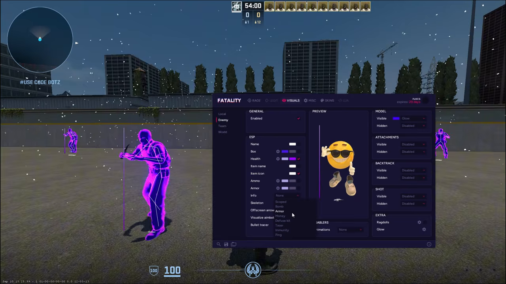

# Reference media — indicators, configs and world HUD

A collection of menu and HUD references added on 2026-11-16. Each case study includes source dates, screenshots and stock/community attribution.

## Start with these

| Need | Best new reference | Useful details |
|---|---|---|
| Config saving / sharing UI | [Neverlose preset manager](../references/neverlose-preset-manager.md) | Official 2026-11-10 tutorial, save/profile toolbar, row menu, share flow; older close-up for inline rename |
| Explicit save/load page | [gamesense presets and key fields](../references/gamesense-config-and-key-fields.md) | Legacy list, name field, action buttons, clipboard pair.[3] |
| Keybind fields | [gamesense presets and key fields](../references/gamesense-config-and-key-fields.md) | Tiny bracketed row-end tags, bound and unbound examples |
| Keybind indicator panel | [Neverlose community indicators](neverlose-perfect-indicators.md) | Narrow header and active-state row, in a legacy script showcase.[5] |
| Watermark / information HUD | [Neverlose community indicators](neverlose-perfect-indicators.md) | Small brand/server/time strip; [2026 windows](neverlose-2026-world-and-windows.md) adds event rows and purchase-summary silhouettes |
| Other indicator geometry | [Fatality community Bilibili preview](fatality-placeholder-hud.md) | Segmented arc and tiny glyph cluster |
| HUD configuration organization | [Fatality community NXC](../references/fatality-nxc-config-and-hud-settings.md) | Original PNGs of enable/style rows, theme controls, independent reset actions |
| Projectile path / endpoint | [Neverlose world/windows](neverlose-2026-world-and-windows.md) | Actual trajectory line, endpoint annotation and presentation settings |
| Fire ground boundaries | [Kizaru molly and tracers](kizaru-molly-and-tracers.md) | Rounded area perimeter, translucent fill and owner-selected teal treatment |

## Area and tracer footage

- [Kizaru — molly and tracers](kizaru-molly-and-tracers.md): supplied 00:17–00:21 passage, original 1080p/60fps inspection, area and tracer excerpts.

- [unmatched rank overlays](unmatched-rank-overlays.md): two original demos, separate Neverlose and gamesense variants.

- [Fatality Halloween — proximity warnings](fatality-halloween-proximity-warning.md): striped-to-filled molotov footprint, grenade trajectory and local red glow; 1080p/60fps excerpts and annotation crops.

## Practical comparisons

- [Config profiles](../widgets/config-profiles.md): popup manager vs dedicated action page vs clipboard/reset page.
- [Projectile timing](projectile-timing.md): distinguish predicted arrival, active lifetime and ground footprint before choosing the visual.
- [Ground area markers](ground-area-markers.md): floor-mesh and screen-hull geometry, fill and edge treatment.

## Additional inspected Fatality footage

A review published **2024-10-01** supplies an opaque purple menu/model-preview example at **04:50**.[8]

## Asset provenance

The [asset manifest](../assets/reference-media-2026-11-16-manifest.json) records each selected PNG's source ID, timestamp where applicable, dimensions and SHA-256. The [source ledger](../assets/reference-media-2026-11-16-sources.json) maps IDs to retrieved URLs.

## Sources
[1] https://www.youtube.com/watch?v=TE_AsKy5GBU — Neverlose official: Misc and Skinchanger Part 2
[3] https://www.youtube.com/watch?v=6WYeedbSXfM — Gamesense legacy review
[4] https://www.youtube.com/watch?v=fCtdJn4k7vs — Neverlose official: Visuals Part 1
[5] https://www.youtube.com/watch?v=0Ax94kiatgU — Perfect NL Indicators release
[6] https://www.bilibili.com/video/BV1EK6uYwE45 — Fatality community Lua preview
[7] https://nxc-lua.com/showcase — NXC Lua creator showcase
[8] https://www.youtube.com/watch?v=pMb6hBihTZQ — Fatality CS2 review

Related: [Visuals](INDEX.md), [References](../references/INDEX.md), [Widgets](../widgets/INDEX.md), [Ground area markers](ground-area-markers.md)
