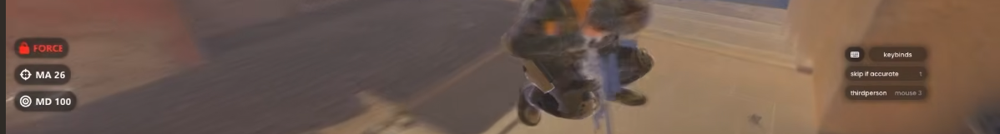

# Status pills

A vertical stack of small stadium-shaped badges that each say one thing about the current state: an icon plus a short code or value ("LOCK", "LIMIT 26").

## Anatomy (owner captures)

- **Shape**: a full stadium (radius = height / 2), about 30–34 px tall at 1080p. Width hugs the content.
- **Content**: a 14 px white glyph, about 7 px gap, then a **bold uppercase** code, optionally with a number ("CODE 26"). Text is near-white.
- **Container**: black at about 45% over the scene (sampled: backdrop `#754d43` → inside `#422e2c`, approximate) with a soft dark halo of a few px. No border.
- **Stack**: left edge, about 14 px margin, about 12 px between pills, vertically near mid-screen.
- **Active state**: icon and text turn red (`#da3126`, sampled from a compressed frame, approximate); the pill itself is unchanged. Inactive pills stay white.
- Pills only exist while their state is relevant. A fourth pill appears at the top of the stack in one capture, with no gap left behind when it is absent.

## Rules

- One idea per pill, 1–2 words. A number belongs inside the pill, not in a separate one.
- The icon carries recognition at a glance; the code confirms it. Use distinct silhouettes (lock, crosshair, concentric target, footsteps).
- Order by importance or by how often they change, and keep the order stable.
- Animate entry and exit (fade 0.2 s / 0.15 s) and spring the others into place. See [HUD principles](hud-principles.md).

## Variant: segmented cells

velocity.cat shows similar status information as cells in a [segmented capsule](segmented-capsules.md) (its watermark): a value in the accent color plus a dim unit, side by side in one bar instead of stacked.

## ImGui approach

`StatusPill(dl, pos, glyph, label, t_active, alpha, bold_font)` in [HUD elements](../implementation/hud-elements.md). It returns the size, so a caller can stack pills with `pos.y += size.y + 12`. Animate `t_active` with `AnimTo` or `FadeTo` for a color crossfade.

## Seen in

- [Owner HUD captures](owner-hud-captures.md): left-edge stack, red active state.
- [velocity.cat — HUD](velocity-cat-hud.md): the segmented-cell variant (watermark).
- [Neverlose — HUD](neverlose-hud.md): rounded cards instead of stadiums, with a 3 px left accent bar that fades at both ends; red / green / white states, two-line cards for a title plus status, and a spinner arc for "in progress".
- [neverwin — visuals](neverwin-visuals.md): options only: normal / success / fail state colors, background and line opacity.
- [Neverlose Recurrence — HUD](neverlose-recurrence-hud.md): one- and two-line indicator cards with a 2 px accent bar that fades at 10 % and 90 % of the height; muted state colours (salmon, steel, tan) and a saturated red for critical. Exact values from the Figma file. Built as `IndicatorCard` / `IndicatorStack` in [HUD elements](../implementation/hud-elements.md).

Related: [Keybind list](keybind-list.md), [HUD principles](hud-principles.md), [Segmented capsules](segmented-capsules.md)
