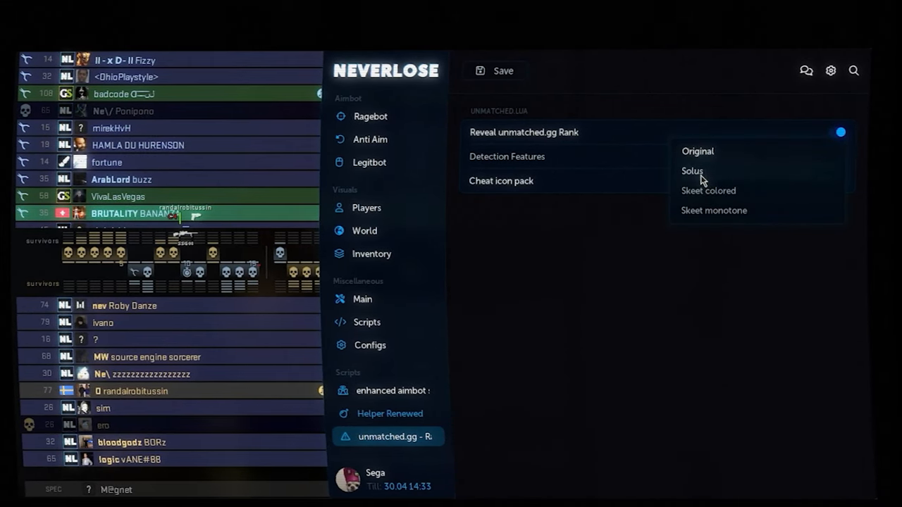
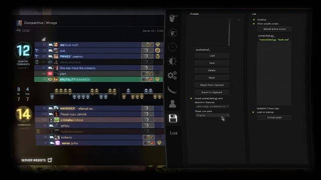

# unmatched — compact rank and player-information overlays

The owner's **unmatched.gg** keyword led to two short demos on the platform's own channel: Neverlose and gamesense/Skeet variants, both published **2023-04-27**. These demonstrate legacy CS:GO-era addon presentation, not current CS2 HUD behavior.[4][5]

## Visible presentation

Both show compact additional rank/icon information inside existing scoreboard rows rather than a second large player table. A settings surface stays beside the scoreboard during the demonstration. The Neverlose clip shows a host-styled settings card with a compact enable row and a small style selector; the gamesense clip uses the host's flat dark page with small labels and list controls.[4][5]

The important design pattern is **augmentation of an existing information surface**: small repeated icon cells, stable row alignment and minimal extra panel chrome. For a neutral UI example, use “Player A” and “Rank 4”; the screenshots retain original labels.

## Limits

These clips do not establish the accuracy of the rank/provider classification, a backend/API contract, or compatibility with current products. The gamesense download required a 360p fallback; its small labels are not a source for exact typography or palette measurements. No Lua was downloaded or run.

## Sources
[4] https://www.youtube.com/watch?v=dSER7i-Whco — unmatched Neverlose rank display demo
[5] https://www.youtube.com/watch?v=ZxHWQ0ZvMP8 — unmatched gamesense rank display demo

Related: [Info bar](info-bar.md), [Keybind list](keybind-list.md), [Media sweep](reference-media-sweep.md)
