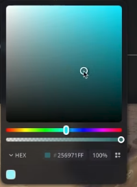

# Color pickers

## Inline swatch

- Small rounded rectangle (~14×8 px or ~12 px square) placed before the row's main control.
- A row can have two swatches (e.g. "visible" and "hidden" colors).
- Click opens the picker popup anchored to the swatch.
- velocity.cat variant: 26 × 16 px, radius 4, **left** of its label like a checkbox, with a 4 px checkerboard under translucent colors. Almost every swatch lives inside a [row settings popup](row-settings-popup.md) rather than on the main surface, which keeps the main surface free of user colors.

## Popup picker

- Rounded saturation/value square, a hue bar and an alpha bar with checkerboard preview.
- Optional hex input and preset swatches.
- One popup can edit several colors with small tabs or a list (neverlose-ui does this).

### The owner's preferred picker (neverlose)

Full-width rounded SV square, then a rounded hue bar with a white pill knob, then an alpha bar with a white circle knob, then one row with a format toggle, hex-with-alpha in an inset field, alpha as a percentage, and a saved-colors button. Saved colors sit in a row underneath, and the panel is translucent. Details in [Neverlose — popups](../references/neverlose-popups.md#color-picker). **Use this one in new menus instead of ImGui's default `ColorPicker4`.**

Rounded gradients in ImGui: draw the SV square and the bars as unrounded `AddRectFilledMultiColor` quads, then paint over the four corners in the panel's color (a corner point plus a quarter arc, filled with `PathFillConcave`). That only works on an opaque panel. On a translucent one, build the rounded shape from vertices and color each vertex instead.

## ImGui approach

- **Swatch**: `ColorButton` with `ImGuiColorEditFlags_NoTooltip | NoBorder`, or draw it by hand as `ColorSwatch` in [Glass sidebar menu](../implementation/glass-sidebar-menu.md) does (with the checkerboard).
- **Quick stand-in**: `ColorPicker4` in a popup with `NoSidePreview | NoSmallPreview | AlphaBar`. The vault's existing recipes ([Glass sidebar menu](../implementation/glass-sidebar-menu.md), [gamesense-style menu](../implementation/gamesense-style-menu.md)) do this today.
- **Target**: the neverlose picker above, drawn by hand with the rounded-gradient technique above. `PickerBody` in [Custom widgets](../implementation/custom-widgets.md) is a first version (SV square, pill hue knob, alpha bar, hex and percent readout), opened by `ColorRow`. It does not have the rounded corners, translucent panel, editable hex field or saved colors yet.

## Seen in

- [Fatality — misc tab](../references/fatality-misc-tab.md): one and two swatches per row.
- [neverlose-ui](../references/neverlose-ui.md): rounded SV field, hue/alpha bars, multi-color popup.
- [Neverlose — popups](../references/neverlose-popups.md): the owner's preferred picker (translucent panel, pill hue knob, hex + percent fields, saved colors).
- [velocity.cat — main menu](../references/velocity-cat-menu.md): swatch-first rows, mostly inside row popups.
- [Pink sidebar menu](../references/pink-sidebar-menu.md): one global accent swatch in the sidebar footer.
- [gamesense — main menu](../references/gamesense-menu.md): tiny flat 14 × 8 swatch right-aligned on the row it colors.
- [Neverlose — themes](../references/neverlose-themes.md): an Edit Style window listing every colour role with a round swatch, and round theme-preset swatches with an accent ring on the selected one.
- [Fatality CS2 — source](../references/fatality-cs2-source.md): SV square, vertical hue bar, horizontal alpha bar, copy/paste buttons and a hex field.
- [Lumin framework — main menu](../references/lumin-framework-menu.md): wide pill swatch on the right, hex value as the row description; checker alpha base, segmented hue bar, rounded SV square.

Related: [Combos and dropdowns](combos-and-dropdowns.md), [Layout and density](../principles/layout-and-density.md)
