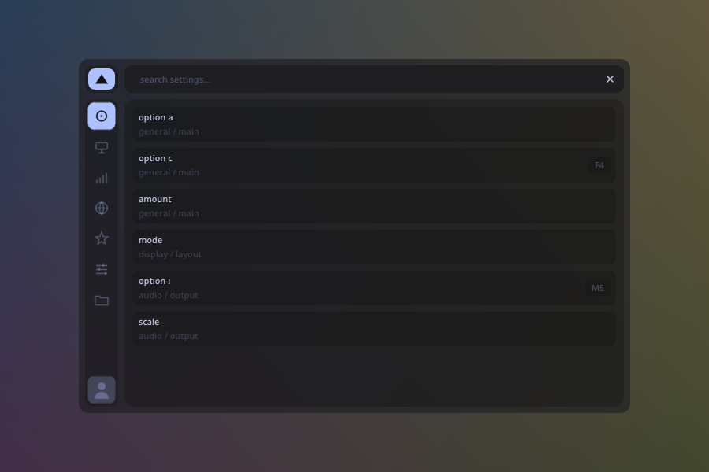

# Settings search

A search field that finds any setting across every tab and jumps to it. It is most useful in menus that hide settings behind [row popups](row-settings-popup.md) or have many sub-tabs.

## Anatomy (velocity.cat)

- **Entry point**: a square 35 × 35 card at the right end of the sub-tab bar, holding a magnifier icon (dim → primary on hover).
- **Expand**: on click, the square grows leftward over the sub-tab bar to the full content width (smoothstep, speed 18). It is drawn as a `dark` fill under an `elevated` fill whose alpha rises from 190 to 245 as it opens. Inside is an input with no frame and the hint "i want to find...", plus a ✕ button at the right (it gets an accent fill at 31% on hover). Esc also closes it.
- **Results** replace the body: a scrolling card of 44 px rows with radius 8. Each row shows the setting name in primary text and its category path below in dim text (3 px gap). If the setting has a keybind, a key badge (20 px tall, radius 5) sits on the right. Hover tints the row toward the accent.
- **Matching**: case-insensitive substring on the name or the category, capped at 50 results.
- **Activate**: click a row or press Enter (Enter takes the first result). The menu switches to that tab and sub-tab, closes search, and pulses the target row's label in the accent for about 1.2 s so the eye finds it.

## Rules

- Build the index from the same labels the menu draws, so results always match what's on screen.
- Show *where* each setting lives (tab / sub-tab). Without it, users can't learn the menu's structure from search.
- The highlight after jumping is the important part; without it, search only gets you to the right page.
- Block clicks on the sub-tabs behind the expanded field while it is open.

## ImGui approach

Grow the search card with `ImLerp(util_w, content_w, smoothstep(t))`. Draw `InputTextWithHint` with a transparent `FrameBg` inside it, and focus it once with `SetKeyboardFocusHere()` on the frame it opens. Results are custom rows (`ItemSize` + `ItemAdd` + `ButtonBehavior`) that filter with `ImStristr`. Code: the search bar in `DrawGlassMenu` and `DrawSearchResults` in [Glass sidebar menu](../implementation/glass-sidebar-menu.md). The recreation skips the jump-and-highlight step because its settings are placeholders.

## Seen in

- [velocity.cat — main menu](../references/velocity-cat-menu.md)
- [Fatality CS2 — source](../references/fatality-cs2-source.md): footer button opens a search popup; picking a result switches tabs, scrolls to the row and rings it with a 2 px accent outline that fades over 2 s.

Related: [Tabs and navigation](tabs-and-navigation.md), [Row settings popup](row-settings-popup.md), [Motion](../principles/motion.md)
