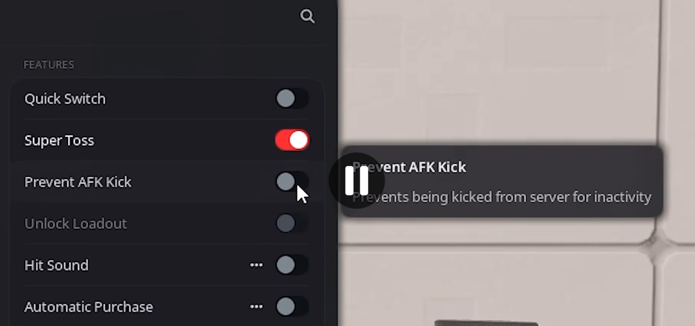

# Tooltips

A short explanation of a setting shown on hover. In a dense menu, labels can only say what a setting is called; the tooltip says what it does.

## Variant A: docked beside the menu (neverlose)

- Positioned just outside the **menu window's right edge**, vertically centered on the hovered row. It doesn't follow the mouse.
- Bold title (the setting's name) plus one sentence in a lighter tier.
- Popup color at about 85% opacity, radius about 8, padding about 12, soft shadow.
- Works on disabled rows, which is where "why is this off" belongs.

## Variant B: at the cursor (ImGui default)

ImGui's `SetTooltip` places the box at the mouse, offset down-right. Fine for icons and short hints, but it covers what's under the cursor and jumps as the mouse moves.

## Rules

- Wait about 0.3–0.5 s before showing, then fade in over about 0.1 s. Hide immediately when the hover ends.
- Once one tooltip is showing, moving to the next row shows the next one at once (no second delay).
- One sentence. If it needs more, the setting needs a better label or a help page.
- Repeat the setting name as the title only when the tooltip is docked away from the row (variant A), so the user can tell which row it belongs to.
- Wrap at about 300 px.
- Near the screen's right edge, dock on the left side of the menu instead.

## ImGui approach

`RowTooltip(title, text)` in [Popup menus](../implementation/popup-menus.md), called after the row's widget. It times the hover per item, then calls `SetNextWindowPos` with pivot (0, 0.5) at the window's right edge and the row's center before `BeginTooltip`. ImGui leaves a tooltip's position alone when one has been set. The shadow is drawn on the background draw list from the tooltip's size in the previous frame.

## Seen in

- [Neverlose — popups](../references/neverlose-popups.md): variant A.
- [neverwin — visuals](../visuals/neverwin-visuals.md): its string table has tooltip text for many settings.
- [Fatality CS2 — source](../references/fatality-cs2-source.md): at the cursor (+16 px), body colour, 1 px outline, small shadow.

Related: [Keybinds](keybinds.md), [Row settings popup](row-settings-popup.md), [Typography and icons](../principles/typography-and-icons.md)
